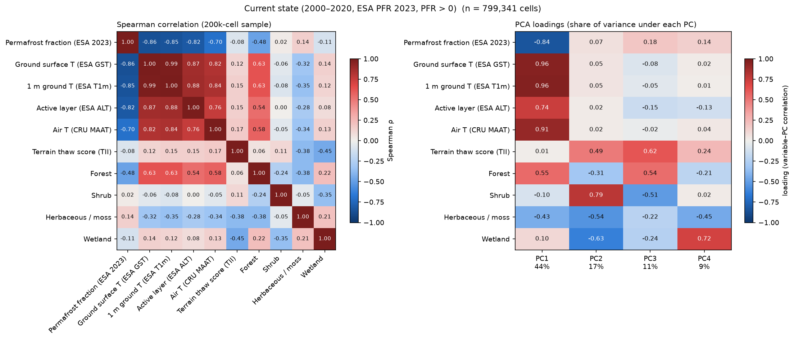
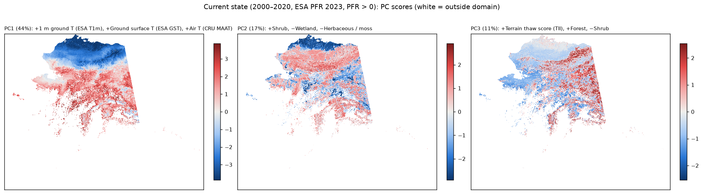
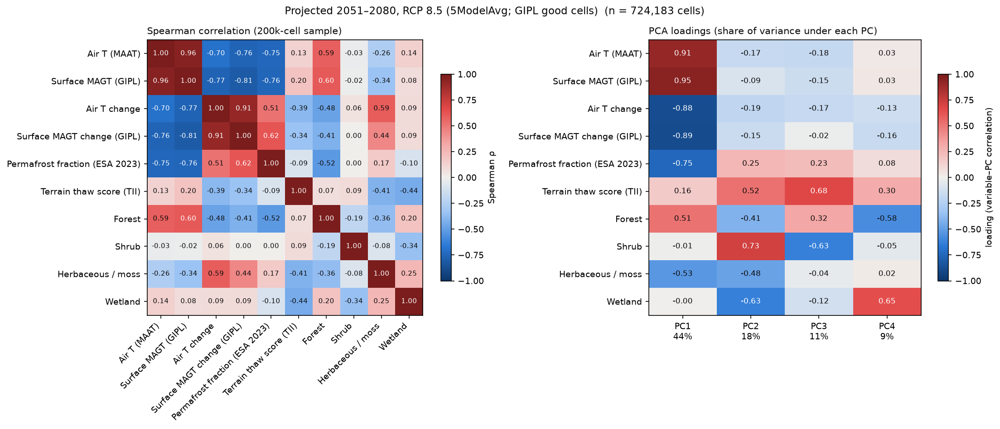
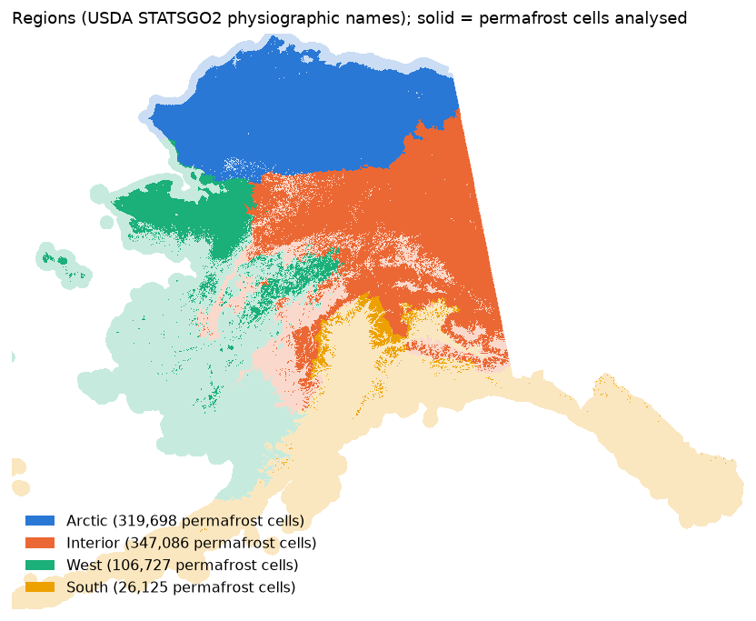
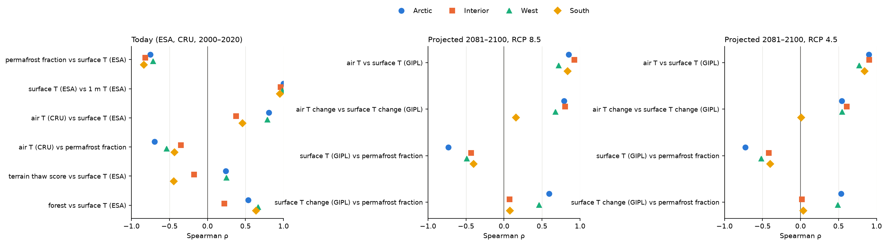
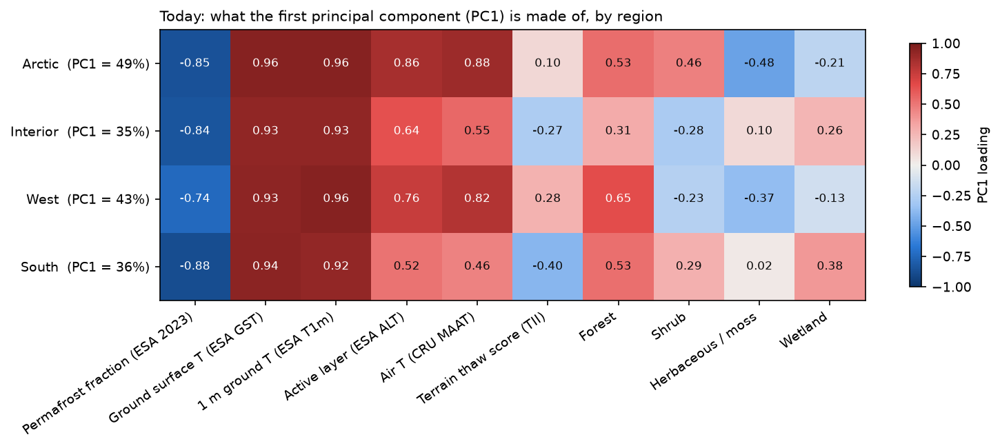

# How related are the inputs to the thaw susceptibility index?

**Question:** the index combines several maps (ground temperature, air temperature, permafrost fraction, terrain,
land cover). If two maps tell the same story, using both counts that story twice. Here we measure how much each input
overlaps with the others, for Alaska today and for projected futures, statewide and by region.

**Short answer:**
- Today, **ground temperature, air temperature, permafrost fraction and active-layer thickness are largely one
  pattern** (cold north vs warmer south). Ground surface and 1 m ground temperature are practically the same map.
- **Terrain (sun-facing slopes) and land cover carry separate information.**
- In the projections, **GIPL surface temperature and air temperature are nearly the same map, and so is where each
  warms most** (ρ 0.74–0.91). GIPL's warming mostly repeats the air's pattern, at about 80 % of its size
  ([PTI.md](PTI.md), section 2). Only in the South do the two warming maps differ.
- Regionally, **air temperature is a much weaker stand-in for ground temperature in the Interior and the South** than
  statewide numbers suggest.

---

## Key terms, in plain language

**Correlation (Spearman ρ, "rho").** A number from −1 to +1 that says how consistently two maps rank places in the
same order. +1: wherever one map is higher, the other is higher too. 0: no consistent relationship. −1: exact
opposite order (where one is high, the other is low). Spearman's version works on ranks, so it does not assume a
straight-line relationship.

| \|ρ\| | How to read it |
|---|---|
| 0.8 – 1.0 | almost the same map |
| 0.5 – 0.8 | strongly related |
| 0.3 – 0.5 | moderately related |
| below 0.3 | weakly related or unrelated |

**Principal component analysis (PCA).** A way to find the few main patterns that many maps share. Each pattern is
called a **principal component (PC)**. PC1 is the pattern that accounts for the largest share of the differences
between places across Alaska; PC2 is the next largest pattern that is independent of PC1; and so on. Before PCA,
every input is put on the same scale (subtract its average, divide by its typical spread), so °C and % can be compared.
- **Share of variance (%)**: how much of all the differences between places that pattern captures.
- **Loading** (−1 to +1): how strongly an input follows that pattern; it is the correlation between the input and
  the PC. Inputs with large loadings of the same sign move together; opposite signs move in opposite directions.
- **PC map**: where each place sits on that pattern.

**VIF (variance inflation factor).** How much of an input could be predicted from all the other inputs together.

| VIF | Share of the input predictable from the others |
|---|---|
| 1 | 0 % (completely unique) |
| 2 | 50 % |
| 5 | 80 % |
| 10 | 90 % |
| 200 | 99.5 % (a near-duplicate) |

Rule of thumb: above about 5–10, an input is largely redundant with the others.

**Why there are no p-values here.** With ~800,000 neighbouring 1 km cells, every relationship is "statistically
significant", and neighbouring cells are not independent anyway. What matters is the size of the relationship.

---

## Inputs and data

| Input | What it is | Source |
|---|---|---|
| Permafrost fraction | Share of the 1 km cell with permafrost (2023) | ESA CCI Permafrost v5 |
| Surface T, 1 m T | Mean annual ground temperature at the surface and at 1 m (2000–2020) | ESA CCI Permafrost v5 |
| Active layer | Seasonal thaw depth (2000–2020) | ESA CCI Permafrost v5 |
| Air T | Mean annual air temperature (2000–2020; projected eras) | SNAP 2 km: CRU TS 4.08; 5-model average |
| Surface T (GIPL) | Projected mean annual ground surface temperature | GIPL 2.0, 5-model average |
| Change | Projected era minus 2014–2023 (GIPL on the climate years it carries, [GIPL_ISSUE_3.md](GIPL_ISSUE_3.md)) | as above |
| Terrain thaw score | Share of sun-facing slope in the cell, from the terrain insolation index | ArcticDEM (32 m) |
| Land cover | Share of forest, shrub, herbaceous/moss, wetland | NLCD Alaska 2016 (30 m) |

All inputs are on the same 1 km grid. Cells: everywhere ESA shows permafrost (≈ 800,000 cells). GIPL values are used
only where GIPL behaves normally (≈ 724,000 cells; see [GIPL_ISSUE_1.md](GIPL_ISSUE_1.md)).

---

## 1. Today (2000–2020)

- **One dominant pattern (PC1, 44 % of all differences):** ground surface T, 1 m T, air T and active layer go
  together; permafrost fraction goes the opposite way. In plain terms: "how warm is this place, and how little
  permafrost does it have".
- **Surface and 1 m ground temperature are the same map** (ρ = 0.99; VIF ≈ 200).
- **Permafrost fraction is strongly tied to ground temperature** (ρ = −0.86) and less to air temperature (−0.70).
- **Air temperature overlaps strongly but not completely** with ground temperature (ρ = 0.82; VIF 5).
- **Terrain thaw score is nearly independent** of the temperature inputs (ρ ≤ 0.17; VIF 1.3).
- **Land cover forms its own patterns** (PC2, 17 %: shrub vs wetland and herbaceous/moss); forest goes with warmer
  ground (ρ = 0.63).

PC1 is the north–south temperature gradient; PC2 and PC3 are land-cover and terrain patterns.

## 2. Projected (5-model average, RCP 4.5 and 8.5)

| Statewide ρ | 2051–2080 RCP 4.5 | 2051–2080 RCP 8.5 | 2081–2100 RCP 4.5 | 2081–2100 RCP 8.5 |
|---|---|---|---|---|
| Air T vs surface T (GIPL) | 0.96 | 0.96 | 0.96 | 0.96 |
| Air T change vs surface T change (GIPL) | 0.74 | 0.91 | 0.76 | 0.91 |
| Surface T (GIPL) vs permafrost fraction | −0.75 | −0.76 | −0.75 | −0.76 |

- **Levels are redundant:** projected air T and GIPL surface T are almost the same map in every period (ρ 0.96–0.97;
  VIF 17–28).
- **Changes largely are too:** where GIPL's surface warms most is where the air warms most (ρ 0.74–0.91); both
  changes load on the main pattern (PC1) with the levels and permafrost fraction. What differs is the size: GIPL's
  surface warms about 20 % less than the air ([PTI.md](PTI.md), section 2).
- **Air warming is larger where it is colder today** (ρ −0.70 with air T, +0.51 with permafrost fraction; RCP 8.5,
  2051–2080), consistent with stronger warming in the far north.
- Changes are measured from 2014–2023 (today), so all three periods have them; 2026–2050 matches the later periods
  (air T vs GIPL surface T 0.97; changes 0.74 / 0.87).
- An earlier version of this document found the two changes mostly unrelated. That came from pairing GIPL years with
  air-temperature years 20 years apart ([GIPL_ISSUE_3.md](GIPL_ISSUE_3.md)).

Same figures for every period: `figures/t2_corr_pca_<rcp>_<period>.png`.

## 3. By region

Four regions from the physiographic names in the USDA general soil map (STATSGO2): Arctic, Interior, West, South.

| Today, ρ | Arctic | Interior | West | South |
|---|---|---|---|---|
| Permafrost fraction vs surface T | −0.75 | −0.82 | −0.72 | −0.83 |
| Surface T vs 1 m T | 1.00 | 0.96 | 0.98 | 0.95 |
| **Air T vs surface T** | 0.81 | **0.38** | 0.79 | **0.46** |
| Air T vs permafrost fraction | −0.70 | −0.35 | −0.54 | −0.43 |
| Terrain thaw score vs surface T | 0.24 | −0.18 | 0.25 | −0.44 |
| Forest vs surface T | 0.54 | 0.22 | 0.67 | 0.64 |

| 2081–2100, ρ (RCP 4.5 / RCP 8.5) | Arctic | Interior | West | South |
|---|---|---|---|---|
| Air T vs surface T (GIPL) | 0.90 / 0.85 | 0.90 / 0.92 | 0.77 / 0.72 | 0.84 / 0.83 |
| Air T change vs surface T change (GIPL) | 0.54 / 0.79 | 0.61 / 0.80 | 0.55 / 0.67 | 0.01 / 0.16 |

- **Everywhere:** surface and 1 m ground temperature are the same map, and permafrost fraction follows ground
  temperature closely.
- **Interior and South:** air temperature says much less about ground temperature (ρ 0.38–0.46) or permafrost
  fraction than in the Arctic and West. The statewide 0.82 mostly reflects the north–south gradient.
- **Terrain:** the link between sun-facing terrain and ground temperature changes sign by region (positive in the
  Arctic and West, negative in the Interior and South), so the terrain term behaves differently across the state.
- **Projected changes:** air warming and GIPL surface warming follow each other in the Arctic, Interior and West
  (ρ 0.54–0.80), but not in the South (0.01–0.16).

The main pattern (PC1) is strongest in the Arctic (49 %) and weakest in the Interior (35 %). Everywhere it is built on
ground temperature and permafrost fraction; air temperature joins it strongly only in the Arctic and West.

---

## What this means for the index

- Ground temperature (surface or 1 m), air temperature, permafrost fraction and active layer **largely measure the
  same thing today**. Weighting them as separate inputs mostly counts that one pattern several times.
- Surface and 1 m ground temperature are **interchangeable** for describing today's state.
- Air temperature is **not a reliable substitute for ground temperature in the Interior and South**.
- **Terrain and land cover add genuinely different information**, but the terrain relationship differs by region.
- From GIPL, neither the projected level nor the *pattern* of its change adds much beyond air temperature (outside
  the South). What differs is the *size* of the change: GIPL's surface warms about 20 % less than the air, which is
  the difference between PTI V1 and V2 ([PTI.md](PTI.md)).

## Caveats

- ESA CCI ground temperature and permafrost fraction are model products (satellite land surface temperature driving a
  permafrost model), not direct measurements, so part of their agreement comes from shared inputs.
- GIPL values exclude the ~9 % of permafrost cells affected by the stuck-cell problem ([GIPL_ISSUE_1.md](GIPL_ISSUE_1.md)).
- Projections are the 5-model average only; single models will differ.
- Land cover is a single year (NLCD 2016).
- The South region is small (≈ 26,000 permafrost cells).

Methods: 1 km GIPL grid; ESA sampled at cell centres; air temperature from the 2 km parent cell; terrain and land
cover aggregated from 32 m / 30 m; GIPL read on climate years (files labelled 20 years later) and changes measured
from 2014–2023. Spearman on a 200,000-cell random sample; PCA on the correlation matrix of all
cells (z-scored inputs); loadings = input–PC correlations; VIF = diagonal of the inverse correlation matrix. Land-cover
barren and water fractions are left out because the fractions add up to 1. Scripts: `scripts/01_data/build_features.py`,
`scripts/01_data/make_regions.py`, `scripts/02_tests/t2_correlation_pca.py`; tables in
`<data>/results/t2/`.
