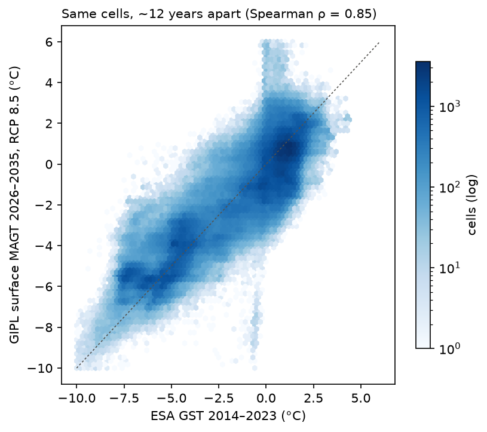
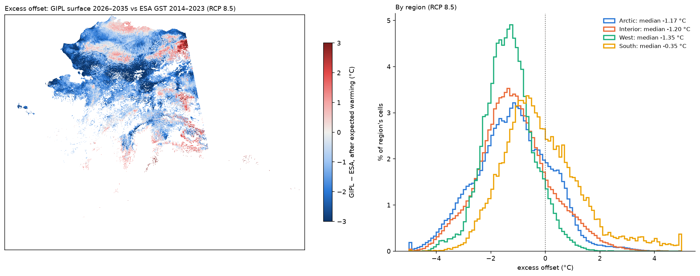
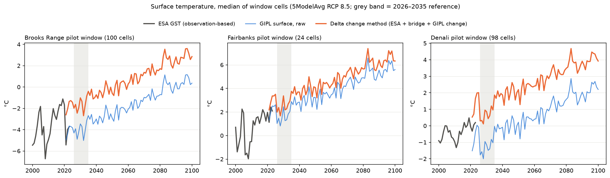

# Joining today's ground temperature (ESA CCI) to projections (GIPL): the delta change method

**Question:** the index needs one continuous record of ground surface temperature, from today (ESA CCI Permafrost,
observation-based, 2000–2023) into the future (GIPL 2.0 projections, 2021–2120). The two datasets come from different
models and inputs. How should they be joined?

**Answer:** use the **delta change method** (SNAP's "delta method"): keep ESA's level for today and add only the
*change* projected by the models. GIPL's own temperature levels do not line up with ESA's, and no single correction
fixes that cell by cell.

---

## Key terms, in plain language

- **Level:** the temperature itself (e.g. −2.5 °C).
- **Change (delta):** how much the temperature rises between a reference period and a future period (e.g. +3.0 °C).
- **Offset:** the difference between two datasets for the same place (GIPL − ESA).
- **Expected warming:** the air warming that the climate models project between two periods. When the two datasets
  describe different years, part of their difference is simply climate change, not disagreement.
- **Start-up drift:** a model's first years after it starts can drift as it settles in, before it is usable.
- **Spearman ρ:** whether two maps rank places in the same order, from −1 to +1 (see [CORRELATION.md](CORRELATION.md)).
- **Delta change method:** future = today's observed level + the change the model projects. The model contributes
  only its change, not its level.

## Data

| | ESA CCI Permafrost v5 | GIPL 2.0 (SNAP) |
|---|---|---|
| What | ground surface temperature (GST), 1 km | ground surface temperature (MAGT surface), 1 km |
| Years | 2000–2023 (here: 2014–2023 mean) | 2021–2120 (here: 2026–2035 reference) |
| Basis | satellite land surface temperature + permafrost model | climate projections (5-model average, RCP 4.5 / 8.5) + permafrost model |

Cells: everywhere ESA shows permafrost and GIPL behaves normally (≈ 724,000 cells; stuck cells excluded, see
[GIPL_ISSUE.md](GIPL_ISSUE.md)).

---

## 1. GIPL needs a few years to settle, and starts colder than ESA

Medians of 100 cells in each of three 10 × 10 km pilot windows (Brooks Range, Fairbanks, Denali).
- **Start-up drift:** GIPL's first ~5 years drift strongly (Denali, 1 m: −4.4 °C in 2021 to about −1 °C by 2026).
  We therefore use **2026–2035** as GIPL's reference period.
- **Offset at 1 m:** where the two overlap (2021–2023), GIPL 1 m temperature is 1.4–1.8 °C colder than ESA.

## 2. GIPL and ESA levels do not match, and not in a fixable way

We compare GIPL 2026–2035 with ESA 2014–2023 and take out the ~1 °C of air warming the same climate models project
between those periods. What is left is disagreement between the two datasets ("excess offset"):

| Region | Cells | ESA vs GIPL, ρ | Expected warming | Excess offset, median | 10th – 90th percentile |
|---|---|---|---|---|---|
| Statewide | 724,326 | 0.85 | +1.0 °C | **−1.2 °C** | −2.8 to +0.5 °C |
| Arctic | 317,000 | 0.82 | +1.1 °C | −1.2 °C | −3.0 to +0.6 °C |
| Interior | 279,692 | **0.43** | +0.9 °C | −1.2 °C | −2.7 to +0.7 °C |
| West | 101,947 | 0.75 | +1.0 °C | −1.4 °C | −2.4 to −0.2 °C |
| South | 25,654 | **0.34** | +0.9 °C | −0.4 °C | −1.8 to +1.7 °C |

RCP 8.5 shown; RCP 4.5 is within 0.1 °C.
- GIPL is about **1.2 °C colder** than ESA would lead us to expect.
- The difference **varies a lot from cell to cell** (a 3 °C range between the 10th and 90th percentiles).
- In the **Interior and South**, the two datasets even disagree on *which places* are warmer (ρ 0.43 and 0.34).

## 3. Join methods compared

The test: how big is the jump, cell by cell, between ESA's last decade and the joined value for 2026–2035, after
allowing for expected warming? (90th percentile of cells, statewide, RCP 8.5.)

| Method | What it does | Jump at the join |
|---|---|---|
| No correction | use GIPL as delivered | 2.8 °C |
| Statewide offset | shift GIPL by one number for all of Alaska | 2.2 °C |
| Regional offsets | shift GIPL by one number per region | 2.2 °C |
| **Delta change method** | ESA level + projected change | **0 °C** (by construction) |

Raw GIPL (blue) starts below ESA (grey) in the Brooks Range and Denali windows; the delta change method (orange)
continues ESA's record and follows GIPL's rise.

---

## Recommendation: the delta change method

For each 1 km cell, model and scenario:

> **future surface temperature (era) = ESA GST 2014–2023 + bridge + GIPL change**
>
> - **ESA GST 2014–2023:** today's observation-based level.
> - **bridge:** the air warming the same climate models project from 2014–2023 to 2026–2035 (≈ +1 °C). GIPL cannot
>   supply this itself because of its start-up drift.
> - **GIPL change:** GIPL surface temperature in the era minus GIPL 2026–2035.

- **What we keep from GIPL:** how much the ground surface warms, which is the part that adds information beyond air
  temperature ([CORRELATION.md](CORRELATION.md)).
- **What we drop:** GIPL's own temperature levels, which repeat air temperature and disagree with ESA.
- **Where it cannot be used:** GIPL stuck cells and the 2 km border around them (~9 % of permafrost cells).
- In the Permafrost Thaw Index ([PTI.md](PTI.md)), this recipe gives the projected warming for version V2; version
  V1 uses air-temperature warming instead (no GIPL).

## Caveats

- ESA CCI is model-based too (satellite surface temperature driving a permafrost model), not direct measurement.
- The method assumes GIPL's *changes* are right even where its *levels* are off. We cannot test that directly.
- The bridge uses air warming as a stand-in for surface warming over about 12 years.
- 5-model average only.

Methods: 1 km GIPL grid; ESA sampled at cell centres; air temperature = SNAP 2 km 5-model average (parent cell).
Jumps measured after removing the model air warming between the two reference periods. Scripts:
`scripts/02_tests/t3_esa_gipl_continuity.py` (pilot windows), `scripts/02_tests/t3_surface_splice.py` (statewide);
tables in `<data>/results/t3/splice_methods.csv`.
