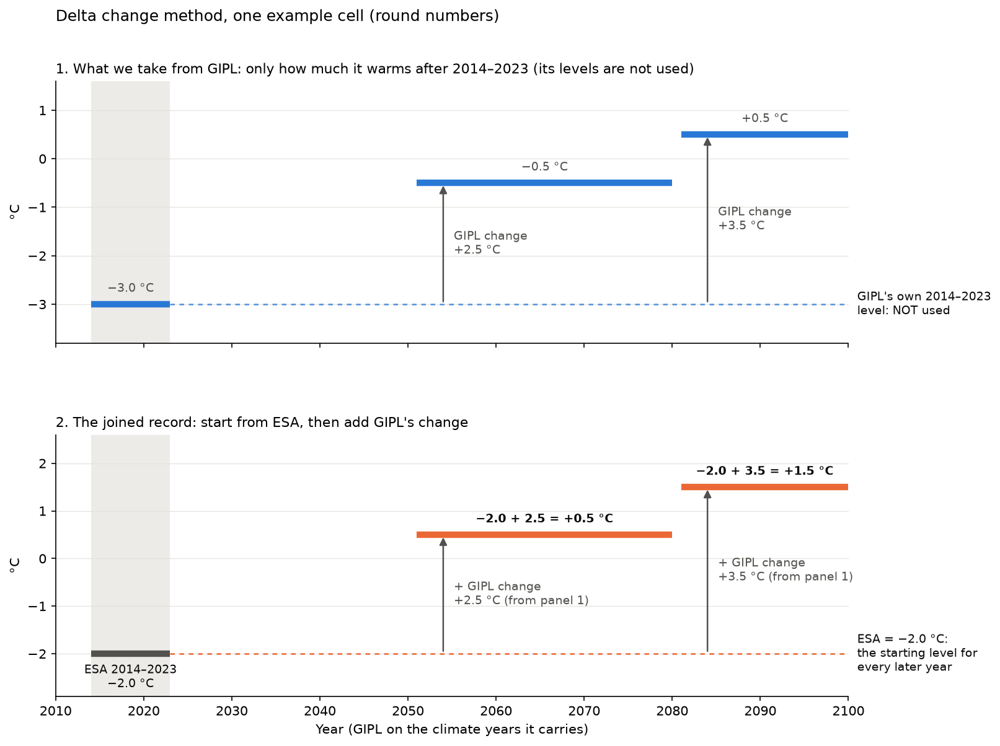

# Joining today's ground temperature (ESA CCI) to projections (GIPL): the delta change method

**Question:** the index needs one continuous record of ground surface temperature, from today (ESA CCI Permafrost,
observation-based, 2000–2023) into the future (GIPL 2.0 projections). The two datasets come from different models and
inputs. How should they be joined?

**Answer:** use the **delta change method** (SNAP's "delta method"): keep ESA's level for today (2014–2023) and add
only the *change* GIPL projects after 2014–2023. GIPL's year labels are 20 years late
([GIPL_ISSUE_3.md](GIPL_ISSUE_3.md)), so the file labelled 2034 holds the climate of 2014. Read that way, GIPL and ESA
share the years 2004–2023. The two records can then be compared and joined on the same decade, with no adjustment
for the years between them.

---

## Key terms, in plain language

- **Level:** the temperature itself (e.g. −2.5 °C).
- **Change (delta):** how much the temperature rises between a reference period and a future period (e.g. +3.0 °C).
- **Offset:** the difference between two datasets for the same place and the same years (GIPL − ESA).
- **Climate year:** the year whose climate a GIPL file carries: the year in the file name minus 20 (minus 19 for the
  GFDL-CM3 RCP 8.5 run; [GIPL_ISSUE_3.md](GIPL_ISSUE_3.md)). All GIPL years in this document are climate years.
- **Start-up period:** a model's first years after it starts, while it is still settling in; they do not behave like
  the rest of the run and are not used. For GIPL: 2001–2003.
- **Spearman ρ:** whether two maps rank places in the same order, from −1 to +1 (see [CORRELATION.md](CORRELATION.md)).
- **Delta change method:** future = today's observed level + the change the model projects. The model contributes
  only its change, not its level.

## Data

| | ESA CCI Permafrost v5 | GIPL 2.0 (SNAP) |
|---|---|---|
| What | ground surface temperature (GST), 1 km | ground surface temperature (MAGT surface), 1 km |
| Years | 2000–2023 (here: 2014–2023 mean) | climate years 2001–2100 (files labelled 2021–2120); here 2014–2023 reference |
| Basis | satellite land surface temperature + permafrost model | observed weather to 2015, then climate projections (5-model average, RCP 4.5 / 8.5) + permafrost model |

Cells: everywhere ESA shows permafrost and GIPL behaves normally (≈ 724,000 cells; stuck cells excluded, see
[GIPL_ISSUE_1.md](GIPL_ISSUE_1.md)).

---

## 1. The two records overlap for 2004–2023

Medians of 100 cells in each of three 10 × 10 km test areas (Brooks Range, Fairbanks, Denali); GIPL on climate years.
- **GIPL's first three years (2001–2003) are a start-up period**: below the surface it starts too cold and climbs
  almost 2 °C in two years ([GIPL_ISSUE_2.md](GIPL_ISSUE_2.md), section 1). They are not shown or used.
- **From 2004 the two records overlap.** Through 2015 both are driven by observed weather (ESA by satellite surface
  temperature, GIPL by observed air temperature). From 2016 GIPL follows the projections, so its year-to-year swings
  no longer match real years, but its decade means can still be compared with ESA's.
- **At the Brooks Range and Denali test areas the two agree closely** (surface, 2014–2023: GIPL −0.4 and +0.1 °C
  from ESA). At Fairbanks, GIPL's surface is 1.6 °C warmer. This test area includes GIPL's stuck cells, which run
  too warm at the surface ([GIPL_ISSUE_1.md](GIPL_ISSUE_1.md)).

## 2. GIPL and ESA levels agree on average but not cell by cell

### Comparing the same decade

Both records cover **2014–2023**, so they can be compared directly: same cells, same years. (Before the 20-year
shift was found, GIPL seemed to start in 2026, and the comparison needed an estimate of the warming between the two
datasets' decades. That is no longer needed.)

### Result

| Region | Cells | ESA vs GIPL, ρ | GIPL − ESA, median | 10th – 90th percentile | Cells where GIPL is colder |
|---|---|---|---|---|---|
| Statewide | 724,326 | 0.85 | **+0.6 °C** | −0.9 to +2.2 °C | 28 % |
| Arctic | 317,000 | 0.85 | +0.6 °C | −1.1 to +2.2 °C | 32 % |
| Interior | 279,692 | **0.44** | +0.7 °C | −0.8 to +2.4 °C | 27 % |
| West | 101,947 | 0.76 | +0.6 °C | −0.3 to +1.6 °C | 21 % |
| South | 25,654 | **0.36** | +1.5 °C | +0.1 to +3.3 °C | 9 % |

RCP 8.5, ground surface, both 2014–2023. RCP 4.5: statewide +0.1 °C (−1.3 to +1.8 °C).
- **On average, GIPL's surface is close to ESA's**, within about half a degree statewide. The exact number depends on
  the scenario because eight of GIPL's ten years (2016–2023) are projected weather, not the real years. Over 2004–2015,
  when both datasets saw the same observed weather, GIPL's surface is 0.9 °C warmer than ESA's under both scenarios.
- **The difference varies a lot from cell to cell** (about 3 °C between the 10th and 90th percentiles), with a clear
  regional pattern: GIPL is warmer on parts of the northern coastal plain, in the eastern Brooks Range, the eastern
  uplands and the southern mountains (by 2–4 °C), and colder along the south side of the Brooks Range (Kobuk and
  Koyukuk valleys, by about 1 °C).
- **In the Interior and South, the two datasets disagree on *which places* are warmer** (ρ 0.44 and 0.36).
- Below the surface (1 m and 2 m), GIPL is within about half a degree of ESA statewide, and boreholes and field
  records agree ([GIPL_ISSUE_2.md](GIPL_ISSUE_2.md), sections 2–3).

## 3. Join methods compared

To build one record from today into the future, GIPL's values have to be put on ESA's footing. We tried four ways:

| Method | What it does to each cell's GIPL values (RCP 8.5) |
|---|---|
| No correction | Uses GIPL's temperatures as delivered. |
| Statewide offset | Subtracts the same number from every cell: GIPL's statewide median offset, **0.6 °C**. |
| Regional offsets | Subtracts one number per region, that region's median offset: **Arctic 0.6, Interior 0.7, West 0.6, South 1.5 °C**. |
| Delta change method | Never uses GIPL's level. For each cell: start from ESA's 2014–2023 level, then add how much GIPL warms after 2014–2023. |

**The delta change method, step by step.** An example cell with round numbers: ESA −2.0 °C (2014–2023), and GIPL
−3.0 °C in 2014–2023 and −0.5 °C in 2051–2080 (a change of +2.5 °C). Joined 2051–2080 value: −2.0 + 2.5 =
**+0.5 °C**. GIPL's own −0.5 °C is never used, so its cell-level offset drops out; only the size of its warming carries
over.

*Panel 1: from GIPL we take only how much it warms after 2014–2023 (+2.5 and +3.5 °C here); its own temperatures,
including −3.0 °C for 2014–2023, are not used. Panel 2: the joined record starts from ESA (−2.0 °C) and adds GIPL's
warming from panel 1.*

**The test:** if a join works, each cell's joined value for 2014–2023 should equal its ESA value. Any difference is
an artificial step in the record at the join (a "jump") that is not climate. With an offset, the jump is each cell's
own offset minus the number subtracted: the typical cell is fixed, but cells far from the typical offset are not.

| Method | Jump, typical cell (median) | Jump, worst 10 % of cells (90th percentile) |
|---|---|---|
| No correction | 0.9 °C | 2.3 °C |
| Statewide offset | 0.75 °C | 2.0 °C |
| Regional offsets | 0.75 °C | 2.0 °C |
| **Delta change method** | **0 °C** | **0 °C** |

Statewide, RCP 8.5. Under RCP 4.5 the median offset is close to 0, so the offsets change nothing (0.75 / 2.0 °C for
all three).
- **Offsets barely help**, because the problem is not one typical difference but the spread *within* each region, which
  no single number can fix.
- **Why the jump matters:** a jump goes straight into a cell's projected warming. The index's warming bands are 1 °C
  wide ([PTI.md](PTI.md)), so a 2 °C artificial jump in one cell in ten would move those cells by up to two classes.
- **The delta change method has no jump by construction**, because it never uses GIPL's level. That is not a free
  pass: it assumes GIPL's *changes* are right even where its *levels* are off, which cannot be tested (see Caveats).

GIPL is shown on climate years from 2004 (after its start-up period). The delta change method (orange) starts at
ESA's 2014–2023 level and then follows GIPL's rise. Raw GIPL (blue) runs close to it at the Brooks Range and Denali
test areas and above it at Fairbanks. The Fairbanks test area has fewer cells because GIPL's stuck cells are
excluded.

---

## Recommendation: the delta change method

For each 1 km cell, model and scenario:

> **future surface temperature (era) = ESA GST 2014–2023 + GIPL change**
>
> - **ESA GST 2014–2023:** today's observation-based level.
> - **GIPL change:** GIPL surface temperature in the era minus GIPL 2014–2023, both in climate years (GIPL files
>   labelled 20 years later: for 2051–2080 use the files labelled 2071–2100; for 2014–2023, those labelled 2034–2043).

- **What we keep from GIPL:** how much the ground surface warms. This trend includes information about vegetation,
  snow, and soil characteristics that have been "baked in" to the GIPL model.
- **What we drop:** GIPL's own temperature levels. On average they are close to ESA's, but individual cells differ by
  up to about 2 °C, and in the Interior and South the two disagree on which places are warmer.
- **Where it cannot be used:** GIPL stuck cells and the 2 km border around them (~9 % of permafrost cells). These
  areas need to be interpolated, filled with values from a similar dataset, or flagged as NA.

## Caveats

- ESA CCI is model-based too (satellite surface temperature driving a permafrost model), not direct measurement.
- The method assumes GIPL's *changes* are right even where its *levels* are off. We cannot test that directly.
- GIPL's 2014–2023 reference mixes two observed years (2014–2015) with eight projected ones. GIPL's surface barely
  changes between 2014–2023 and 2016–2025 (statewide median within 0.1 °C), so a purely projected reference would
  leave GIPL's warming almost the same. The projected air warms 0.1–0.3 °C between those two decades, so measured from
  2016–2025, GIPL's warming would sit about 0.2 °C closer to the air's ([PTI.md](PTI.md), section 2).
- The 20-year shift in GIPL's year labels is inferred from the data, not documented ([GIPL_ISSUE_3.md](GIPL_ISSUE_3.md)).
- 5-model average only.

Methods: 1 km GIPL grid; ESA sampled at cell centres; GIPL read on climate years (file year − 20). Offset = GIPL
surface 2014–2023 − ESA GST 2014–2023 per cell. Jump = joined 2014–2023 value − ESA 2014–2023. Reference-decade
sensitivity: GIPL change 2014–2023 → 2051–2080 vs 2016–2025 → 2051–2080, compared with air. Scripts:
`scripts/02_tests/t3_esa_gipl_continuity.py` (test areas), `scripts/02_tests/t3_surface_splice.py` (statewide),
`scripts/03_report/splice_schematic.py` (example-cell schematic); tables in `<data>/results/t3/splice_methods.csv` and
`<data>/results/t3_overlap_stats.csv`.
