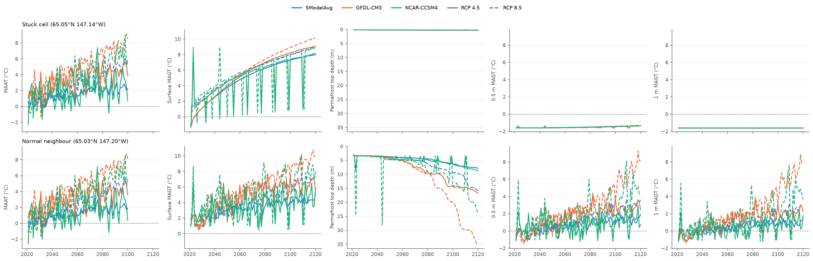
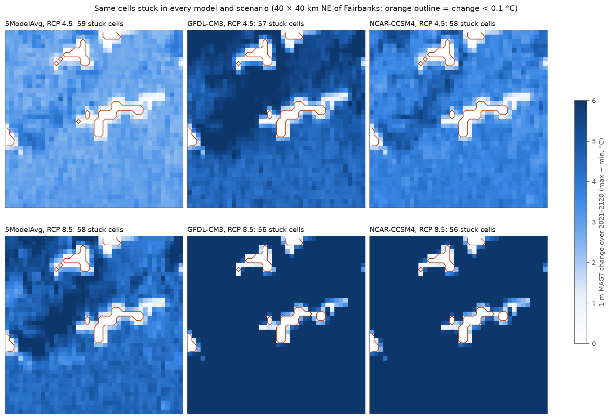
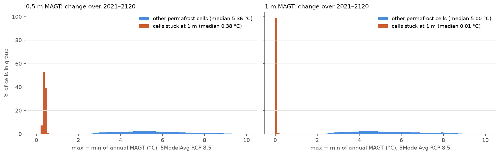
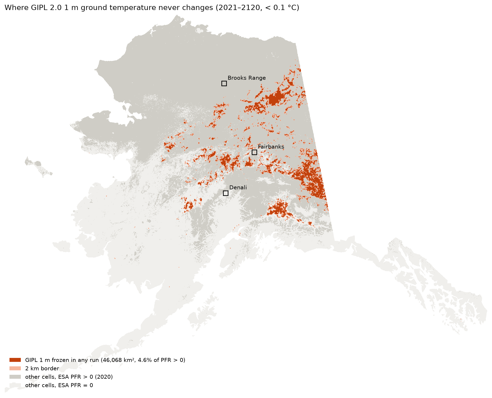
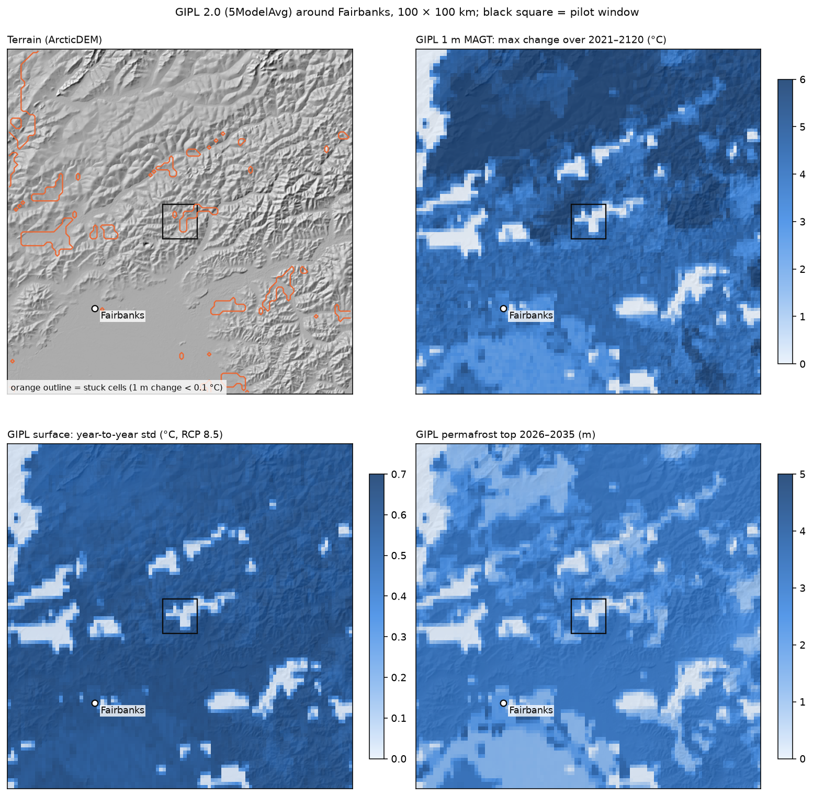
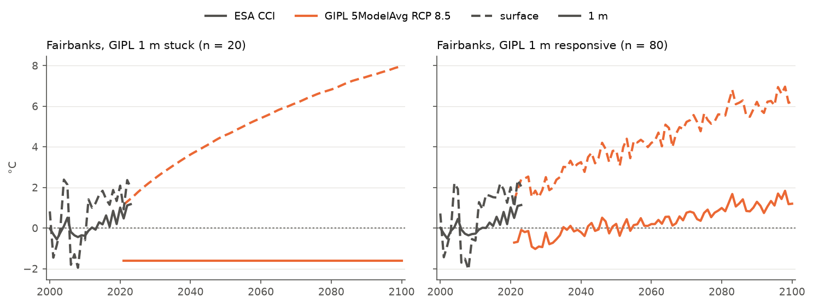
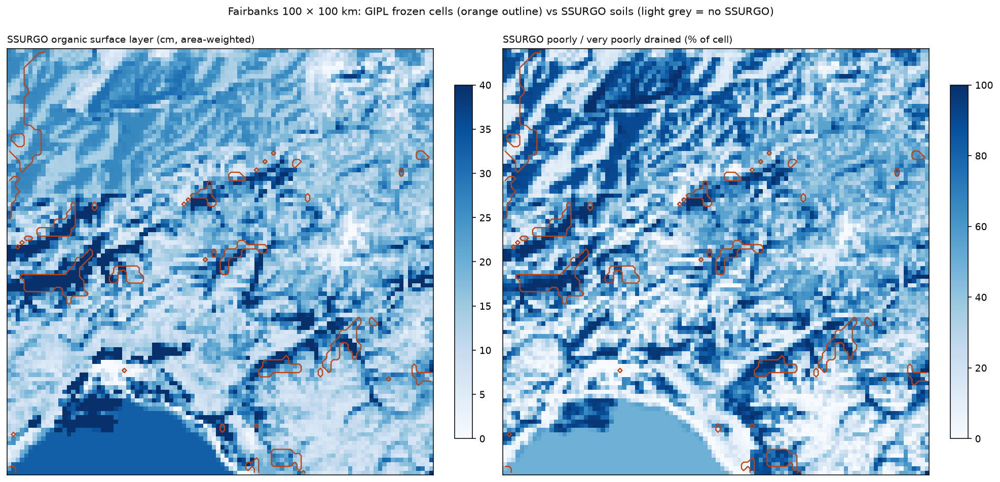
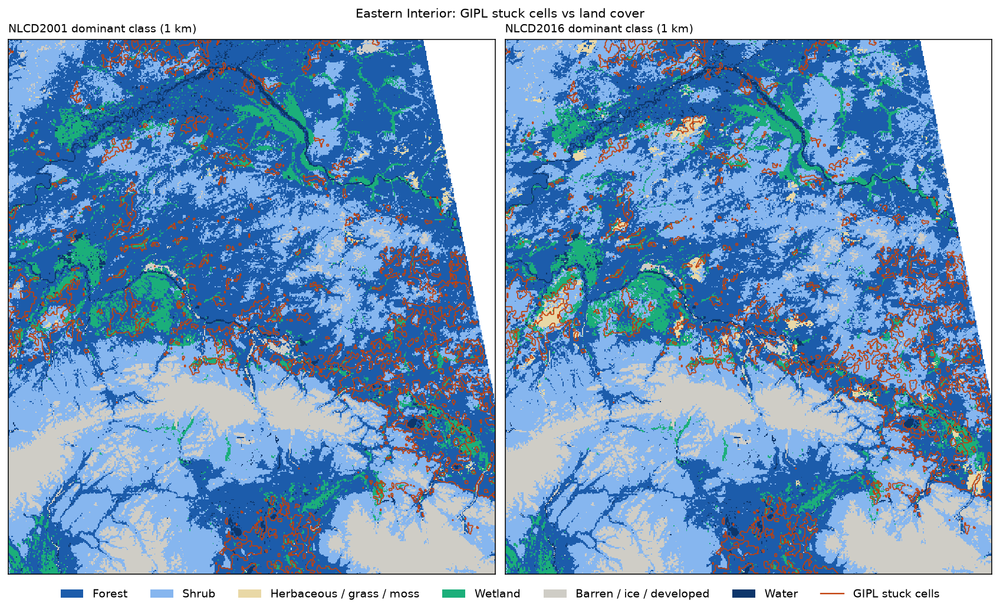
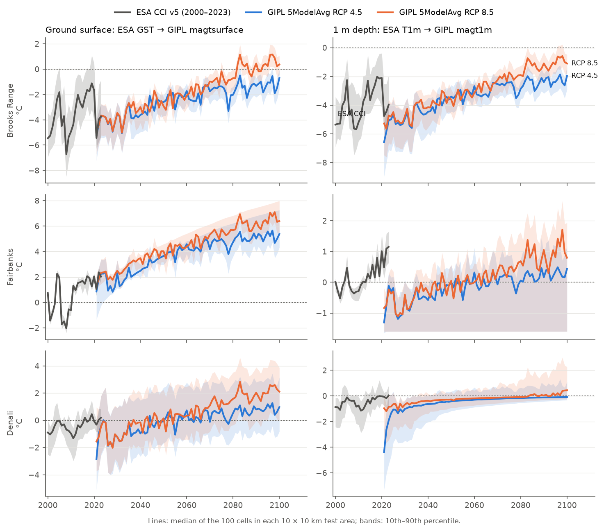

# GIPL 2.0 (1 km): 0.5 m and 1 m ground temperature that does not respond to warming

**Dataset:** SNAP GIPL 2.0 permafrost model output, 1 km, 2021–2120, 3 runs (5ModelAvg, GFDL-CM3, NCAR-CCSM4) ×
RCP 4.5 / 8.5. Same values in the Rasdaman coverage `crrel_gipl_outputs_nc` and in the source GeoTIFFs.

**Issue:** across ~46,000 km² of Alaska, GIPL's mean annual ground temperature at 1 m (MAGT 1 m) stays fixed for
the entire century while the ground surface above it warms by several °C. These cells are called "stuck" below
(1 m MAGT changes by **< 0.1 °C** between 2021 and 2120). In the same cells, MAGT at 0.5 m is nearly flat
(**~0.4 °C** change over the century vs ~5 °C elsewhere).

---

## 1. What a stuck cell looks like

Two cells about 4 km apart near Fairbanks, under the same air warming (MAAT: SNAP 2 km air temperature for the same
model and scenario, available to 2100). **Top:** the surface warms to +8–10 °C, but the permafrost top stays at
0.1–0.25 m, 0.5 m MAGT creeps from −1.6 to −1.3 °C, and 1 m MAGT is −1.6 °C in every year of every run.
**Bottom:** in the normal neighbour the permafrost top deepens to 8–35 m and MAGT warms at 0.5 m and 1 m.

## 2. The same cells are stuck in every model and scenario

The stuck pattern does not depend on the climate forcing: it is fixed to the cells. Cells bordering the stuck
patches are partly damped (pale ring around the outlines).

## 3. 0.5 m depth: the same cells barely change

Statewide, 5ModelAvg RCP 8.5. Cells stuck at 1 m vs all other permafrost cells (ESA CCI PFR > 0, away from stuck
patches):

| MAGT change 2021–2120 | Stuck at 1 m | Other permafrost cells |
|---|---|---|
| 0.5 m, median (1st–90th percentile) | 0.38 °C (0.25–0.45) | 5.4 °C (2.4–8.0) |
| 0.5 m, share of cells changing < 0.5 °C | > 99 % | ~0 % |
| 1 m, median | 0.01 °C | 5.0 °C |

At 0.5 m the cells drift slowly instead of staying exactly constant, so only 30 cells statewide fall under the
< 0.1 °C threshold; the affected area is the same as at 1 m (NCAR-CCSM4 RCP 4.5: 0.32 vs 5.1 °C).

## 4. How much of Alaska

| | Area | Share of ESA CCI permafrost area (PFR > 0, 2020) |
|---|---|---|
| Stuck in at least one run | **46,068 km²** | **4.6 %** |
| Stuck in all six runs | 44,721 km² (97 % of the above) | 4.5 % |
| Within 2 km of a stuck cell | 44,340 km² | 4.3 % |

- 1,172 patches, but 90 % of the stuck area lies in patches ≥ 25 km². Largest: upper Tanana valley (12,182 km²),
  north of Fort Yukon (4,568 km²), Copper River Basin (3,410 km²), Yukon Flats, lowlands west of Nenana.
- Each stuck cell holds its own constant value (−5.0 to −1.1 °C, 1st–99th percentile), not one common temperature.

## 5. Around Fairbanks (100 × 100 km)

484 of 10,000 cells (4.8 %) are stuck. Medians, stuck vs other cells (5ModelAvg, RCP 8.5):

| | Stuck | Other |
|---|---|---|
| Permafrost top, 2026–2035 → 2081–2100 | 0.16 → 0.23 m | 3.1 → 6.8 m |
| Talik thickness, 2081–2100 | 0.23 m | 4.2 m |
| Surface MAGT change, 2081–2100 vs 2026–2035 | +6.0 °C | +5.1 °C |
| Elevation | 333 m | 464 m |

## 6. An independent product sees nothing unusual in these cells

ESA CCI Permafrost v5 (2000–2023), Fairbanks pilot window, 20 stuck vs 80 other cells:

| ESA CCI | Stuck | Other |
|---|---|---|
| T1m (median) | 0.03 °C | 0.03 °C |
| T1m trend 2000–2023 | +0.56 °C/decade | +0.54 °C/decade |
| GST (median) | 1.2 °C | 1.2 °C |
| Permafrost fraction 2020 | 43 % | 33 % |
| Active layer thickness | 1.38 m | 1.45 m |

## 7. The pattern is not explained by available soil or land-cover maps

| Soil map | Map units containing stuck cells | Typical share of a stuck cell's unit that is stuck | Units ≥ 50 % stuck |
|---|---|---|---|
| STATSGO2 (Alaska, 2016), statewide | 83 of 251 | 19 % | 1 (1 % of stuck cells) |
| SSURGO, 6 surveys around Fairbanks | 49 | 22 % | 6 (13 % of stuck cells) |

Stuck cells lean towards wetter, more organic soils (SSURGO: organic layer 25 vs 18 cm; poorly drained 74 vs 49 %),
but most wet, organic ground (e.g. Tanana Flats) is not stuck, and the patches cross soil-unit boundaries.

NLCD Alaska (30 m, aggregated to the GIPL 1 km cells); stuck cells vs other permafrost cells within 25 km:

| | NLCD 2001 | NLCD 2016 |
|---|---|---|
| Evergreen forest cover, stuck vs other cells | 57 % vs 29 % | 40 % vs 22 % |
| Cells dominated by evergreen forest that are stuck | 28 % | 27 % |
| Cells dominated by woody wetlands that are stuck | 22 % | 22 % |
| Best single-class rule (≥ 50 % evergreen): stuck cells caught / flagged cells that are stuck | 61 % / 31 % | 39 % / 31 % |

Stuck cells lean towards black-spruce forest and woody wetlands, but most of that land cover is not stuck.

## 8. What we know about the cause

- The values are in the **source GeoTIFFs** (SNAP CKAN archive), identical to Rasdaman (max difference 0.0000 over
  18,000 checked values). It is not an ingest or service problem.
- **No documentation** exists for this 1 km CMIP5 run. The only method reference (Marchenko, Romanovsky & Tipenko
  2008, NICOP) describes an earlier 0.5° run. The cause therefore cannot be identified or verified without more information.

## 9. Other GIPL 1 m behaviour seen in the same tests

- **Offset from ESA CCI:** in the 2021–2023 overlap, GIPL 1 m MAGT is 1.4–1.8 °C colder than ESA CCI T1m (median,
  all three pilot windows: Brooks Range, Fairbanks, Denali).
- **Start-up drift:** the first ~5 years drift strongly (Denali: 1 m MAGT from −4.4 °C in 2021 to about −1 °C by 2026).

---

Methods: stuck = max − min of annual 1 m MAGT over 2021–2120 < 0.1 °C; the 0.5 m comparison uses the same
max − min. Permafrost area = ESA CCI Permafrost
v5.0 PFR > 0 (2020) sampled at GIPL cell centres. Scripts in `scripts/02_tests/` (`t3_esa_gipl_continuity.py`,
`t3b_gipl_artifact.py`, `t3c_gipl_statewide.py`, `t3d_statsgo_overlay.py`, `t3e_ssurgo_fairbanks.py`,
`t3f_landcover.py`, `t3g_gipl_0p5m.py`) and
`scripts/03_report/gipl_issue_figures.py`.
