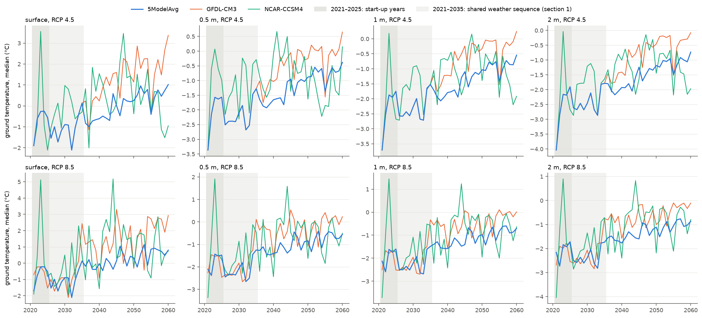
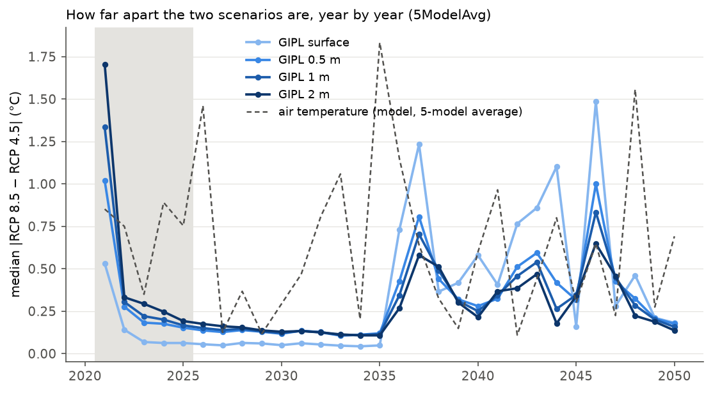
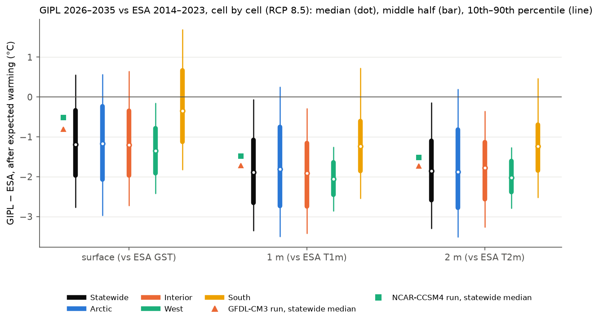
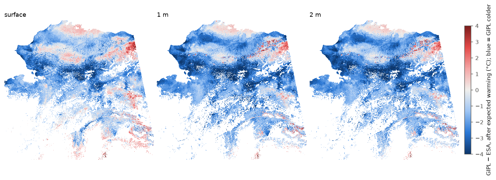
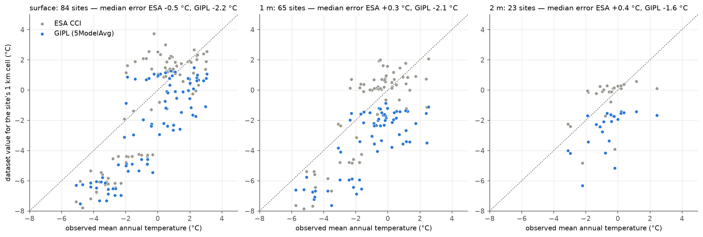
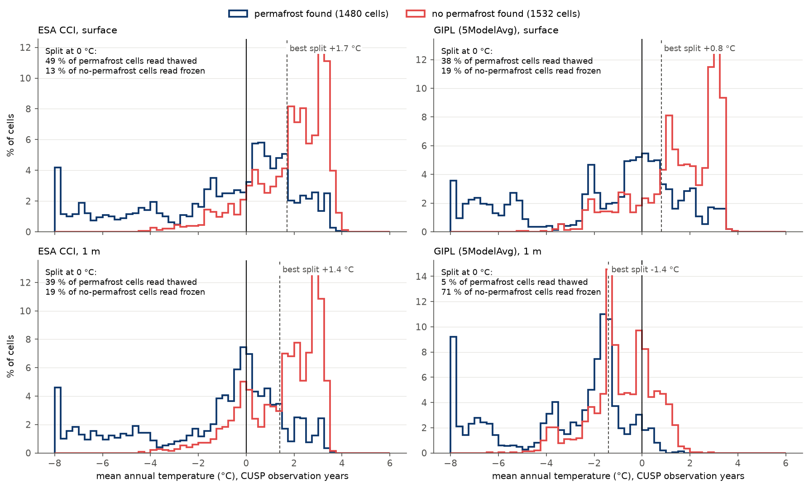
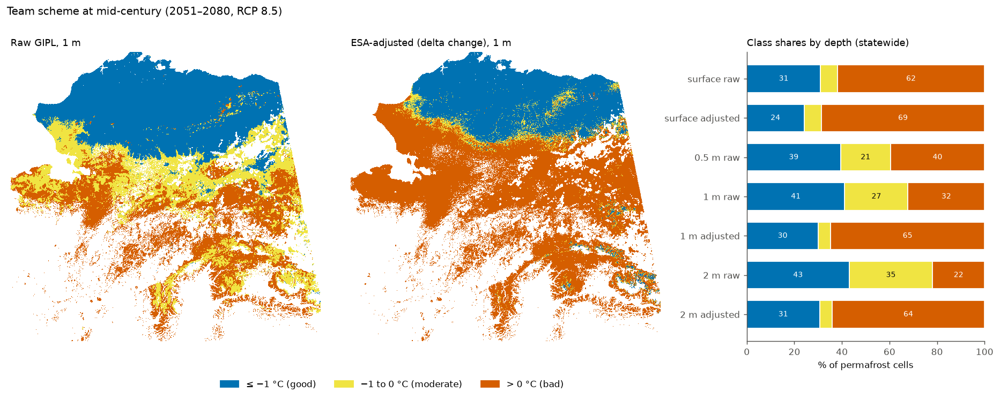
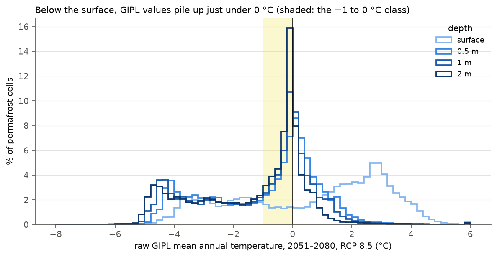

# GIPL 2.0 (1 km), issue 2: start-up period and cold bias
## Can GIPL ground temperatures be read as absolute values, or only as a change?

**Question:** should GIPL's projected ground temperatures be used as **absolute values** (for example, frozen vs
thawed around 0 °C), or only for their **change** over time (how much the ground warms)?

This matters because one proposed index design sorts cells around the freezing point. Simplified, it reads:
**−1 °C and below = good, −1 to 0 °C = moderate, above 0 °C = bad** (called the **0 °C scheme** below). That only works
if GIPL's temperatures are right in absolute terms. The alternative, used in V2 of [PTI.md](PTI.md), takes only
GIPL's change and gets today's level from ESA CCI.

---

**Short answer:**
- **Use GIPL for its change, not its temperature levels.** Three independent checks agree that GIPL's levels are too
  cold, by more than the width of a 0 °C-scheme class (1 °C):
  - **Against ESA CCI:** after allowing for the warming between the two datasets' decades, GIPL is **1.2 °C colder at
    the surface and 1.9 °C colder at 1 m and 2 m** (statewide median). GIPL is colder in 82–91 % of permafrost cells.
  - **Against 90 monitoring boreholes (mostly 2015–2024):** GIPL is **2.2 / 2.1 / 1.6 °C too cold** at the
    surface / 1 m / 2 m; ESA is within 0.5 °C (median). Even GIPL's 2026–2035 values, taken as delivered, are
    colder than what the boreholes measured a decade earlier.
  - **Against ~3,000 field sites where permafrost was or was not found (CUSP):** at 1 m, GIPL reads **71 % of the
    sites without permafrost as frozen**. The temperature that best separates the two groups is −1.4 °C in GIPL and
    +1.4 °C in ESA: **not 0 °C in either dataset.**
- **On raw GIPL, the 0 °C scheme would mostly measure GIPL's bias.** At mid-century (2051–2080), raw GIPL and
  ESA-adjusted GIPL put a cell in the same class for only **54–61 % of cells at 1 m and 46–52 % at 2 m**. Below the
  surface, half of all cells sit within 0.5 °C of a class edge, because GIPL's values pile up just under 0 °C.
- **GIPL's first 15 years are not a normal projection.** In 2021–2023 the ground below the surface starts in the
  wrong place and climbs almost 2 °C in two years. Through **2035**, the 5-model average (both scenarios) and the
  GFDL-CM3 run follow **one shared year-to-year weather sequence**. Scenario-specific behaviour starts only in 2036.
- **Option A, ESA-adjusted values compared with 0 °C, beats raw GIPL but still has no sound 0 °C line at 1 km.**
  Even ESA's own 0 °C line reads 39 % of permafrost sites as thawed at 1 m: a 1 km cell mixes frozen and unfrozen
  ground. A threshold scheme would need its edges calibrated against field data, not fixed at 0 °C.
- **Option B, change only (PTI V2), is the most defensible use of GIPL, with caveats.** It removes the level bias by
  construction. But GIPL's warming does not follow the scenario's air warming closely, and its 2026–2035 reference
  decade sits inside the shared-weather stretch. This is why PTI keeps V1 (air temperature) alongside V2.

---

## Key terms, in plain language

- **Level (absolute value):** the temperature itself, e.g. −1.5 °C. **Change:** how much it rises between two periods,
  e.g. +2.0 °C.
- **MAGT:** mean annual ground temperature. GIPL provides it at the ground surface and at fixed depths (0.5 m, 1 m,
  2 m, ...).
- **Bias:** a systematic difference between a dataset and reality (or a reference). A **cold bias** means values are
  too low.
- **Expected warming:** the air warming that the climate projections give between two periods. Used to compare
  datasets that describe different decades ([ESA_GIPL_SPLICING.md](ESA_GIPL_SPLICING.md), section 2).
- **Excess offset:** GIPL − ESA minus the expected warming, i.e. the disagreement that is not explained by climate
  change between the two decades.
- **ESA-adjusted (delta change method):** ESA's level + expected warming + GIPL's change. GIPL contributes only its
  change ([ESA_GIPL_SPLICING.md](ESA_GIPL_SPLICING.md)).
- **Start-up period:** a model's first years after it starts, while it is still settling.
- **Shared weather sequence:** the same pattern of warm and cold years appearing in runs that should have different
  weather (different scenarios or climate models).
- **Borehole:** a monitored hole with temperature sensors at fixed depths; here, the University of Alaska Fairbanks
  (UAF) Permafrost Laboratory network.
- **CUSP:** the CommUnity near-Surface Permafrost dataset: field records (probes, pits, cores) of whether permafrost
  was found in the top metre or two.
- **Ranking skill:** the chance that a randomly chosen permafrost site is colder in a dataset than a randomly chosen
  site without permafrost (0.5 = no better than a coin toss, 1 = perfect). It measures whether the *pattern* is right,
  independent of the level.

## Data

| | What | Years used | Role here |
|---|---|---|---|
| **GIPL 2.0** (SNAP) | modelled MAGT at the surface, 0.5 m, 1 m, 2 m; 1 km | 2021–2100 | the dataset being tested; 5-model average (headline), GFDL-CM3, NCAR-CCSM4; RCP 4.5 and 8.5 |
| **ESA CCI Permafrost v5** | satellite surface temperature + permafrost model; ground surface (GST), 1 m, 2 m; 1 km | 2003–2023 | today's reference level (no 0.5 m layer) |
| **Air temperature** (SNAP 2 km) | CMIP5 5-model average (projections) and CRU TS 4.08 (observed) | 2003–2100 | expected warming between decades |
| **Boreholes** (UAF Permafrost Lab, Arctic Data Center) | daily measured temperatures, 121 Alaska sites | 2015–2025 | independent check of levels |
| **CUSP v1.2** | field records of permafrost found / not found, 3,012 GIPL cells | 2000–2024 | independent check of frozen / thawed calls |

Cells: permafrost cells where GIPL behaves normally (724,326 cells; GIPL's stuck cells and the 2 km border around them
are excluded, see [GIPL_ISSUE_1.md](GIPL_ISSUE_1.md)). Following the team's choice, 0.5 m is analysed for start-up,
change and the 0 °C scheme only; ESA has no 0.5 m layer to compare levels with.

---

## 1. GIPL's first fifteen years

### 1.1 What the runs look like

*Statewide median of permafrost cells. Dark band: start-up years; light band: shared weather sequence (section 1.3).
In the top row the orange GFDL-CM3 line is hidden under the blue 5-model average line until 2035: the two are
identical.*

- **Below the surface, GIPL starts far below its later values and climbs fast.** At 1 m, the 5-model average under
  RCP 4.5 goes from −3.7 °C in 2021 to −1.9 °C in 2023; at 2 m from −4.0 to −2.2 °C. The surface rises from −1.9 to
  −0.3 °C over the same two years. Real ground does not warm 1.5–2 °C in two years.
- **The NCAR-CCSM4 run jumps in 2023** (surface +3.6 °C under RCP 4.5 and +5.1 °C under RCP 8.5, against −0.3 °C in
  the other runs), then drops back.
- **The surface drops by about 1 °C in 2026** in the 5-model average under both scenarios (and a year earlier in
  GFDL-CM3 RCP 8.5). This is the drop described in [ESA_GIPL_SPLICING.md](ESA_GIPL_SPLICING.md), section 1. It appears
  in every run that follows the shared weather sequence (section 1.3), so it may be a cold year in that sequence
  rather than a separate model problem.

### 1.2 The two scenarios start from different ground

In 2021 the two scenarios' long-term climates are still almost the same; only their weather differs (by 0.85 °C in
the median cell that year). A weather difference acts at the surface first and fades with depth, so GIPL's two runs
should start close together, with any gap largest at the surface.

| Median gap, RCP 8.5 vs RCP 4.5 (5-model average) | Surface | 0.5 m | 1 m | 2 m | Air |
|---|---|---|---|---|---|
| 2021 | 0.53 °C | 1.02 °C | 1.33 °C | **1.71 °C** | 0.85 °C |
| 2023–2035 | ≤ 0.07 °C | 0.11–0.18 °C | 0.11–0.22 °C | 0.11–0.29 °C | 0.1–1.8 °C |
| 2036–2040 | 0.37–1.23 °C | 0.28–0.81 °C | 0.25–0.70 °C | 0.21–0.58 °C | 0.2–1.2 °C |

- **In 2021 the gap grows with depth** (1.7 °C at 2 m, more than the air's 0.85 °C). The weather cannot do that; the two
  runs must have been started from different ground temperatures.
- **From 2023 to 2035 the gap almost vanishes** (surface ≤ 0.07 °C), even though the two scenarios' air temperatures
  differ by up to 1.8 °C in single years. GIPL behaves as if both scenarios had the same weather in those years.
- **From 2036 the gap reopens** to the size expected from different weather.

### 1.3 Through 2035, several runs share one weather sequence

If two runs have different weather, their warm and cold years should not line up. We correlated the year-to-year
changes of every cell between runs (median over cells; 1 = identical pattern, 0 = unrelated):

| Year-to-year changes, ground surface | 2021–2035 | 2036–2060 |
|---|---|---|
| 5-model average, RCP 4.5 vs RCP 8.5 | **0.97** | −0.37 |
| 5-model average vs GFDL-CM3, RCP 4.5 | **1.00** (identical values) | 0.61 |
| 5-model average vs GFDL-CM3, RCP 8.5, GFDL shifted by one year | **0.99** | 0.77 |
| NCAR-CCSM4, RCP 4.5 vs RCP 8.5 | 0.70 | −0.07 |
| *For comparison: model air temperature, RCP 4.5 vs RCP 8.5* | *−0.08* | *−0.10* |

- **GFDL-CM3 RCP 4.5 and the 5-model average RCP 4.5 are identical in every cell for 2021–2035** (checked at the
  surface, 1 m and 2 m), and differ from 2036 on.
- **GFDL-CM3 RCP 8.5 follows the same sequence one year ahead.**
- **Under RCP 4.5, the 5-model average swings like a single climate model before 2036** (0.5–1 °C from year to year,
  like GFDL-CM3) **and like an average of models after** (mostly 0.1–0.3 °C).
- **GIPL's year-to-year changes barely follow the projected air temperature** that we use for V1 and for expected
  warming (median correlation −0.45 to +0.49 in every run and period, surface and 1 m). GIPL may have been driven by
  a different version of the climate data; this cannot be checked without documentation.

**What this means:** the 2021–2035 values of the 5-model average and GFDL-CM3 runs are not projections for a
particular scenario or climate model. The first ~3 years are a start-up period at every depth; the following years
share one weather sequence. Comparing GIPL with observations anywhere in 2021–2035 is unreliable, and the 2026–2035
reference decade used for the delta change method sits inside the shared stretch (consequence in section 5).

## 2. After the start-up period: GIPL is colder than ESA, more so below the surface

Same comparison as [ESA_GIPL_SPLICING.md](ESA_GIPL_SPLICING.md), section 2, now at three depths: GIPL 2026–2035
against ESA 2014–2023, minus the expected air warming between the two decades (about +1.0 °C).

| Excess offset, median (RCP 8.5) | Surface (vs ESA GST) | 1 m (vs ESA T1m) | 2 m (vs ESA T2m) |
|---|---|---|---|
| Statewide | **−1.2 °C** | **−1.9 °C** | **−1.9 °C** |
| Arctic | −1.2 °C | −1.8 °C | −1.9 °C |
| Interior | −1.2 °C | −1.9 °C | −1.8 °C |
| West | −1.4 °C | −2.1 °C | −2.0 °C |
| South | −0.4 °C | −1.2 °C | −1.2 °C |
| Cells where GIPL is colder | 82 % | 91 % | 91 % |
| Spread, statewide (10th to 90th percentile) | −2.8 to +0.6 °C | −3.4 to −0.1 °C | −3.3 to −0.1 °C |

RCP 4.5 is within 0.1 °C.
- **The bias is larger below the surface:** about 2 °C at 1 m and 2 m.
- **It is not one number:** cells differ by about 3 °C between the 10th and 90th percentiles, so no single correction
  fixes it ([ESA_GIPL_SPLICING.md](ESA_GIPL_SPLICING.md), section 3).
- **It holds in every run:** GFDL-CM3 RCP 8.5 −0.8 / −1.7 / −1.7 °C, NCAR-CCSM4 −0.5 / −1.5 / −1.5 °C (surface / 1 m /
  2 m; GFDL-CM3 RCP 4.5 equals the 5-model average for these years, section 1.3).
- **It holds with a later reference decade:** with GIPL 2036–2045 (after the shared stretch) instead of 2026–2035,
  the statewide median is −0.9 to −1.4 °C at the surface and −1.7 to −2.1 °C at 1 m and 2 m.
- **It is largest where it matters most for a 0 °C scheme.** At 1 m, the bias is near 0 in cells that ESA puts below
  −7 °C, −1.1 to −2.0 °C between −7 and 0 °C, and −2.2 to −3.2 °C in cells ESA puts above 0 °C.

*RCP 8.5. Blue: GIPL colder than ESA after expected warming. GIPL is more than 1 °C warmer than ESA in only 5 % of
cells at the surface (3 % at 1 m), mainly in the eastern Brooks Range, the mountains of eastern Alaska and part of the
northern coastal plain.*

## 3. Which dataset is right? Two independent field checks

ESA is also model-based, so the comparison above cannot say on its own which dataset is off. Two kinds of field data
can.

### 3.1 Boreholes: measured ground temperatures

90 borehole sites in normal GIPL cells, with 1–18 years of daily data each (mostly 2015–2024; two sites back to
2007). For each site, the observed mean annual temperature is compared with ESA for the same years and with GIPL's
value implied for those years (GIPL 2026–2035 minus the expected warming between the observation years and
2026–2035).

| Error = dataset − observed (median of sites) | Surface (84 sites) | 1 m (65 sites) | 2 m (23 sites) |
|---|---|---|---|
| ESA CCI | −0.5 °C | +0.3 °C | +0.4 °C |
| GIPL, implied for the observation years | **−2.2 °C** | **−2.1 °C** | **−1.6 °C** |
| GIPL 2026–2035 as delivered, no adjustment | −1.3 °C | −1.0 °C | −0.8 °C |
| GIPL start-up years vs same-year observations | −1.1 °C | −1.1 °C | −0.8 °C |
| Sites where GIPL (implied) is colder than observed | 83 % | 94 % | 96 % |
| Typical size of the error (mean absolute): ESA / GIPL | 1.9 / 2.4 °C | 1.3 / 2.4 °C | 1.0 / 2.0 °C |

- **GIPL is the dataset that runs cold.** ESA's median error is within half a degree; GIPL's is about 2 °C at every
  depth.
- **The result does not depend on the warming adjustment.** GIPL's values for 2026–2035, a decade later and warmer,
  are still colder than what the boreholes measured in 2015–2024 (row 3).
- **ESA is not perfect either:** a single site typically differs from its 1 km cell by 1–2 °C (row 6). At the
  surface, ESA runs 2–4 °C too cold at a cluster of North Slope and Brooks Range sites (Deadhorse, Franklin Bluffs,
  Imnavait, Roche Moutonnée), and too warm at recently burned sites. ESA is accurate on average, not at every point.

### 3.2 CUSP: was permafrost found?

3,012 GIPL cells with field records: 1,480 where permafrost was found in at least half of the records and 1,532
where it mostly was not (searches reaching at least 1 m). For each cell, the dataset temperature for the years of the
field visits is compared with what was found. (In the histograms, cells colder than −8 °C are shown at −8 °C.)

| | Ranking skill | At a 0 °C split: permafrost sites read as thawed | At a 0 °C split: no-permafrost sites read as frozen | Best split |
|---|---|---|---|---|
| ESA, surface | 0.80 | 49 % | 13 % | +1.7 °C |
| ESA, 1 m | 0.82 | 39 % | 19 % | +1.4 °C |
| ESA, 2 m | 0.82 | 32 % | 22 % | +1.3 °C |
| GIPL, surface | 0.81 | 38 % | 19 % | +0.8 °C |
| GIPL, 0.5 m | 0.81 | 7 % | 65 % | −1.3 °C |
| GIPL, 1 m | 0.81 | **5 %** | **71 %** | **−1.4 °C** |
| GIPL, 2 m | 0.81 | 4 % | 74 % | −1.5 °C |

GIPL values implied for the field years, as in 3.1.
- **Both datasets rank places equally well** (ranking skill 0.80–0.82). GIPL's *pattern* is fine; its *level* is
  not.
- **GIPL's 0 °C line is in the wrong place.** Below the surface, GIPL calls ~70 % of the no-permafrost sites frozen.
  Its best split is −1.3 to −1.5 °C: a cold bias of about 1.5 °C, consistent with sections 2 and 3.1.
- **ESA's 0 °C line is not right either, in the other direction:** its best split is +1.3 to +1.7 °C. Many 1 km cells
  whose average temperature is above 0 °C still contain permafrost in places (north-facing slopes, peat, under
  insulating moss). A 0 °C line on a 1 km average does not separate frozen from thawed ground.
- **Under the 0 °C scheme**, sites without permafrost would be rated at 1 m as follows:

  | No-permafrost sites | ≤ −1 °C (good) | −1 to 0 °C (moderate) | > 0 °C (bad) |
  |---|---|---|---|
  | ESA | 7 % | 12 % | 81 % |
  | GIPL | **47 %** | 24 % | 29 % |

  GIPL would rate about half of the places where field crews found no permafrost as "good" (frozen and stable).
- **A caution about GIPL as delivered:** GIPL's raw 2026–2035 values at 1 m happen to split the CUSP sites near 0 °C
  (best split −0.2 °C). That is because they describe a period about 18 years after most field visits (median
  2012): about 1.3 °C of warming happens to cancel most of the cold bias. The same cancellation does not happen at
  mid-century.

## 4. What the 0 °C scheme would do at mid-century

The scheme applied to GIPL in 2051–2080, two ways: to GIPL's raw values, and to ESA-adjusted values (ESA level +
expected warming + GIPL change).

| 2051–2080, statewide, RCP 4.5 / RCP 8.5 | Surface | 1 m | 2 m |
|---|---|---|---|
| Same class, raw vs adjusted | 85 / 84 % | **54 / 61 %** | **46 / 52 %** |
| Raw GIPL in a colder class | 13 / 13 % | 45 / 37 % | 53 / 47 % |
| "Moderate" (−1 to 0 °C), raw GIPL | 7 / 7 % | 31 / 27 % | 37 / 35 % |
| "Moderate" (−1 to 0 °C), adjusted | 5 / 7 % | 5 / 5 % | 5 / 5 % |
| Raw values within 0.5 °C of a class edge | 16 / 15 % | 50 / 48 % | 54 / 54 % |

0.5 m (raw only): 44 / 39 % good, 26 / 21 % moderate, 30 / 40 % bad.
- **At 1 m and 2 m, raw and adjusted GIPL disagree for 40–55 % of cells**, almost always with raw GIPL in the colder
  class. In the Interior they agree for only 24–50 % of cells.
- **The surface agrees better (85 %)** because most surface values are well away from the class edges (only 15–16 %
  lie within 0.5 °C of one): most Arctic cells stay below −1 °C and most of the rest of the state is above 0 °C.

- **Below the surface, GIPL's values pile up just under 0 °C.** Thawing frozen ground has to melt its ice first, which
  holds the temperature close to 0 °C for years (the "zero curtain"). At 1 m and 2 m, about half of all cells sit
  between −1.5 and +0.5 °C at mid-century (79–88 % in the Interior).
- **Inside that pile-up, a 1 °C-wide class cannot absorb a 2 °C bias.** A cell's class depends almost entirely on
  where GIPL happens to place it near 0 °C, which is exactly where GIPL's bias is largest (section 2).

## 5. Is the change signal any better?

**What the change fixes:**
- **The level bias drops out.** GIPL's change between two periods does not depend on its level, so the 1–2 °C cold
  bias has no effect.
- **GIPL's pattern is sound** (section 3.2): the problem is the level, not which places are warmer.

**What the change does not fix:**

1. **The reference decade sits in the shared stretch.** The delta change method measures GIPL's warming from
   2026–2035, which is inside the shared weather sequence (section 1.3). Moving the reference to 2036–2045 would change
   a cell's projected warming by:

   | Surface, statewide | RCP 4.5 | RCP 8.5 |
   |---|---|---|
   | Median change in projected warming | +0.2 °C | −0.3 °C |
   | Cells changing by more than 0.5 °C | 15 % | 26 % (Interior, West, South ~40 %) |

   At 1 m and 2 m the median change is ±0.2 °C or less. This is small next to the 1–2 °C level bias, but comparable to
   the half-degree that can move a cell across a 1 °C warming band in [PTI.md](PTI.md).

2. **GIPL's warming does not follow the scenario's air warming closely:**
   - From 2036 to 2070, GIPL's surface warms 0.53 °C per decade under **both** scenarios, while the projected air
     warms 0.29 (RCP 4.5) and 0.90 (RCP 8.5) °C per decade.
   - By 2081–2100, the extra 2.6 °C of air warming under RCP 8.5 shows up as only 1.5 °C of extra GIPL warming at the
     surface, 0.9 °C at 1 m and 0.8 °C at 2 m.
   - For comparison, over 2003–2023 ESA's ground surface warmed about 1.7 times as fast as the observed air (0.62 vs
     0.37 °C per decade). GIPL's surface warms 1.8 times as fast as the air under RCP 4.5 but 0.6 times under RCP 8.5.
   So GIPL's warming is plausible in size, but it does not scale with the scenario the way the air does. Part of this
   is expected (snow insulates the ground in winter, [PTI.md](PTI.md) section 2). Part may come from GIPL being driven
   by different climate data (section 1.3); without documentation the two cannot be separated.

3. **Below the surface, the change stalls near 0 °C.** In the pile-up (section 4), warming at 1 m and 2 m slows while
   ice melts. Depth-based change therefore understates warming in thawing cells. The surface does not have this
   problem, which is one reason PTI V2 uses the surface.

## 6. The options side by side

| | Raw GIPL values, 0 °C scheme | **A.** ESA-adjusted values, 0 °C scheme | **B.** Change only (PTI V2) |
|---|---|---|---|
| Uses from GIPL | level and change | change | change |
| Today's level comes from | GIPL | ESA + expected warming | ESA (in 2 °C-wide bands) |
| Affected by GIPL's cold bias (1.2–2 °C) | fully | no | no |
| Affected by GIPL's first 15 years | levels and reference decade | reference decade (median ±0.3 °C) | reference decade (median ±0.3 °C) |
| Is 0 °C the right line at 1 km? | no: GIPL's best split is −1.4 °C at 1 m | no: ESA's best split is +1.3 to +1.7 °C | does not rely on a fixed temperature line |
| A 1 °C level error can move a cell | a full class | a full class | at most one "today" band (2 °C wide); warming bands unaffected |
| Field check | fails (71 % of no-permafrost sites read frozen at 1 m) | ESA misreads 39 % of permafrost sites at 0 °C (1 m) | not testable directly (future change) |
| **Verdict** | **not recommended** | possible only with calibrated edges | **recommended, with the caveats in section 5** |

---

## Recommendation

1. **Do not use GIPL temperature levels as absolute values**, at any depth. They are 1.2–2 °C too cold against ESA,
   boreholes and field records alike, and the bias is largest near 0 °C.
2. **Use GIPL only for its change, at the ground surface** (as in PTI V2). The surface avoids the zero-curtain pile-up,
   has the smallest bias, and has a direct ESA counterpart for today's level.
3. **If the team wants a temperature-threshold scheme**, build it on ESA-adjusted values (option A), and set the class
   edges from field data (for example CUSP) rather than at −1 and 0 °C. Note that it still inherits ESA's errors (about
   0.5 °C on average, 1–2 °C at a single site).
4. **Decide the reference decade** for GIPL's change: 2026–2035 (current; inside the shared stretch) or 2036–2045
   (cleaner, but relies more on the air-temperature bridge: about +1.5 °C instead of +1.0 °C). The effect on PTI V2 is
   a few tenths of a degree in the median.
5. **Report to SNAP** that GFDL-CM3 RCP 4.5 is identical to the 5-model average RCP 4.5 for 2021–2035, and that the runs
   share one weather sequence through 2035.

## Caveats

- **ESA CCI is model-based** (satellite surface temperature driving a permafrost model), not measurement.
- **A borehole is a point; a GIPL or ESA cell is 1 km².** Individual sites can differ from their cell by several
  degrees (snow drifts, vegetation, water, recent fire). The medians over many sites are the meaningful numbers.
  Boreholes in GIPL's stuck cells or their border (25 sites, mostly in the eastern Interior) are excluded.
- **CUSP sites are not spread evenly:** most no-permafrost cells are in the West (983) and Interior (511), most
  permafrost cells in the Arctic and Interior. "No permafrost" means none was found within the depth searched (at least
  1 m), not that there is none deeper or nearby.
- **Expected warming uses SNAP's projected air temperature**, which GIPL's year-to-year changes barely follow (section
  1.3). The borehole comparison without any adjustment (section 3.1, row 3) avoids this and gives the same answer.
- **GIPL's set-up is not documented**, so the causes of the start-up behaviour, the shared weather sequence and the
  cold bias cannot be identified.
- **5-model average throughout**, with GFDL-CM3 and NCAR-CCSM4 checked for the start-up and bias.

Methods: GIPL 2.0 source GeoTIFFs (SNAP CKAN archive; identical to Rasdaman), 1 km grid; cells with ESA CCI PFR
> 0 (2023) and normal GIPL behaviour (class 2 of the stuck-cell mask, 724,326 cells); regions from the USDA general soil
map physiography ([CORRELATION.md](CORRELATION.md)). ESA sampled at cell centres (nearest 0.01° pixel), 2003+ only for
trends (one product version). Air temperature: SNAP 2 km 5modelAvg (projected) and CRU TS 4.08 (observed), parent 2 km
cell. Expected warming = air temperature difference between the two periods for the same cell and scenario. Excess
offset = GIPL 2026–2035 − ESA 2014–2023 − expected warming. Year-to-year correlations: per cell, Pearson correlation of
first differences, median over every 10th cell. Boreholes: "Thermal State of Permafrost in North America –
continuously observed ground temperatures" (UAF Permafrost Laboratory, Arctic Data Center, 2015/16–2024/25 packages;
121 US sites); June–May years with ≥ 330 valid days per sensor; surface = "surf" sensor (else 0–5 cm), 1 m and 2 m from
a sensor within 5 cm or linear interpolation between sensors ≤ 1.5 m apart; site means over all usable years; ESA for
the two calendar years each June–May year spans. CUSP v1.2 (https://github.com/jonschwenk/cusp): Alaska records from
2000, visual classifications dropped, "not found" only with a search depth ≥ 100 cm; grouped by GIPL cell (permafrost
cell = permafrost found in ≥ 50 % of records); dataset values averaged over the median visit year ± 2 years (air
temperature for GIPL's implied value from 2006 at the earliest). Ranking skill = area under the ROC curve; best split
= threshold maximising the mean of the two hit rates. 0 °C scheme: ≤ −1, −1 to 0, > 0 °C (simplified team proposal).
Scripts: `scripts/01_data/fetch_boreholes.py`, `scripts/02_tests/t6_gipl_levels.py` (stacks, start-up, bias,
reference decade, scenario response, classes, trends), `scripts/02_tests/t6b_sites.py` (boreholes, CUSP),
`scripts/03_report/gipl_issue2_figures.py`; `slurm/17_t6_prep.slurm`, `slurm/18_t6_analyze.slurm`; tables in
`<data>/results/t6/`.
