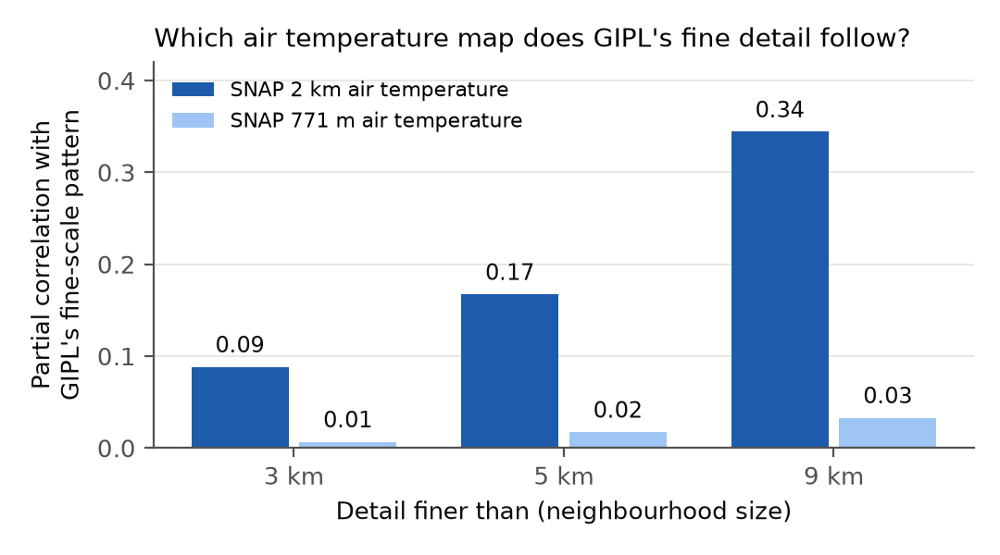
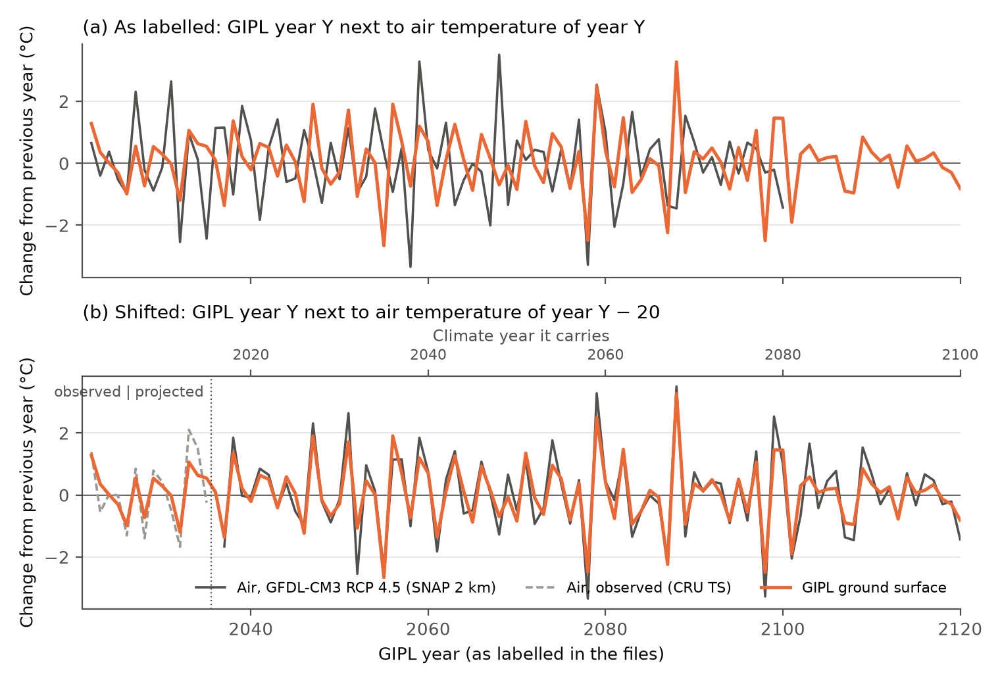
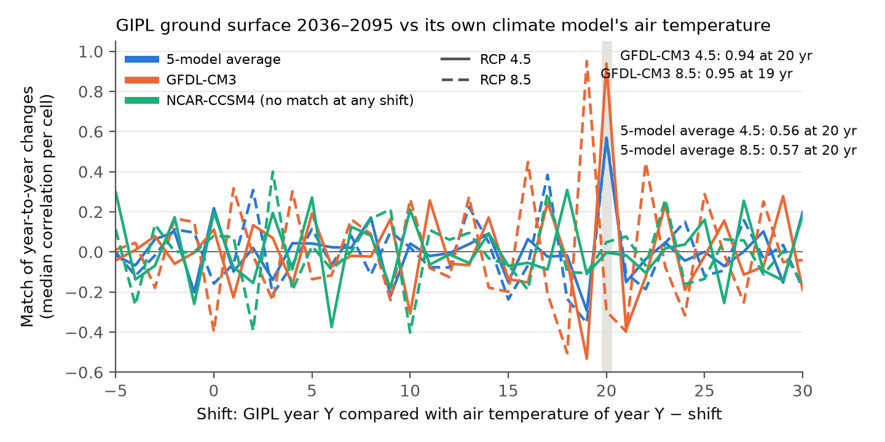
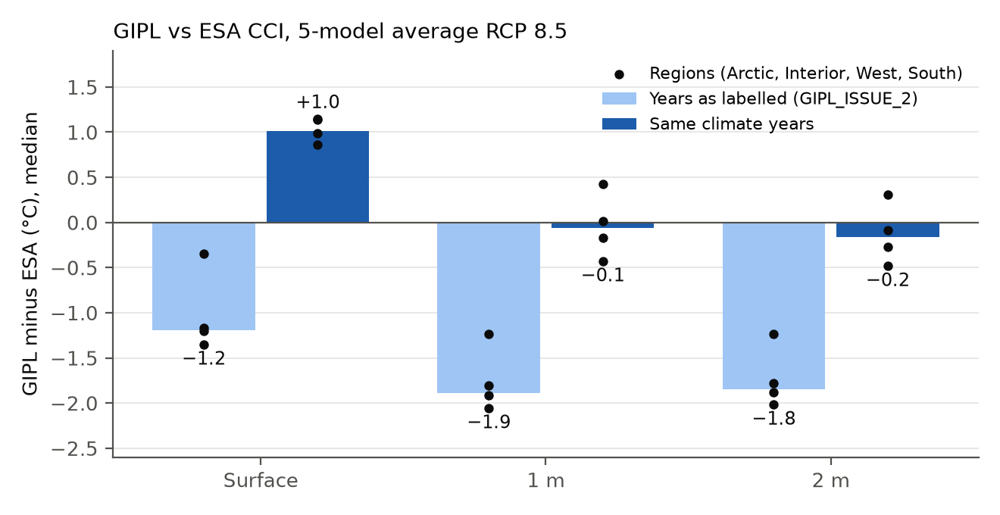

# GIPL 2.0 (1 km), issue 3: which climate data, and which years?
## Was GIPL driven by different climate data than the air temperatures we compared it with?

**Question:** our GIPL audit ([GIPL_ISSUE_2.md](GIPL_ISSUE_2.md), [ESA_GIPL_SPLICING.md](ESA_GIPL_SPLICING.md),
[GIPL_TRUST.pdf](GIPL_TRUST.pdf)) compared GIPL with SNAP's **2 km** downscaled air temperature and found that GIPL's
year-to-year swings barely follow it. SNAP also publishes the same climate models at **771 m**. Was GIPL driven by the
771 m data, or by something else?

---

**Short answer:**
- **GIPL was driven by SNAP's 2 km climate data, not the 771 m data.** GIPL's fine-scale map detail carries the 2 km
  product's pattern and none of the 771 m product's extra detail. GIPL also switches from observed to projected climate
  exactly where SNAP's 2 km observed record ends (2015). The 771 m record ends in 2009. Even if the 771 m data had been
  used, it would barely matter: it has the same year-to-year swings (correlation 0.999), the same warming, and is only
  0.2 °C warmer.
- **But GIPL's years are labelled 20 years late.** **GIPL year Y carries the climate of year Y − 20** (GFDL-CM3 RCP
  8.5: Y − 19). GIPL "2021–2035" is **observed climate of 2001–2015**. GIPL "2036–2120" is the CMIP5 projection for
  **2016–2100**. Shifted this way, GIPL's year-to-year swings follow its climate model's air temperature almost
  exactly (GFDL-CM3: correlation 0.94–0.95 in every cell, against 0.11 / −0.40 as labelled).
- **This explains most of the oddities in GIPL_ISSUE_2.** The "shared weather" through 2035 is the observed weather of
  2001–2015, the same in every scenario. The 2036 switch is where the projections start. The start-up period is
  2001–2003. Warming rates and the scenario response look normal once the years are shifted. And the files run to 2120
  although the projections stop in 2100.
- **The cold bias largely disappears.** Compared with ESA CCI for the *same climate years*, GIPL is **within 0.2 °C at
  1 m and 2 m** and **1.0 °C warmer at the surface** (statewide medians). GIPL_ISSUE_2 reported −1.9 and −1.2 °C.
  Against boreholes (RCP 8.5, as in GIPL_ISSUE_2), GIPL is now within 0.6 °C at all three depths, close to ESA.
  GIPL_ISSUE_2 reported 1.6–2.2 °C too cold.
- **The two NCAR-CCSM4 runs match no available climate data**, at any shift: not SNAP's CCSM4 at 2 km or 771 m, not
  the WRF-downscaled CCSM4, and not observations. Their forcing is unknown; treat them with caution.
- **Read every GIPL year as Y − 20.** The dataset effectively covers 2001–2100, not 2021–2120. Several earlier
  findings and PTI V2 need revising (section 5).

---

## Key terms, in plain language

- **Downscaled climate data:** a global climate model's output (100–200 km cells) turned into a fine map. SNAP adds the
  model's *change* to a detailed map of today's climate (PRISM). The 2 km and 771 m products use the same climate model
  runs but different PRISM maps (1961–1990 vs 1971–2000) and cover different areas (Alaska + Canada vs Alaska).
- **Forcing:** the climate data a model is driven with. For GIPL: monthly air temperature and precipitation (snow is
  derived from them).
- **CRU TS:** a gridded record of *observed* monthly air temperature. SNAP downscales it the same way as the projections.
- **Year-to-year change:** this year's value minus last year's. Each climate run has its own sequence of warm and cold
  years, so this sequence works like a fingerprint.
- **Match (correlation of year-to-year changes):** for each cell, how closely GIPL's ups and downs follow the air's
  (1 = same pattern, 0 = unrelated). We report the median over cells.
- **Shift:** comparing GIPL year Y with air temperature of year Y − shift.

## 1. Background: what the documents say

None of the available documents names the exact climate product. SNAP's catalogue record for GIPL 2.0 has an empty
lineage field. The GIPL 2.0 report to CRREL and Marchenko et al. (ICOP 2024) say only "SNAP … CMIP5 … scaled down to
1 km". SNAP publishes no 1 km climate data, so the forcing was resampled from either the 2 km or the 771 m product.
Older material shows the lab used SNAP's 2 km data for GIPL-1.3 (2012 Seward Peninsula report). It also shows that the
GIPL 2.0 set-up runs from August to August (2010 GIPL/SNAP presentation). The data have to answer the question.

## 2. Not 771 m: GIPL carries the 2 km fingerprint

| Test | 2 km product | 771 m product |
|---|---|---|
| GIPL's fine-scale map detail (detail finer than 9 km), partial correlation | **0.34** | 0.03 |
| Neighbouring GIPL cells differ more across the product's cell edges | **+11 %** east–west, +3 % north–south | ±0 % |
| Observed record ends | **2015** (CRU TS 4.0) = where GIPL switches to projections | 2006 / 2009 (CRU TS 3.0 / 3.1) |
| Land mask | covers every GIPL cell | covers every GIPL cell (no help) |
| Year-to-year changes, 771 m vs 2 km, same model | correlation 0.999 | |
| Level, 771 m minus 2 km | +0.19 °C statewide (Arctic +0.28, Interior +0.15, West +0.02, South +0.60) | |
| Warming 2014–2023 → 2026–2035 | +1.08 °C | +1.08 °C |

- **The fine-scale test is the decisive one.** The two products' local detail differs because they use different PRISM
  maps. GIPL's local detail follows the 2 km map and ignores the 771 m map.
- **The block pattern is weak** (+11 %). GIPL was probably not given the 2 km values by plain nearest-neighbour copying.
  Smoother resampling would leave a weak trace like this.
- **The question matters less than expected.** For the same climate model, the two products swing identically from
  year to year and warm by the same amount. Using one or the other changes levels by about 0.2 °C.

## 3. GIPL's years are shifted by 20

*GFDL-CM3, RCP 4.5, statewide median. (a) As labelled, GIPL's ups and downs have nothing to do with the air's.
(b) Shifted by 20 years, they line up almost exactly, including the observed 2001–2015 stretch.*

| Match of year-to-year changes, ground surface | As labelled | Shifted | Cells above 0.5 |
|---|---|---|---|
| GFDL-CM3 RCP 4.5, GIPL 2036–2095 vs model air | 0.11 | **0.94** (20 yr) | 100 % |
| GFDL-CM3 RCP 8.5, GIPL 2036–2095 vs model air | −0.40 | **0.95** (19 yr) | 100 % |
| 5-model average RCP 4.5 / 8.5, GIPL 2036–2095 vs model air | 0.22 / −0.16 | **0.56 / 0.57** (20 yr) | 90 / 77 % |
| GIPL 2021–2035 (5-model average, GFDL-CM3 RCP 4.5) vs observed air (CRU) 2001–2015 | | **0.76** (20 yr) | 94 % |
| GFDL-CM3 RCP 8.5 vs WRF-downscaled GFDL-CM3 (independent product) | −0.37 | **0.93** (19 yr) | |

- **Every shift from −5 to 30 years was tested** against all 16 candidate datasets: 2 km and 771 m projections for all
  models and scenarios, observed CRU, and older CMIP3 projections. The peak sits at 20 years for all four
  5-model-average and GFDL-CM3 runs (19 for GFDL-CM3 RCP 8.5). No other shift comes close.
- **The 5-model average matches less closely** because averaging five models smooths the year-to-year swings, so
  GIPL's own variability (snow, soil) weighs more. It still peaks clearly at 20 years.
- **GIPL's annual values are calendar-year means** (match 0.94 for January–December vs 0.76 for August–July).
- **GFDL-CM3 RCP 8.5 runs one year further:** its "2119" is 2100, the last projected year. Its "2120" map is an exact
  copy of "2119" in every cell, and no other run has this.

## 4. What this changes in the audit

| Finding in [GIPL_ISSUE_2.md](GIPL_ISSUE_2.md) | With GIPL year Y = climate year Y − 20 |
|---|---|
| Ground 1.2 / 1.9 / 1.9 °C colder than ESA (surface / 1 m / 2 m) | **+1.0 / −0.1 / −0.2 °C** vs ESA 2006–2015 (RCP 8.5; RCP 4.5 +1.0 / −0.1 / −0.25). Colder in 20 / 52 / 56 % of cells |
| 2.2 / 2.1 / 1.6 °C colder than boreholes | **−0.3 / −0.5 / −0.05 °C** (RCP 8.5; RCP 4.5 −0.8 / −0.7 / −0.3); ESA −0.5 / +0.3 / +0.4 |
| CUSP field sites, 1 m: 68 % of sites without permafrost read as frozen; best split −1.4 °C | **31 %; best split −0.2 °C** (ESA: 15 %, +1.4 °C). Ranking skill unchanged (0.82) |
| Shared weather sequence through 2035 | Observed weather 2001–2015, the same in every scenario |
| Start-up period 2021–2023 | 2001–2003: the model starts from a steady-state ground profile |
| Surface warms 0.53 °C/decade under both scenarios (2036–2070) | Those years are 2016–2050, when the scenarios barely differ (air +0.66 / +0.67). For 2036–2070 itself: GIPL +0.27 / +0.73, air +0.29 / +0.90 °C/decade |
| Only 58 % of the extra RCP 8.5 air warming reaches the surface by 2081–2100 (1 m: 35 %; our recomputation 55 / 33 %) | **87 %** at the surface, 53 % at 1 m, 47 % at 2 m |
| Data run to 2120 | Climate runs to 2100; GIPL 2101–2120 = 2081–2100 |

- **Most of the cold bias came from comparing the wrong years.** The old comparison treated GIPL 2026–2035 as 12 years
  *after* ESA's 2014–2023 and expected it to be about 1 °C warmer. In fact it is the climate of 2006–2015, 8 years
  *before*, and observed air warmed 1.1 °C between those decades. The 2 °C swing is the size of the reported bias.
- **The surface now reads warm against ESA** (+1.0 °C) but slightly cold against boreholes (−0.3 °C). ESA's surface
  temperature is itself 0.5 °C cold at the boreholes. Treat the surface level as uncertain by about ±1 °C.
- **Still unexplained:** the identical first-year maps of four runs, and the different starting ground temperatures of
  the two scenarios (they get the same 2001–2015 weather but start apart; the gap closes by "2023").
- **Not affected:** the stuck cells ([GIPL_ISSUE_1.md](GIPL_ISSUE_1.md)) are stuck in every year, and the ranking skill
  against field sites does not depend on the years.

## 5. NCAR-CCSM4: forcing unknown

Neither NCAR-CCSM4 run matches SNAP's CCSM4 air temperature, at 2 km or 771 m and at any shift from −5 to 30 years
(best match 0.40). It also fails to match the WRF-downscaled CCSM4 (best 0.32), observed CRU, or any other candidate.
Its year-to-year swings must come from climate data we do not have. This adds to its other quirks (the 2023 spike,
the sawtooth in stuck cells). **Use NCAR-CCSM4 runs only with that caveat**, and keep the 5-model average as the
headline.

## 6. What needs revising

- **PTI V2 and the delta change method** ([PTI.md](PTI.md), [ESA_GIPL_SPLICING.md](ESA_GIPL_SPLICING.md)): the GIPL
  change used for "2051–2080" is really the change from 2006–2015 to 2031–2060. The fix is simple and removes the
  air-temperature bridge: ESA 2014–2023 + (GIPL "2071–2100" − GIPL "2034–2043"). Both GIPL periods are then the same
  climate years as their labels minus 20, and the reference matches ESA's decade. For 2081–2100, use GIPL "2101–2120".
- **[GIPL_ISSUE_2.md](GIPL_ISSUE_2.md) and [GIPL_TRUST.pdf](GIPL_TRUST.pdf):** the cold-bias sections, the borehole and
  CUSP results, the shared-weather and scenario-response sections, and the 0 °C scheme comparison (it used
  ESA-adjusted values built with the old bridge).
- **[CORRELATION.md](CORRELATION.md):** the projected comparisons of air warming with GIPL warming paired eras 20 years
  apart.

## Caveats

- **The shift is inferred from the data, not documented.** The evidence is strong and consistent: four runs, three
  independent air temperature products (SNAP delta downscaling, WRF, observed CRU), the 2015 switch, and the
  duplicated final year. It should still be confirmed with SNAP or the GIPL team if possible.
- **Which 2 km observed record was used** (CRU TS 4.0, 2017, ends in 2015) is inferred from the switch year. We
  compared against CRU TS 4.08, which has nearly the same year-to-year changes.
- **ESA CCI is model-based too** (satellite surface temperature driving a permafrost model), and ESA 2003+ is one
  product version. Boreholes: 84 / 65 / 23 sites; their years map to GIPL's projected period (not observed weather),
  so only multi-year means are compared.
- **Precipitation and snow** (the other GIPL forcing) were not tested. GIPL's own snow and soil variability is one
  reason the 5-model-average match is moderate.

Methods: GIPL 2.0 source GeoTIFFs (SNAP CKAN archive), 1 km grid; permafrost cells with normal GIPL behaviour
(class 2 of the stuck-cell mask, ESA PFR 2023 > 0; 724,326 cells; every 10th cell for correlations). Candidate air
temperature (SNAP archive, read-only): CMIP5 monthly tas at 771 m (`AK_771m`, PRISM 1971–2000 base) and 2 km
(`AK_CAN_2km`, PRISM 1961–1990 base) for 5modelAvg, GFDL-CM3, CCSM4 under RCP 4.5 / 8.5; CRU TS 3.1 771 m; CRU TS 4.08
2 km; CMIP3 5-model average 771 m (A1B, A2); WRF degree days (`AK_WRF`, thawing minus freezing index, RCP 8.5).
Values from the source cell under each GIPL cell centre; annual value = mean of 12 calendar months. Match = per-cell
Pearson correlation of first differences, median over cells. Fine-scale test: GIPL surface and air (both 2036–2065 means,
5-model average) minus their local mean over 3 / 5 / 9 km windows; partial correlation of GIPL with each product given
the other. Block test: median |difference| of adjacent GIPL cells, grouped by whether they share a 2 km parent cell, or
whether their 771 m cells are adjacent or one apart. Bias: GIPL "2026–2035" − ESA 2006–2015 (old: GIPL 2026–2035 − ESA
2014–2023 − model air warming 2014–2023 → 2026–2035). Boreholes and CUSP as in [GIPL_ISSUE_2.md](GIPL_ISSUE_2.md), with
each observation year y compared with GIPL year y + 20 (CUSP: visit year ± 2, GIPL "2024" and later only). Scripts:
`scripts/02_tests/t7_gipl_forcing.py` (stages prep, mask, pairs, highpass, yty, lagscan, season, levels, yearmap,
bias20, offsets, reinterp, sites20), `scripts/03_report/gipl_forcing_figures.py`; `slurm/19_t7_prep.slurm`,
`slurm/20_t7_analyze.slurm`; tables in `<data>/results/t7/`. Documents: SNAP catalogue record c24a957b; Marchenko,
Bjella, Nicolsky, Romanovsky (ICOP 2024); CRREL contract report W913E5-21-C0010 (linked from the SNAP record);
GIPL/SNAP presentation (2010); Seward Peninsula REA permafrost chapter (2012).
