# Permafrost Thaw Index (PTI)
## "How susceptible to thaw is the permafrost in this cell, if permafrost is there?"

That question defines the index. It describes the permafrost **in a 1 km cell, if permafrost is there**: how close
the ground is to thawing today and how much it is projected to warm.

---

**BLUF:**
- **The index comes from a simple two-way table:** how warm the ground surface is today and how much it is
  projected to warm. Each cell's class can be explained in one sentence ("surface near 0 °C today, projected to warm
  +3.3 °C: High").
- **Why a table:** a scale based only on future temperature asks just one question: how warm will this place be? That
  makes very cold places look safe even when they warm a lot, and warm places look at risk even when little changes.
  The table asks two questions instead (how warm is it today, and how much will it warm?), and its rules are written
  out so anyone can check or adjust them.
- **Through 2050, almost no cell is above Moderate** (warming mostly stays under 2 °C). By 2051–2080, about
  two-thirds of permafrost cells are High or Very high (65–69 %); by 2081–2100 under RCP 8.5, nearly all (98–100 %).
- **Two versions, differing only in where the projected warming comes from:** V1 uses air temperature (no GIPL); V2
  uses GIPL, with air temperature where GIPL has no usable values (about 1 in 5 Interior cells, flagged). Where V2
  uses GIPL, the two give the same class for 58–100 % of cells, depending on scenario and era; when they differ, it is
  almost always by one class (section 4).
- **Permafrost extent, terrain and land cover stay out of the number** and go in the data sentence.
- **Decisions needed:** the table's entries and band edges (especially the "over 5 °C" column, which decides the
  Arctic under RCP 8.5 by 2081–2100), and whether to adopt V1 or V2.

---

## Caveats

It is important to note that our 1km resolution datasets cannot disambiguate permafrost vs non-permafrost areas within the same cell. Every value (e.g. MAAT, MAGT) is therefore some combination of permafrost and non-permafrost areas, where they exist.

What we **cannot** answer:
- "how much of the cell has permafrost?"
- "where in the cell is the permafrost?"
- "what specific hazards could result from permafrost thaw in this cell (e.g. thermokarst)?"
- "what is the temperature of the permafrost in this cell?"

We simply do not have the data required to make predictions on those topics. However, those topics can be contextualized next to the index in a **data sentence** describing datasets not directly used in computing the index. For example, the following data sentence leads with the index value for the cell, followed by higher-resolution contextual information about the cell:

> *PTI:  (2051–2080, RCP 8.5): surface near 0 °C today (−1.0 °C), projected to
> warm +3.2 °C. Permafrost extent: sparse (PFR 29 %). Terrain: 45 % sun-facing slopes, so permafrost is likely
> limited to shaded and flatter ground. Land cover: 60 % black spruce / wetland (insulating organic layer).*

Section 5 of this document has example data sentences for 3 test areas.

---

## Key terms

- **PTI class:** one of five classes, coloured as in the table: 
    
  .
- **Permafrost cells:** 1 km cells where ESA shows any permafrost (permafrost fraction, PFR, above 0; ≈ 800,000
  cells). Only these cells get a class.
- **Today's surface temperature:** mean annual ground surface temperature, 2014–2023, from ESA CCI Permafrost
  (observation-based).
- **Projected warming:** how much the ground surface warms from today to an era (2026–2050, 2051–2080, 2081–2100),
  under a greenhouse-gas scenario (RCP 4.5: moderate; RCP 8.5: high), using the 5-climate-model average.
- **Delta change method:** future = today's observed level + the change a model projects; the model contributes only
  its change ([ESA_GIPL_SPLICING.md](ESA_GIPL_SPLICING.md)).
- **V1:** projected warming = air-temperature warming (SNAP 2 km downscaled climate). No GIPL.
- **V2:** projected warming = GIPL ground-surface warming (delta change method). Where GIPL has no usable values
  ([GIPL_ISSUE.md](GIPL_ISSUE.md)), V1's air warming is used and the cell is flagged.
- **Context layers:** permafrost extent (ESA PFR), terrain (share of sun-facing and shaded slopes) and land cover
  (share of black spruce / wetland). Shown in the data sentence, not used in the class.

---

## 1. How the index works: the two-way table

Each permafrost cell is described by two numbers, and the table turns them into a class:
1. **Today's surface temperature**, in four bands: cold (below −4 °C), cool (−4 to −2 °C), near 0 (−2 to 0 °C),
   warm surface (above 0 °C).
2. **Projected warming** by the era, in five bands: under 2 °C, 2–3 °C, 3–4 °C, 4–5 °C, over 5 °C.

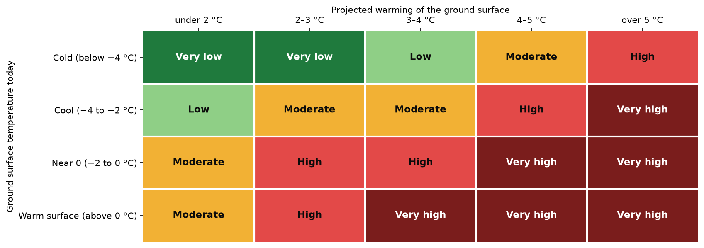

- Going **right** (more warming), the class rises; going **down** (warmer today), it rises too.
- The **warm-surface row** is not automatically top class: permafrost under a surface that is already above 0 °C
  survives only where it is locally protected (snow, organic layers, shading), so it reaches Very high only with large
  warming.
- The **over 5 °C** column is the 4–5 °C column moved up one class (Very high stays Very high). It matters mainly for
  the Arctic under RCP 8.5 by 2081–2100: its surface warms by 5.5–6 °C (median) and ends above 0 °C, so cells that
  are cold today become High rather than Moderate.
- The entries are a **draft for the team to edit**; maps and numbers follow the table.
- Permafrost extent, terrain and land cover describe *how much* of a cell is permafrost and *where*, which the index
  does not answer; ground temperature and permafrost fraction also largely carry the same information
  ([CORRELATION.md](CORRELATION.md)). They are reported in the data sentence instead.

## 2. Two versions: V1 and V2

### Why two versions

The index needs to know how much the **ground surface** will warm. There are two sources for that, and each has a
weakness:

- **Air temperature projections** (SNAP 2 km downscaled climate, 5-model average) cover every cell and are simple to
  explain. But air is not ground: snow, vegetation and organic soil sit between the two, so air warming is only a
  stand-in for ground-surface warming. **V1** uses air warming.
- **GIPL** is a permafrost model that turns air temperature and snow into ground temperatures, so its surface
  temperature is closer to what the ground itself experiences. But it has areas with unusable values
  ([GIPL_ISSUE.md](GIPL_ISSUE.md)), and its temperature levels do not match today's observation-based values, so only
  its *change* is used ([ESA_GIPL_SPLICING.md](ESA_GIPL_SPLICING.md)). **V2** uses GIPL's warming where it is usable
  and air warming elsewhere (flagged).

Neither can be checked against future observations, so both are shown; which one to adopt is an open question.

| | Projected warming from | Uses GIPL | Cells with a class: all of Alaska | Cells with a class: Interior |
|---|---|---|---|---|
| **V1** | air temperature (SNAP 2 km, 5-model average) | no | 100 % | 100 % |
| **V2** | GIPL ground surface (delta change method); air temperature where GIPL has no usable values, flagged | yes | 100 % (GIPL in 91 %) | 100 % (GIPL in 81 %) |

Both use the same today's surface temperature and the same table.

### Why GIPL's ground surface warms differently from the air

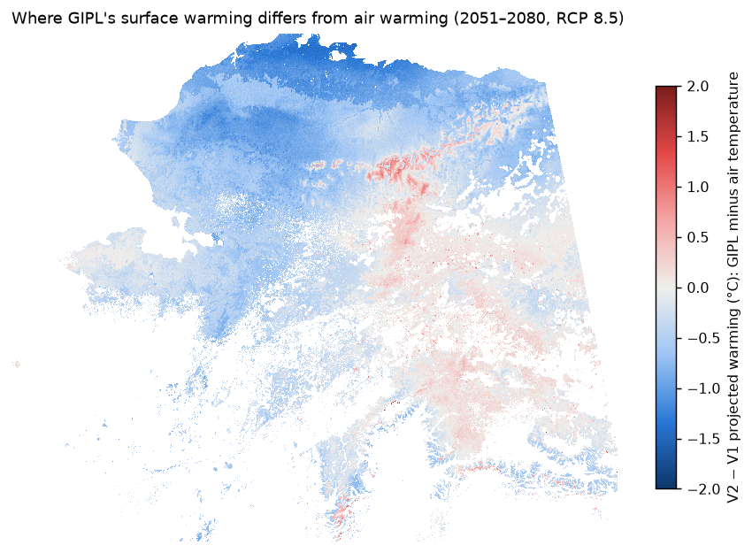

*V2 − V1 projected warming, 2051–2080, RCP 8.5. Blue: GIPL's ground surface warms less than the air; red: more.*

- **The air warms much more in winter than in summer**: winter (December–February) warming is about twice summer
  (June–August) warming in the Arctic, Interior and West, and 1.2–1.5 times in the South; the gap is largest in the
  Arctic.
- **Snow insulates the ground in winter.** Under a snowpack, winter air warming reaches the ground surface only
  partly, so where warming is concentrated in winter, GIPL's surface warms less than the air. The data agree: the
  larger a cell's winter-over-summer warming, the more GIPL lags the air (statewide Spearman ρ = −0.70 under RCP 8.5,
  2051–2080), and the lag is largest in the Arctic.
- **That is not the whole story.** Under RCP 4.5, GIPL warms slightly *more* than the air overall, and in the West the
  relationship reverses. Snow changes in other ways too (for example, a shorter snow season exposes the ground to
  warmer air in spring), and GIPL's snow and soil inputs are not documented, so these effects cannot be separated.

| 2051–2080, RCP 4.5 / RCP 8.5 | Winter air warming | Summer air warming | V2 − V1 (annual ground surface) |
|---|---|---|---|
| Statewide | +3.6 / +4.4 °C | +1.7 / +2.6 °C | +0.3 / −0.3 °C |
| Arctic | +4.1 / +5.3 °C | +1.7 / +2.8 °C | +0.1 / −0.7 °C |
| Interior | +3.2 / +3.9 °C | +1.6 / +2.5 °C | +0.4 / −0.1 °C |
| West | +3.7 / +4.6 °C | +1.7 / +2.5 °C | +0.2 / −0.3 °C |
| South | +2.7 / +3.1 °C | +1.8 / +2.6 °C | +0.2 / −0.1 °C |

Because a difference of half a degree can move a cell across a warming band, V1 and V2 do not always give the same
class. Where V2 uses GIPL, they agree for nearly all cells through 2050, but for only 58–94 % of cells in the later
eras; section 4 maps where they differ. Each area in section 3 lists its own median warming for V1 and V2.

## 3. Results, area by area

Each subsection covers one area, so it can be discussed on its own: **statewide** first, then the four regions
(**Arctic, Interior, West, South**), taken from the physiographic regions of the USDA general soil map (map in
[CORRELATION.md](CORRELATION.md)).

Each area has two figures, one per scenario. **Rows are eras; columns are V1 (table, map) and V2 (table, map).**

How to read a table panel:
- The coloured boxes are the two-way table, drawn on temperature axes (today's surface temperature down the side,
  projected warming along the bottom; dotted lines = band edges).
- Grey shading shows where the area's cells sit (darker = more cells). The histograms on the edges show the spread
  of today's temperature (right) and of projected warming (top).
- The percentage in each box is the share of the area's permafrost cells that fall in it.

Maps show the same classes. On the regional maps, permafrost cells outside the region are light grey.

Each area's table gives the median projected warming and the share of its permafrost cells per class, as
**V1 / V2**.

### 3.1 Statewide

799,669 permafrost cells; today's surface temperature: median −0.1 °C. V2 uses GIPL in 91 % of cells (air warming,
flagged, in the rest).

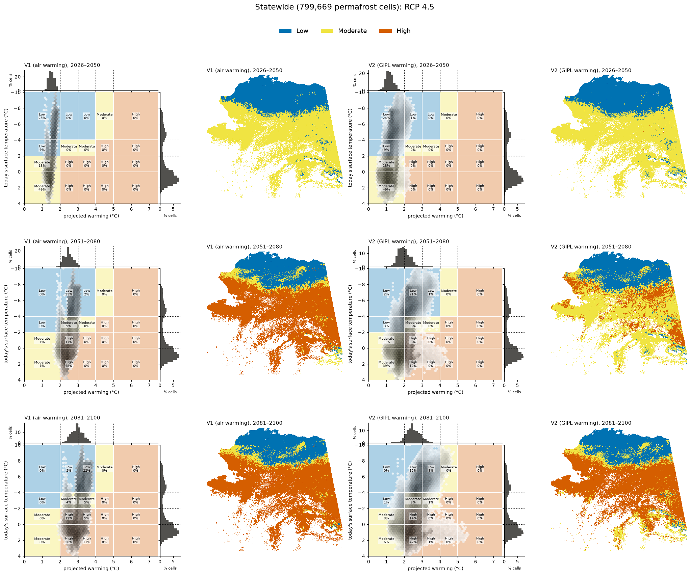

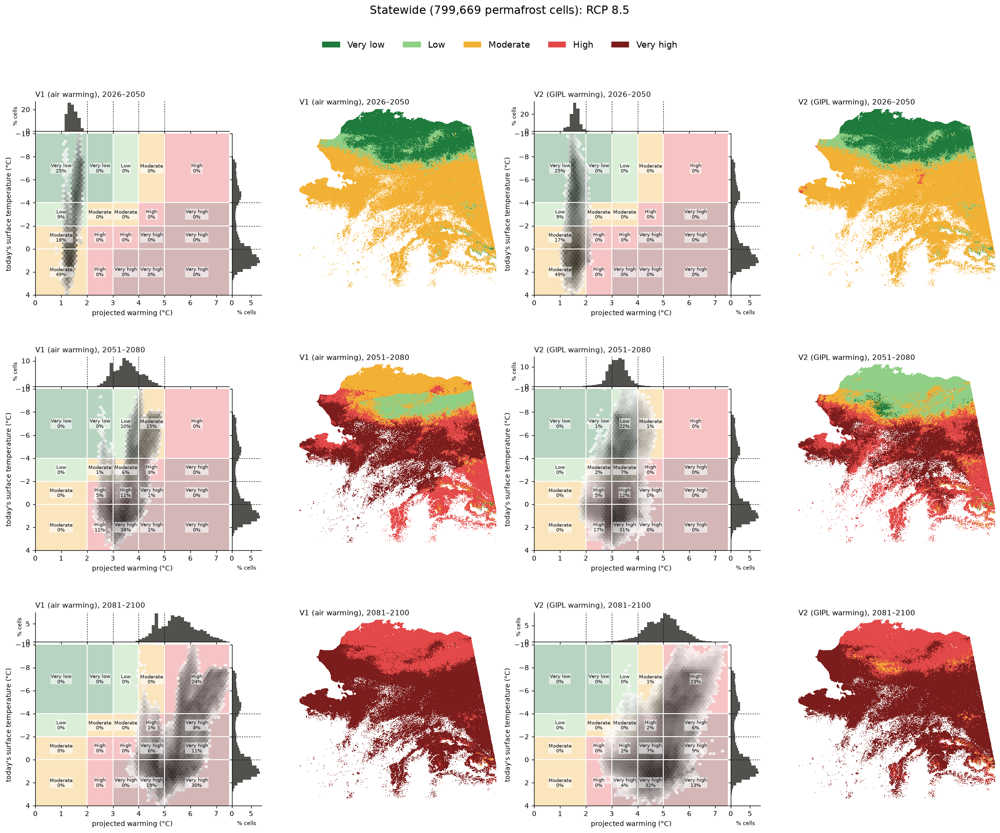

| Era, scenario | Projected warming, median (V1 / V2) | Very low | Low | Moderate | High | Very high |
|---|---|---|---|---|---|---|
| 2026–2050, RCP 4.5 | +1.5 / +1.4 °C | 25 / 25 % | 9 / 9 % | 66 / 66 % | 0 / 0 % | 0 / 0 % |
| 2026–2050, RCP 8.5 | +1.4 / +1.6 °C | 25 / 25 % | 9 / 9 % | 66 / 66 % | 0 / 0 % | 0 / 0 % |
| 2051–2080, RCP 4.5 | +2.5 / +2.7 °C | 23 / 16 % | 2 / 9 % | 10 / 11 % | 65 / 60 % | 0 / 5 % |
| 2051–2080, RCP 8.5 | +3.5 / +3.2 °C | 0 / 1 % | 10 / 22 % | 21 / 10 % | 30 / 35 % | 39 / 32 % |
| 2081–2100, RCP 4.5 | +3.0 / +3.5 °C | 2 / 0 % | 22 / 18 % | 9 / 14 % | 55 / 28 % | 11 / 39 % |
| 2081–2100, RCP 8.5 | +5.5 / +5.0 °C | 0 / 0 % | 0 / 0 % | 0 / 2 % | 26 / 28 % | 74 / 71 % |

- **Through 2050, almost nothing is above Moderate** (V1: no cells; V2: under 0.5 %): projected warming stays mostly
  under 2 °C, so cells that are warm today are Moderate rather than automatically Very high.
- **By 2051–2080, about two-thirds of permafrost cells are High or Very high** (65–69 %), in both scenarios and both
  versions. Under RCP 4.5 that share hardly grows by 2081–2100 (66–67 %), but more cells move from High to Very
  high; under RCP 8.5 it reaches nearly all cells (98–100 %), as warming of over 5 °C lifts even the cold Arctic to
  High.
- **The Arctic holds almost all of the lower classes** (section 3.2); the Interior, West and South are mostly High or
  Very high from 2051 on (82–100 % of cells).
- **V1 vs V2:** where V2 uses GIPL, 69 % of cells change class in at least one of the six scenario-era combinations,
  almost always by one class. The biggest differences: RCP 4.5, 2081–2100 (42 % of cells, V2 higher) and RCP 8.5,
  2051–2080 (35 %, mostly V2 lower). See section 4.

### 3.2 Arctic

319,698 permafrost cells; today's surface temperature: median −4.5 °C (mostly cold, some cool and near 0 °C in the
south). V2 uses GIPL in 99 % of cells.

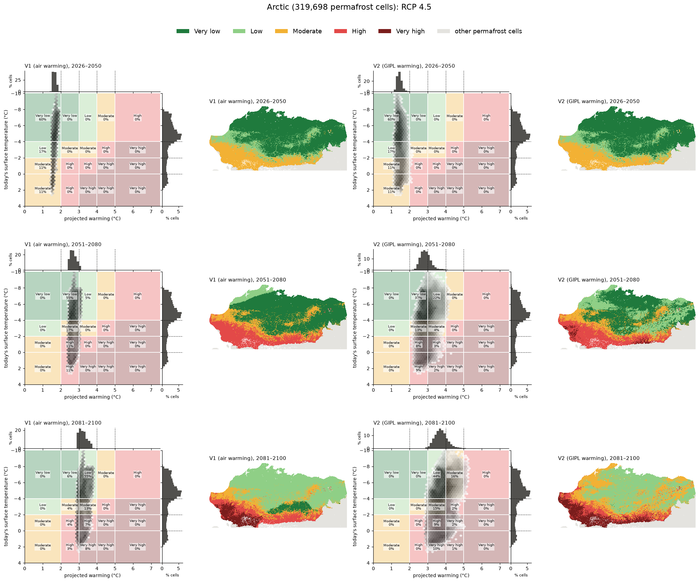

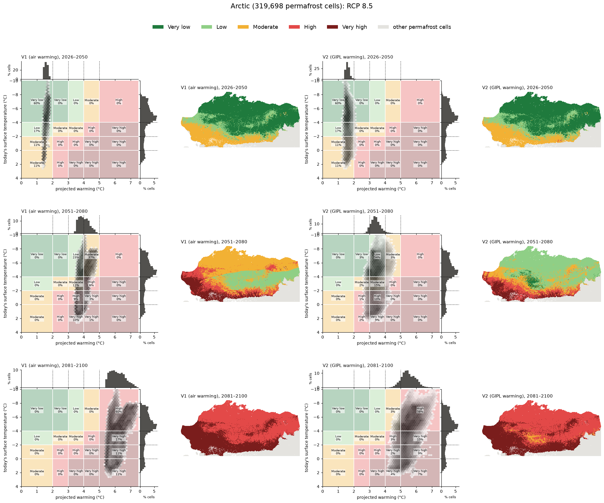

| Era, scenario | Projected warming, median (V1 / V2) | Very low | Low | Moderate | High | Very high |
|---|---|---|---|---|---|---|
| 2026–2050, RCP 4.5 | +1.6 / +1.4 °C | 60 / 60 % | 17 / 17 % | 23 / 23 % | 0 / 0 % | 0 / 0 % |
| 2026–2050, RCP 8.5 | +1.6 / +1.6 °C | 60 / 60 % | 17 / 17 % | 23 / 23 % | 0 / 0 % | 0 / 0 % |
| 2051–2080, RCP 4.5 | +2.7 / +2.9 °C | 55 / 37 % | 5 / 22 % | 17 / 17 % | 23 / 21 % | 0 / 2 % |
| 2051–2080, RCP 8.5 | +4.0 / +3.4 °C | 0 / 3 % | 23 / 54 % | 48 / 20 % | 15 / 13 % | 14 / 10 % |
| 2081–2100, RCP 4.5 | +3.2 / +3.7 °C | 6 / 0 % | 55 / 44 % | 17 / 31 % | 14 / 12 % | 8 / 13 % |
| 2081–2100, RCP 8.5 | +6.1 / +5.5 °C | 0 / 0 % | 0 / 0 % | 0 / 3 % | 60 / 60 % | 40 / 37 % |

- **Through 2050, mostly Very low** (60 %), with Low and Moderate along the southern edge.
- **RCP 4.5:** about a quarter of cells are High or above in 2051–2100 (the warmer southern foothills); the rest stay
  Very low to Moderate.
- **RCP 8.5, 2051–2080:** median warming sits right at the 4 °C edge. V1 (+4.0 °C) puts much of the cold north in
  "Moderate" (cold today, 4–5 °C of warming), V2 (+3.4 °C) in "Low" (cold today, 3–4 °C). The straight diagonal line
  on the V1 map is that edge crossing the coarse air-warming grid; V2 does not have it.
- **RCP 8.5, 2081–2100:** the surface warms by +5.5 to +6.1 °C (median) and ends at about +1.0 to +1.7 °C, warmer
  than the Interior's surface today (+0.7 °C). The "over 5 °C" column makes the cold north High (60 % of cells);
  nearly all the rest is Very high. Without that column those 60 % would be Moderate (first open question).
- **V1 vs V2:** 70 % of cells change class in at least one combination. Under RCP 8.5, V2 is mostly lower (2051–2080:
  50 % of cells; see above); under RCP 4.5 it is higher (21–27 % of cells). 3 % of cells differ by two classes in
  some combination (mostly RCP 4.5, 2081–2100). See section 4.

### 3.3 Interior

347,086 permafrost cells; today's surface temperature: median +0.7 °C (mostly warm surface and near 0 °C). V2 uses
GIPL in 81 % of cells; the other 19 % (GIPL's unusable areas, [GIPL_ISSUE.md](GIPL_ISSUE.md)) use air warming and
are flagged.

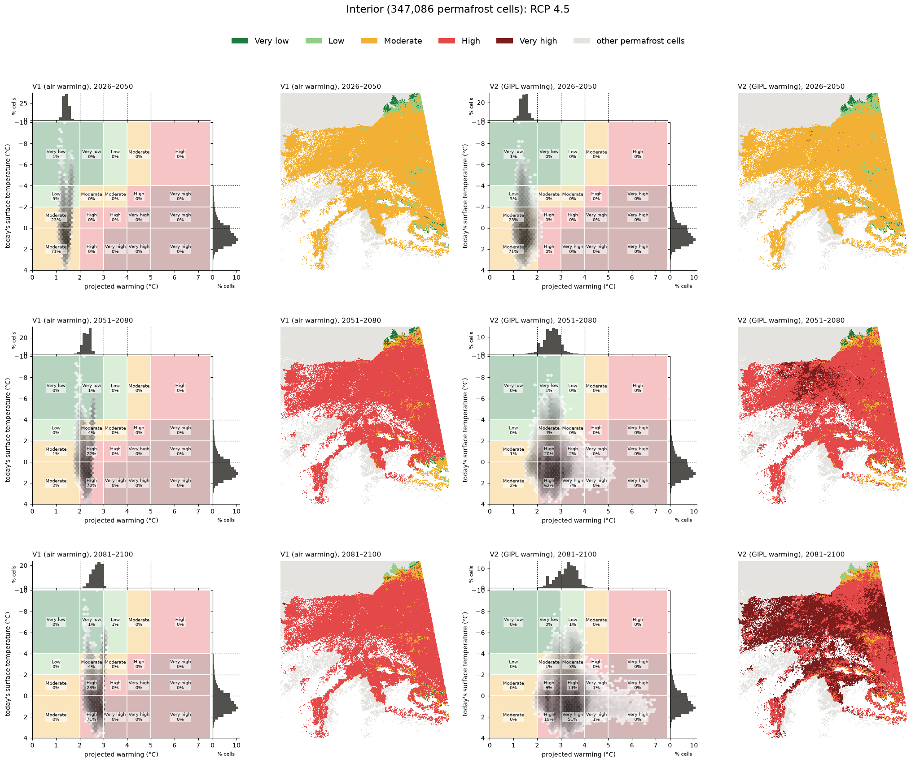

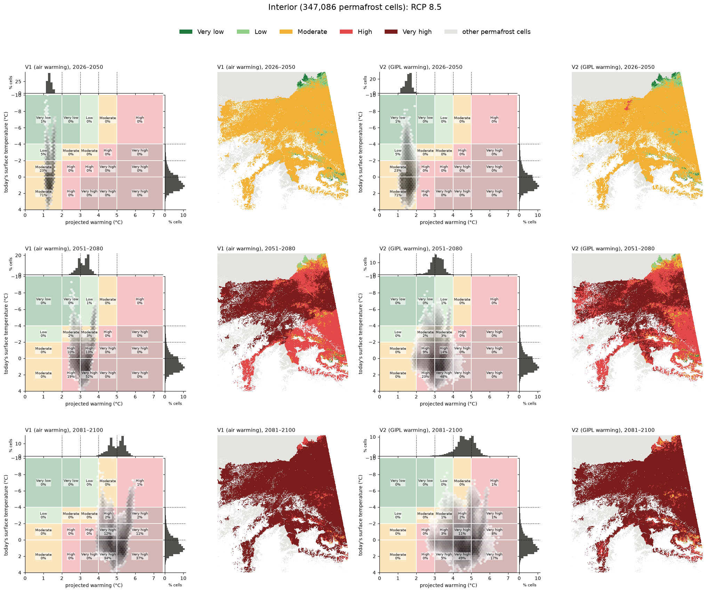

| Era, scenario | Projected warming, median (V1 / V2) | Very low | Low | Moderate | High | Very high |
|---|---|---|---|---|---|---|
| 2026–2050, RCP 4.5 | +1.4 / +1.5 °C | 1 / 1 % | 5 / 5 % | 94 / 94 % | 0 / 0 % | 0 / 0 % |
| 2026–2050, RCP 8.5 | +1.3 / +1.6 °C | 1 / 1 % | 5 / 5 % | 94 / 94 % | 0 / 0 % | 0 / 0 % |
| 2051–2080, RCP 4.5 | +2.3 / +2.6 °C | 1 / 1 % | 0 / 0 % | 7 / 7 % | 91 / 84 % | 0 / 8 % |
| 2051–2080, RCP 8.5 | +3.2 / +3.1 °C | 0 / 0 % | 1 / 1 % | 5 / 5 % | 42 / 45 % | 52 / 48 % |
| 2081–2100, RCP 4.5 | +2.7 / +3.3 °C | 1 / 0 % | 1 / 1 % | 5 / 5 % | 94 / 41 % | 0 / 53 % |
| 2081–2100, RCP 8.5 | +5.0 / +4.7 °C | 0 / 0 % | 0 / 0 % | 0 / 1 % | 3 / 7 % | 96 / 91 % |

- **Through 2050, almost all Moderate** (94 %).
- **2051–2080:** over 90 % High or Very high in both scenarios. Under RCP 8.5 the median warming (+3.1 to +3.2 °C)
  sits on the 3 °C edge, so cells split roughly evenly between High and Very high.
- **2081–2100, RCP 4.5: the largest V1/V2 difference anywhere.** V2 warms more (+3.3 vs +2.7 °C) and crosses the 3 °C
  edge: V1 is 94 % High, V2 is 53 % Very high.
- **2081–2100, RCP 8.5:** over 90 % Very high in both versions.
- **V1 vs V2:** 76 % of the cells where V2 uses GIPL change class in at least one combination, mostly with V2 higher
  (RCP 4.5, 2081–2100: 66 % of those cells). The 19 % of cells without usable GIPL values are identical in both
  versions. See section 4.

### 3.4 West

106,727 permafrost cells; today's surface temperature: median +0.9 °C (nearly all warm surface or near 0 °C). V2
uses GIPL in 96 % of cells.

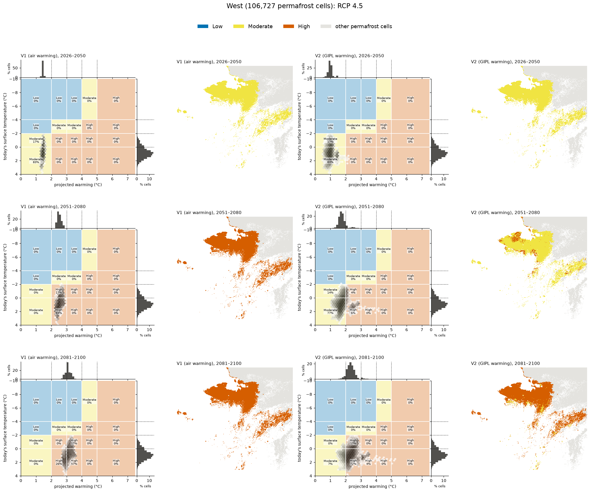

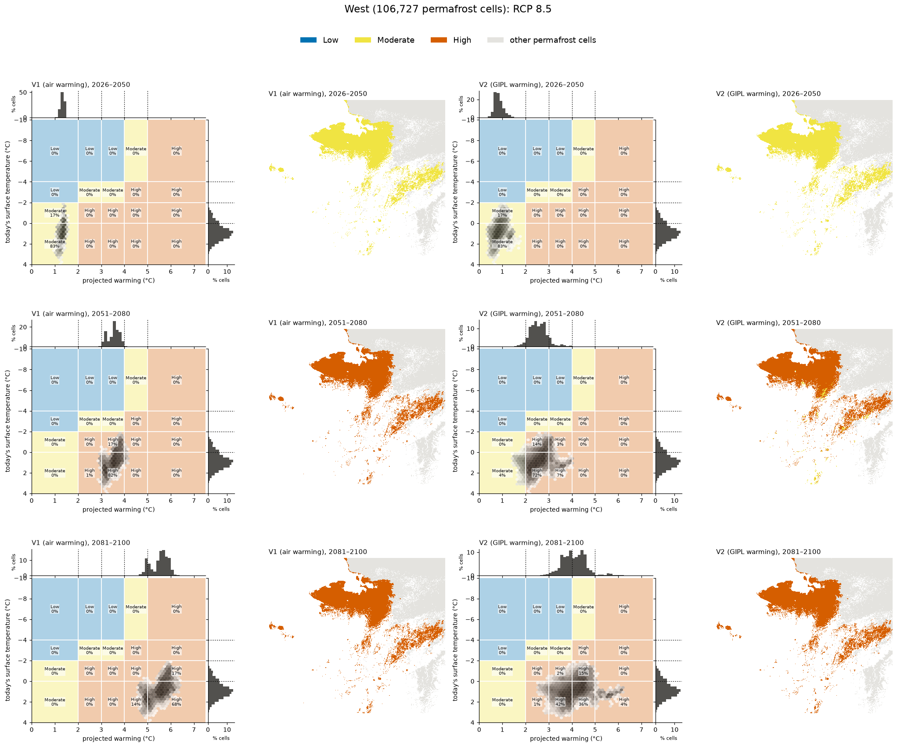

| Era, scenario | Projected warming, median (V1 / V2) | Very low | Low | Moderate | High | Very high |
|---|---|---|---|---|---|---|
| 2026–2050, RCP 4.5 | +1.4 / +1.4 °C | 0 / 0 % | 0 / 0 % | 100 / 100 % | 0 / 0 % | 0 / 0 % |
| 2026–2050, RCP 8.5 | +1.4 / +1.6 °C | 0 / 0 % | 0 / 0 % | 100 / 98 % | 0 / 2 % | 0 / 0 % |
| 2051–2080, RCP 4.5 | +2.5 / +2.6 °C | 0 / 0 % | 0 / 0 % | 0 / 1 % | 100 / 91 % | 0 / 8 % |
| 2051–2080, RCP 8.5 | +3.6 / +3.2 °C | 0 / 0 % | 0 / 0 % | 0 / 0 % | 18 / 50 % | 82 / 50 % |
| 2081–2100, RCP 4.5 | +3.1 / +3.3 °C | 0 / 0 % | 0 / 0 % | 0 / 0 % | 43 / 24 % | 57 / 76 % |
| 2081–2100, RCP 8.5 | +5.6 / +4.8 °C | 0 / 0 % | 0 / 0 % | 0 / 0 % | 0 / 0 % | 100 / 100 % |

- **Through 2050, almost all Moderate** (98–100 %).
- **2051–2080:** essentially all High (RCP 4.5) or High / Very high (RCP 8.5). Under RCP 8.5, V1 warms more (+3.6 vs
  +3.2 °C): V1 is 82 % Very high, V2 splits evenly.
- **2081–2100:** High / Very high under RCP 4.5 (V2 more Very high); all Very high under RCP 8.5.
- **V1 vs V2:** 52 % of cells change class in at least one combination: V2 lower under RCP 8.5, 2051–2080 (34 % of
  cells), and mostly higher under RCP 4.5, 2081–2100 (28 %). See section 4.

### 3.5 South

26,125 permafrost cells (the smallest region); today's surface temperature: median +0.4 °C. V2 uses GIPL in 98 % of
cells.

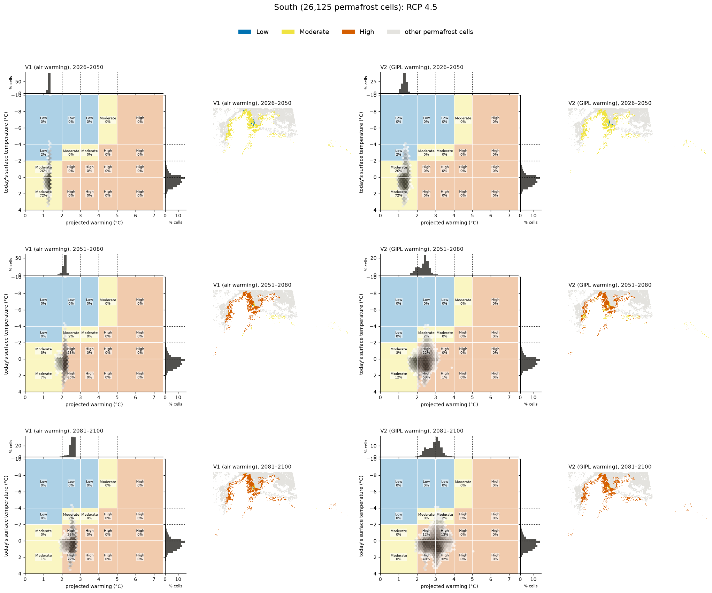

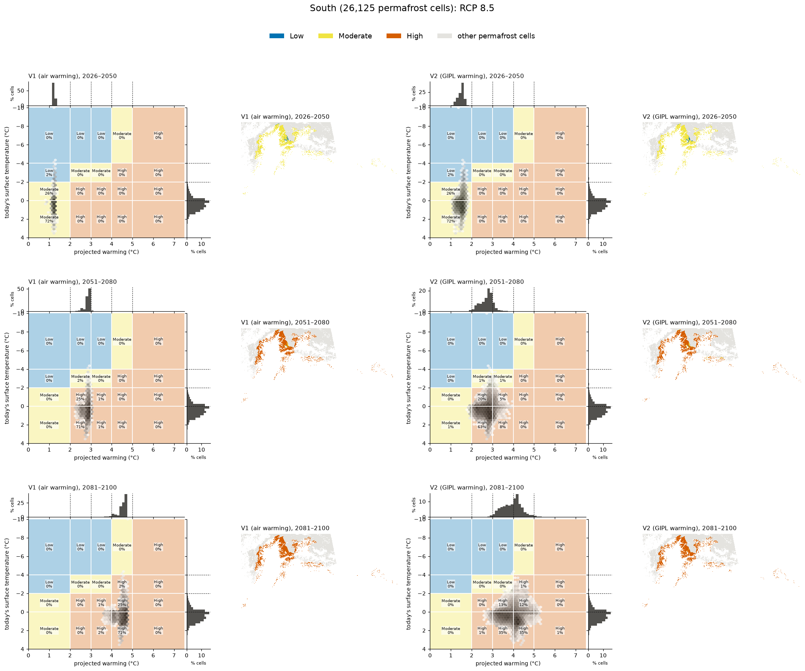

| Era, scenario | Projected warming, median (V1 / V2) | Very low | Low | Moderate | High | Very high |
|---|---|---|---|---|---|---|
| 2026–2050, RCP 4.5 | +1.3 / +1.3 °C | 0 / 0 % | 2 / 2 % | 98 / 98 % | 0 / 0 % | 0 / 0 % |
| 2026–2050, RCP 8.5 | +1.2 / +1.5 °C | 0 / 0 % | 2 / 2 % | 98 / 98 % | 0 / 0 % | 0 / 0 % |
| 2051–2080, RCP 4.5 | +2.1 / +2.4 °C | 0 / 0 % | 0 / 0 % | 12 / 18 % | 88 / 82 % | 0 / 1 % |
| 2051–2080, RCP 8.5 | +2.9 / +2.8 °C | 0 / 0 % | 0 / 0 % | 2 / 3 % | 97 / 89 % | 1 / 8 % |
| 2081–2100, RCP 4.5 | +2.6 / +3.0 °C | 0 / 0 % | 0 / 0 % | 2 / 2 % | 97 / 65 % | 0 / 32 % |
| 2081–2100, RCP 8.5 | +4.6 / +4.0 °C | 0 / 0 % | 0 / 0 % | 0 / 0 % | 3 / 16 % | 97 / 84 % |

- **Through 2050, almost all Moderate** (98 %).
- **2051–2080:** mostly High in both scenarios. Under RCP 8.5 the median warming (+2.8 to +2.9 °C) sits just under the
  3 °C edge, so nearly all cells are High rather than Very high; a small change to that edge would flip most of them.
- **2081–2100:** RCP 4.5 mostly High (V2 warms to the 3 °C edge, so a third of its cells become Very high); RCP 8.5
  mostly Very high.
- **V1 vs V2:** 58 % of cells change class in at least one combination: V2 higher under RCP 4.5, 2081–2100 (34 % of
  cells), lower under RCP 8.5, 2081–2100 (14 %). See section 4.

## 4. Where V1 and V2 differ

V1 and V2 share today's surface temperature and the table; only the projected warming differs (section 2). To see
where that changes the class, each cell's V1 and V2 classes are compared in all six **combinations** of scenario
(RCP 4.5, RCP 8.5) and era (2026–2050, 2051–2080, 2081–2100). Only cells where V2 actually uses GIPL are compared
(724,326 cells, 91 % of permafrost cells). In the rest, V2 uses V1's air warming, so the two are identical by
construction (grey on the maps).

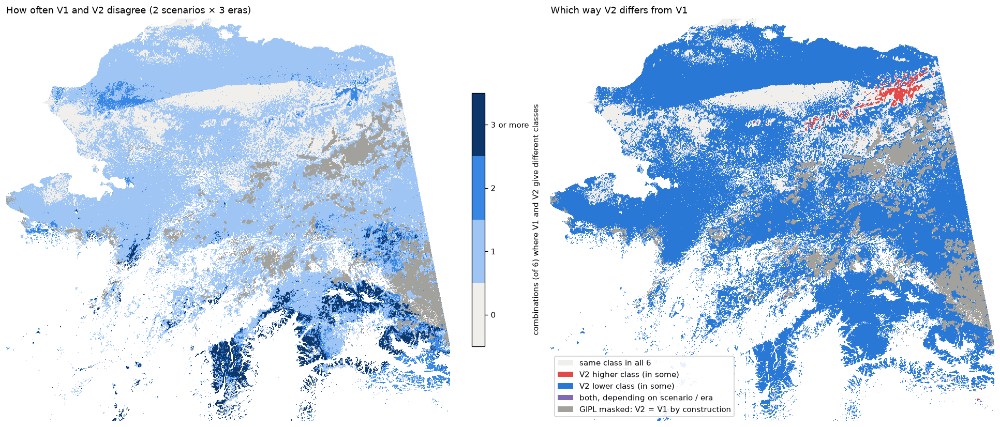

*Left: in how many of the six combinations V1 and V2 give different classes. Right: whether V2's class is higher
than V1's, lower, or higher in some combinations and lower in others.*

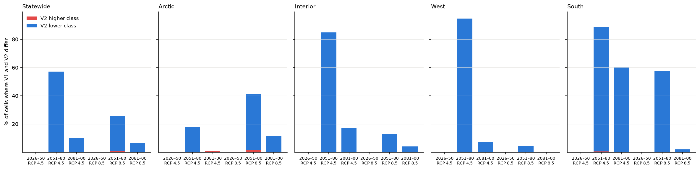

*Share of each area's cells (where V2 uses GIPL) with a different class in each combination. Red: V2 higher; blue:
V2 lower.*

| Area | Cells where V2 uses GIPL | Same class in all 6 | Differ in 1 / 2 / 3+ combinations | V2 higher only | V2 lower only | Both directions | Most affected scenario and era |
|---|---|---|---|---|---|---|---|
| Statewide | 724,326 | 31 % | 43 / 22 / 4 % | 33 % | 23 % | 14 % | RCP 4.5, 2081–2100: 42 % of cells (V2 higher) |
| Arctic | 317,000 | 30 % | 42 / 19 / 9 % | 16 % | 37 % | 17 % | RCP 8.5, 2051–2080: 52 % (mostly V2 lower) |
| Interior | 279,692 | 24 % | 49 / 26 / 1 % | 57 % | 8 % | 11 % | RCP 4.5, 2081–2100: 66 % (V2 higher) |
| West | 101,947 | 49 % | 30 / 21 / 0 % | 17 % | 19 % | 15 % | RCP 8.5, 2051–2080: 34 % (V2 lower) |
| South | 25,654 | 42 % | 46 / 12 / 1 % | 36 % | 22 % | 1 % | RCP 4.5, 2081–2100: 34 % (V2 higher) |

- **Through 2050, the two agree almost everywhere** (at least 98 % of cells in every area): warming is mostly under
  2 °C in both versions.
- **Most cells that differ do so in only one or two of the six combinations**, and almost always by one class (two
  classes: 1 % of cells statewide, 3 % in the Arctic).
- **The direction follows section 2.** Under RCP 4.5, GIPL's surface warms slightly more than the air, so V2 is a
  class higher where warming sits just below a band edge: most of all in the Interior in 2081–2100, near the 3 °C
  edge. Under RCP 8.5, GIPL's surface warms less than the air (partly because snow shields the ground from winter
  warming), so V2 is a class lower: most of all in the Arctic in 2051–2080, near the 4 °C edge.
- **On the maps**, V2 is mostly lower across the Arctic and mostly higher across the Interior; in parts of the
  north-west Arctic and the south-west Interior it is higher in some combinations and lower in others.
- **For the V1-or-V2 decision:** the choice moves classes by one step, in one or two combinations per cell; it does
  not change the overall picture in section 3. It matters most where an area's warming sits near a band edge (the
  Arctic under RCP 8.5 in 2051–2080, the Interior under RCP 4.5 in 2081–2100).

## 5. Test areas and example data sentences

Generated automatically from V2 (2051–2080, RCP 8.5) and the context layers. The examples are for the 1 km cell at
the centre of each of three 10 × 10 km test areas: Brooks Range (Arctic), Fairbanks and Denali (both Interior).

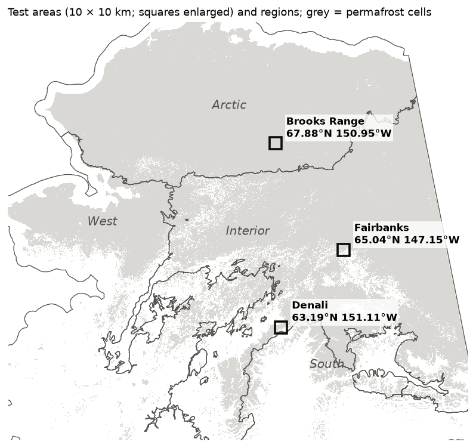

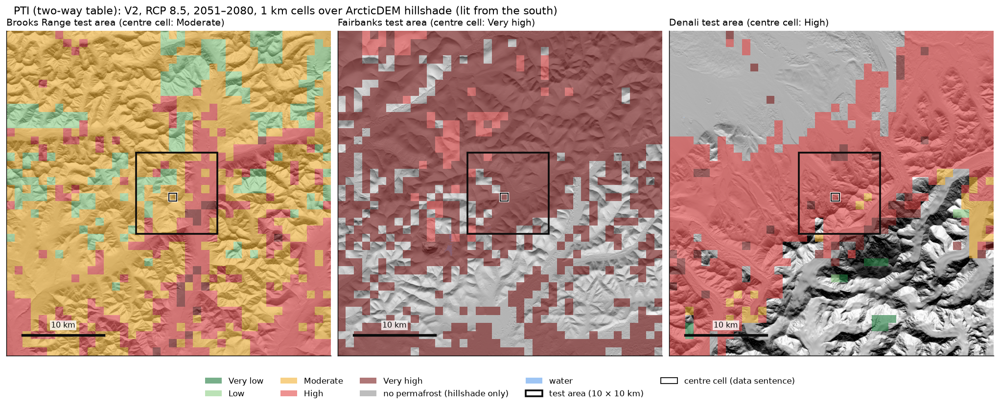

*PTI classes (V2, RCP 8.5, 2051–2080) in a 40 × 40 km area around each test area, drawn semi-transparent over
an ArcticDEM hillshade (lit from the south, so north-facing slopes are in shadow); lakes and rivers in blue.
Black square: the 10 × 10 km test area; small outlined cell: the centre cell described by the data sentence
below.*

> **Brooks Range test area:** PTI:  (2051–2080, RCP 8.5): surface cool
> today (−3.9 °C), projected to warm +3.4 °C. Permafrost extent: continuous (PFR 100 %). Terrain: 78 % shaded slopes,
> which favour permafrost. Land cover: 0 % black spruce / wetland; mostly shrub, tundra or open ground.

> **Fairbanks test area:** PTI:  (2051–2080, RCP 8.5): surface above
> 0 °C today (+1.7 °C), projected to warm +3.1 °C. Permafrost extent: sparse (PFR 14 %). Terrain: 70 % sun-facing
> slopes, so permafrost is likely limited to shaded and flat ground. Land cover: 65 % black spruce / wetland
> (insulating organic layer). Note: GIPL unavailable here; air-temperature warming used instead.

> **Denali test area:** PTI:  (2051–2080, RCP 8.5): surface above 0 °C today
> (+0.2 °C), projected to warm +2.8 °C. Permafrost extent: extensive (PFR 71 %). Terrain: 84 % shaded slopes, which
> favour permafrost. Land cover: 0 % black spruce / wetland; mostly shrub, tundra or open ground.

Draft wording rules:

| Context | Source | Wording |
|---|---|---|
| PTI class | the two-way table (section 1); V2 in these examples | class name, coloured as in the table |
| Today's surface temperature | ESA GST 2014–2023 | cold (below −4 °C), cool (−4 to −2 °C), near 0 °C (−2 to 0 °C), above 0 °C |
| Permafrost extent | ESA PFR 2023 (comes in steps of ~14 %) | sparse (≤ 29 %), patchy (43–57 %), extensive (71–86 %), continuous (100 %) |
| Terrain | share of the cell with sun-facing (TII > 0.1) or shaded (TII < −0.1) slopes | ≥ 40 % sun-facing: "permafrost likely limited to shaded and flat ground"; ≥ 40 % shaded: "favour permafrost"; else "mostly flat or gentle" |
| Land cover | NLCD 2016 evergreen forest + woody and herbaceous wetland | ≥ 50 %: "insulating organic layer"; else "mostly shrub, tundra or open ground" |
| GIPL flag (V2) | GIPL mask ([GIPL_ISSUE.md](GIPL_ISSUE.md)) | "GIPL unavailable here; air-temperature warming used instead." |

## Open questions

1. **Table entries.** Most consequential: "cold today, over 5 °C of warming" is High. Under RCP 8.5 the Arctic
   warms by 5.5–6 °C by 2081–2100, so this one box decides 60 % of Arctic cells in that era (they would be Moderate
   without the "over 5 °C" column).
2. **Band edges:** today −4 / −2 / 0 °C; warming 2 / 3 / 4 / 5 °C. Several areas' warming sits close to an edge (the
   Arctic near 4 °C under RCP 8.5 in 2051–2080; the Interior and South near 3 °C), so moving an edge by half a degree
   would change many classes.
3. **V1 or V2:** where V2 uses GIPL, they give different classes for up to 42 % of cells in one scenario and era
   (66 % in the Interior), and 69 % of cells differ in at least one of the six combinations (section 4).
4. **Data sentence wording and thresholds** (40 % terrain, 50 % land cover) are drafts.

## Notes

- ⚠️ The table is a judgement: there is no data to calibrate its entries, and band edges create steps (a cell at −2.1 °C
  and one at −1.9 °C can land in different rows).
- ⚠️ Surface temperature is not actual permafrost temperature: snow, vegetation and soil decide how surface warming reaches
  the permafrost below.
- 5-model average only; single climate models and the full uncertainty range are not shown.
- V1, and V2 where GIPL is unavailable, use air warming as a stand-in for ground-surface warming.
- V2 relies on GIPL's projected *changes*; GIPL's own temperature levels are not used
  ([ESA_GIPL_SPLICING.md](ESA_GIPL_SPLICING.md)). Why GIPL's warming differs from air warming is only partly
  explained (section 2).

Methods: 1 km GIPL grid; permafrost cells = ESA CCI Permafrost v5 PFR 2023 > 0; today = ESA ground surface
temperature 2014–2023 (sampled at cell centres); air temperature = SNAP 2 km 5-model average (parent cell); V2 warming
= model air warming 2014–2023 → 2026–2035 ("bridge") + GIPL surface change from 2026–2035 (delta change method), on
cells where GIPL is usable ([GIPL_ISSUE.md](GIPL_ISSUE.md)). Seasonal air warming (section 2): December–February and
June–August means, era minus 2014–2023, on cells where GIPL is usable (`scripts/02_tests/t4b_seasonal_warming.py`).
Table breaks: today −4 / −2 / 0 °C; warming 2 / 3 / 4 / 5 °C. V1 vs V2 (section 4): classes compared cell by cell
in each of the six scenario × era combinations, on permafrost cells where V2 uses GIPL. Data sentences: the 1 km cell
at the centre of each test area; class badges in `docs/figures/badges/`. Terrain from the 32 m terrain insolation
index; land cover from NLCD 2016 (30 m). Scripts: `scripts/02_tests/t4_index_variants.py` (`TABLE`, `TODAY_EDGES`,
`WARM_EDGES`; data sentences), `scripts/03_report/pti_results_figures.py` (section 3),
`scripts/03_report/pti_extra_figures.py` (section 4 and the test-area map), `scripts/03_report/test_area_maps.py` (test-area class maps); per-cell results and summary tables
(`pti_area_summary.csv`, `v1_v2_differences.csv`, `sentences.csv`) in `<data>/results/t4/`. Alternatives that were
tested and set aside are archived in [PTI_EXPERIMENTS.md](PTI_EXPERIMENTS.md).
