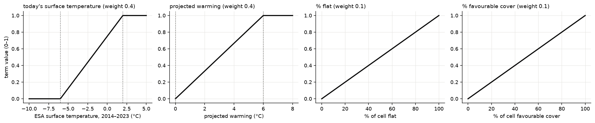
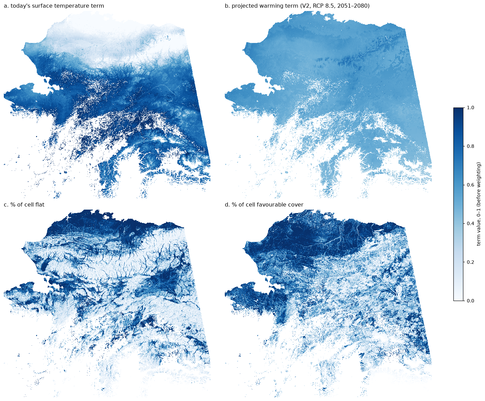
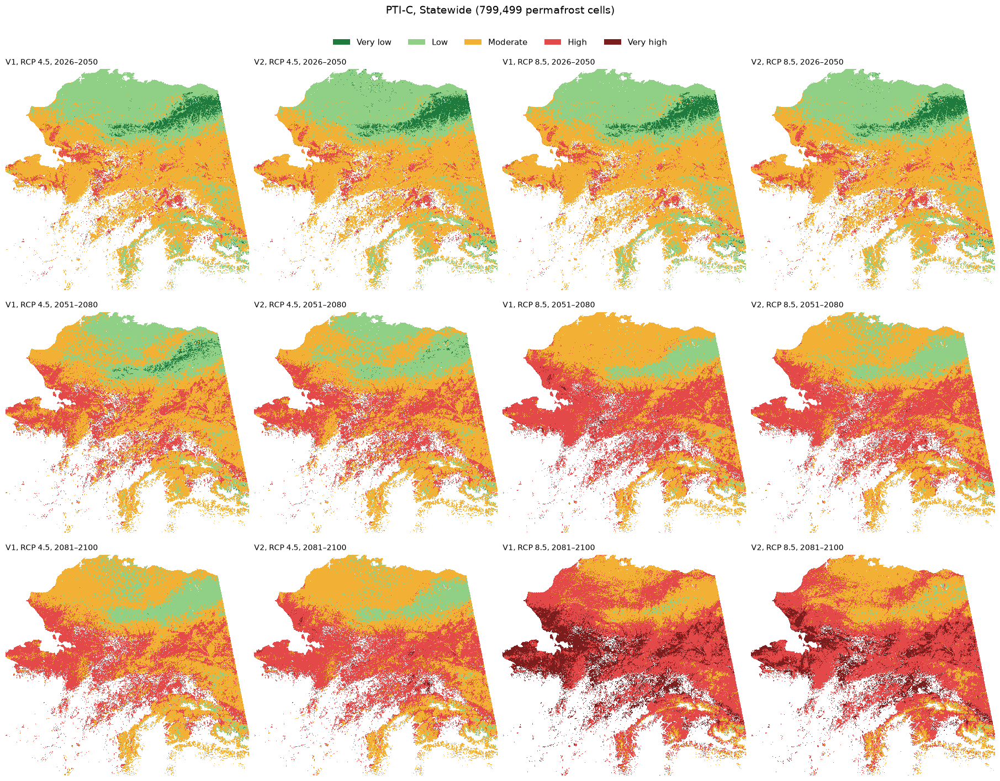
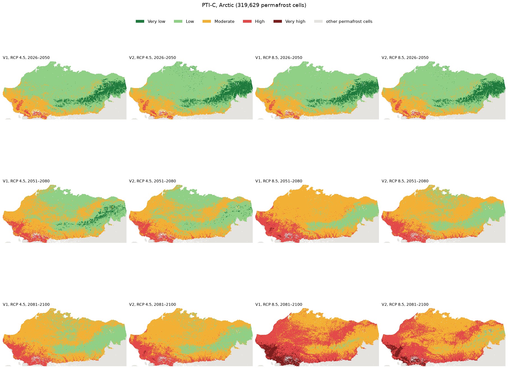
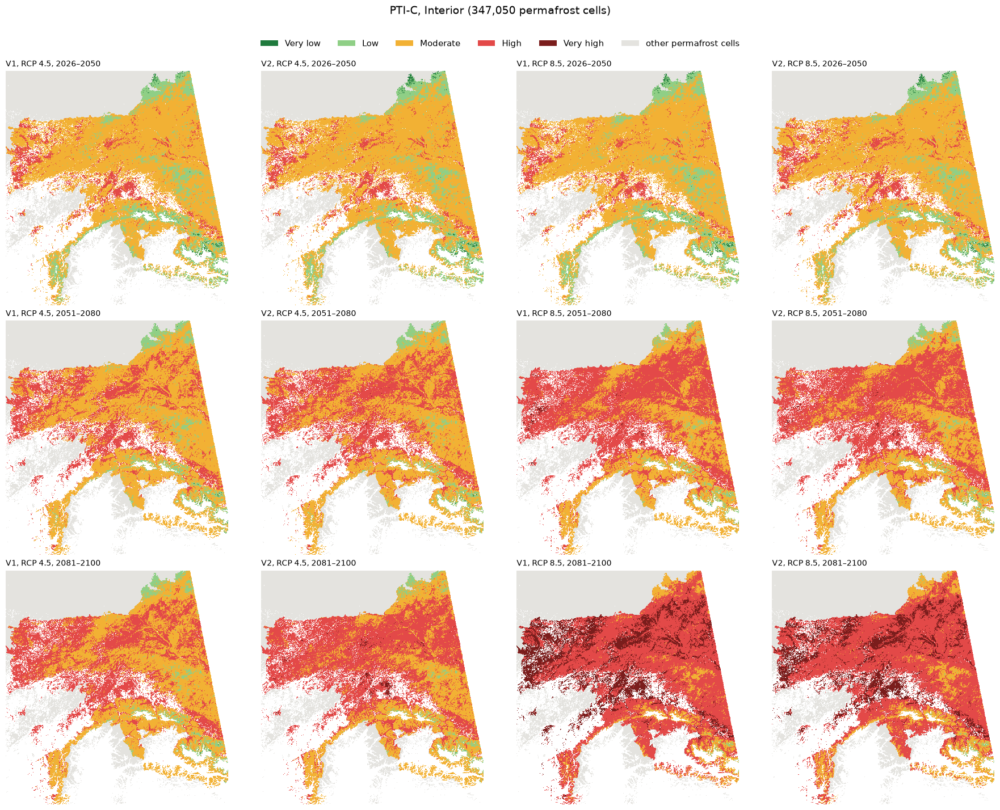
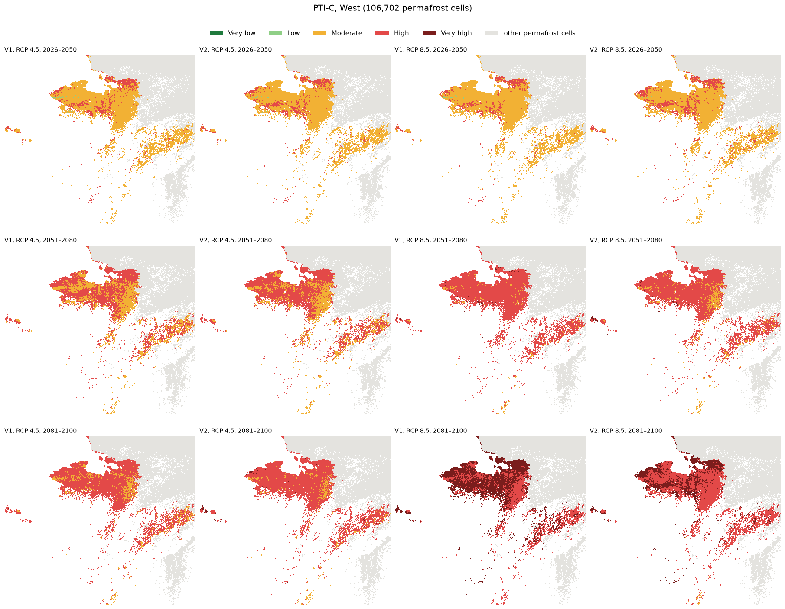
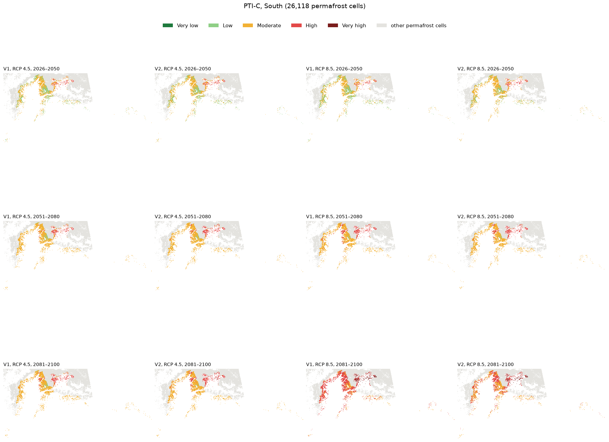
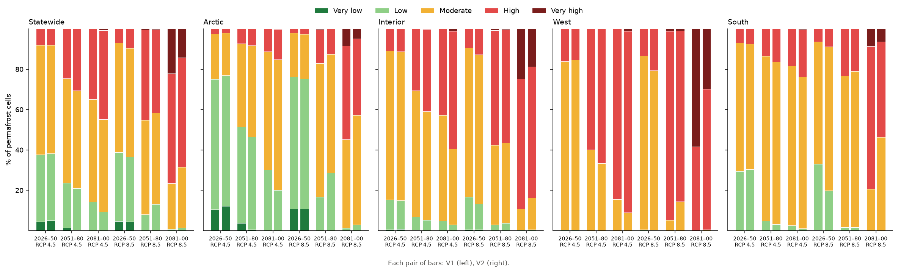
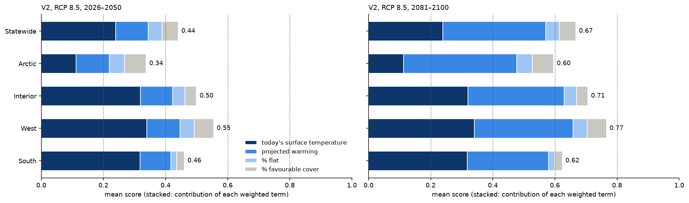

# Permafrost Thaw Index, composite version (PTI-C)
## "Does this cell contain permafrost that is susceptible to thaw?"

This is an **alternative** to the two-way table in [PTI.md](PTI.md). Both use the same two temperature inputs. The
composite adds two descriptions of the ground inside each 1 km cell (how much of it is flat, and how much is covered
by vegetation associated with permafrost) and combines all four into one score from 0 to 1.

That changes the question slightly. PTI.md asks how susceptible the permafrost is *if it is there*; PTI-C also asks
how much of the cell is the kind of ground where permafrost sits. Given the same temperature today and the same
projected warming, a cell scores higher when more of it is flat or covered by permafrost-favourable vegetation.

---

**BLUF:**
- **One score from four inputs:** PTI-C = 0.4 × today's ground surface temperature + 0.4 × projected warming +
  0.1 × % of the cell that is flat + 0.1 × % covered by permafrost-favourable vegetation, each first scaled to 0–1.
  The score is cut into five classes at 0.2, 0.4, 0.6 and 0.8.
- **Why only these inputs:** most gridded permafrost and climate layers measure the same thing (section 1), so
  adding them would count the same information several times. Terrain and land cover are the exceptions, which is
  why they get their own terms.
- **Temperature drives the score:** today's temperature and projected warming make up 78–85 % of the statewide
  mean score. Terrain and land cover can move a cell by at most 0.2, enough to cross one class.
- **Through 2050, mostly Low to Moderate** (statewide 86–88 % of cells). By 2081–2100 under RCP 8.5,
  68–77 % of cells are High or Very high.
- **Scores bunch in the middle:** Very high appears almost only under RCP 8.5 by 2081–2100 (14–22 % of cells), and Very
  low only in the coldest Arctic cells. Averaging four terms pulls scores toward the middle.
- **Permafrost fraction (PFR) is the gate, not a term:** only cells where ESA shows permafrost get a score (section
  2 explains why).
- **Decisions needed:** the weights, the scaling bounds, the class breaks, and which vegetation classes count as
  permafrost-favourable.

---

## Caveats

Our 1 km datasets cannot separate permafrost from non-permafrost ground within a cell. The terrain and land-cover
shares describe how much of a cell is the kind of ground where permafrost is likely, but they do not say where the
permafrost is or how much of the cell it covers.

What PTI-C **cannot** answer:
- "how much of the cell has permafrost?" (permafrost fraction is reported, but not used in the score)
- "where in the cell is the permafrost?"
- "what specific hazards could result from permafrost thaw in this cell (e.g. thermokarst)?"
- "what is the temperature of the permafrost in this cell?"

Section 6 has example data sentences for three test areas.

---

## Key terms

- **PTI class:** one of five classes, coloured as in PTI.md: 
    
  . In PTI-C the class comes from the 0–1 score.
- **Permafrost cells:** 1 km cells where ESA shows any permafrost (permafrost fraction, PFR, above 0; ≈ 800,000
  cells). Only these cells get a score.
- **Today's surface temperature:** mean annual ground surface temperature, 2014–2023, from ESA CCI Permafrost
  (observation-based).
- **Projected warming:** how much the ground surface warms from today to an era (2026–2050, 2051–2080, 2081–2100),
  under RCP 4.5 (moderate) or RCP 8.5 (high), using the 5-climate-model average. Exactly as in PTI.md.
- **V1 / V2:** as in PTI.md. V1 takes projected warming from air temperature; V2 from GIPL's ground surface
  (delta change method, [ESA_GIPL_SPLICING.md](ESA_GIPL_SPLICING.md)), with air warming where GIPL has no usable
  values (flagged).
- **% flat:** share of the cell's land that is flat, from the 32 m terrain insolation index (TII between −0.1 and
  +0.1, i.e. receiving about as much sun as level ground).
- **% favourable cover:** share of the cell in vegetation associated with permafrost (NLCD 2016 classes: evergreen
  forest, woody wetlands, emergent herbaceous wetlands, sedge/herbaceous, dwarf scrub, moss).
- **Weight:** how much each input counts in the score. The four weights add up to 1.

---

## 1. Why these inputs?

We have many gridded layers that could go into a composite. Most of them carry the same information: where it is
warm, ground temperatures are warm at every depth, the active layer is thick, and there is little permafrost.
Adding several of them would count that one signal several times. The table lists the candidates, how strongly each
overlaps with others (Spearman ρ: −1 to +1, where ±1 means the two layers rank cells identically), and whether it is
used.

| Gridded layer | Strongest overlap | Used in PTI-C? |
|---|---|---|
| **ESA ground surface temperature, 2014–2023** | (reference) | **Yes: "today" term** |
| ESA temperature at 1 m | ρ 0.99 with ESA surface temperature | No: same information |
| ESA active-layer thickness | ρ 0.87 with ESA surface temperature | No: same information |
| ESA permafrost fraction (PFR) | ρ −0.86 with ESA surface temperature | **Gate only** (see below) |
| Air temperature, historical (CRU TS 4.08, 2 km) | ρ 0.82 with ESA surface temperature | No: same information |
| Air temperature, projected (SNAP 2 km), *level* | ρ 0.95 with GIPL surface temperature | No: same information |
| **Air temperature, projected, *warming*** | ρ −0.64 with air temperature level (colder places warm more) | **Yes: "warming" term, V1** |
| GIPL ground surface temperature, *level* | ρ 0.95 with air temperature | No: same information, and ~1.2 °C colder than ESA |
| **GIPL ground surface temperature, *warming*** | weakest overlap of all layers (VIF 1.2) | **Yes: "warming" term, V2** |
| GIPL 0.5 m and 1 m temperature, permafrost top, talik | stuck cells ([GIPL_ISSUE.md](GIPL_ISSUE.md)) | No: unusable in parts of the Interior |
| **Terrain (32 m terrain insolation index): % flat** | ρ −0.06 with ESA surface temperature; 0.35 with warming | **Yes: "% flat" term** |
| **Land cover (NLCD 2016, 30 m): % favourable cover** | ρ −0.26 with ESA surface temperature; 0.54 with warming | **Yes: "% favourable cover" term** |

Statewide, permafrost cells; correlations from [CORRELATION.md](CORRELATION.md), and for the two new terms from this
analysis (warming = V1, RCP 8.5, 2051–2080). VIF: variance inflation factor, how much a layer is predicted by all
the others (1 = not at all).

**Why PFR is the gate and not a term:** the new question ("does this cell *contain* permafrost…") makes PFR relevant,
but as a weighted term it would work against the temperature term. Warm cells have little permafrost (ρ −0.86), so
"warm today" would push the score up while "little permafrost" pushed it down, and the two would partly cancel. PFR
is therefore used to select the cells that get a score, and reported in the data sentence.

## 2. How the index works

Each input is first scaled to 0–1, then weighted and added:

> **PTI-C = 0.4 · s(today) + 0.4 · s(warming) + 0.1 · (% flat) + 0.1 · (% favourable cover)**
>
> - **s(today) = (surface temperature + 6) / 8**, capped at 0 and 1: −6 °C and colder → 0; +2 °C and warmer → 1.
>   −6 °C is cold, stable permafrost; above about +2 °C ESA shows almost no permafrost.
> - **s(warming) = warming / 6**, capped at 0 and 1: no warming → 0; 6 °C or more → 1.
> - **% flat** and **% favourable cover** are already 0–1 (0 % → 0, 100 % → 1).

- **Fixed bounds, not percentiles:** a score means the same thing in every era and scenario.
- **Added, not multiplied:** with multiplication, any input near 0 would zero the whole score (a cold place with
  very large warming would look safe).
- **Weights:** today's temperature and warming carry the index (0.4 each, equal because there is no basis to favour
  either); terrain and land cover adjust it (0.1 each), so together they can move a cell by at most 0.2.
- **Direction:** more flat ground and more permafrost-favourable cover raise the score. Flat lowlands are often
  ice-rich and prone to thermokarst when they thaw; the vegetation classes mark ground where permafrost is likely.
  Either term can be dropped (weight 0) or reversed (use 1 − share) later.

*Each input before weighting (0–1). The warming term (b) is shown for V2, RCP 8.5, 2051–2080; it changes with
version, scenario and era, the others do not.*

| Class | Score |
|---|---|
|  | below 0.2 |
|  | 0.2 to 0.4 |
|  | 0.4 to 0.6 |
|  | 0.6 to 0.8 |
|  | 0.8 and above |

## 3. Two versions: V1 and V2

PTI-C uses the same two warming sources as PTI.md: **V1** air-temperature warming, **V2** GIPL ground-surface
warming with air warming where GIPL has no usable values (about 1 in 5 Interior cells, flagged). Why there are two,
and why GIPL warms differently from the air, is explained in [PTI.md](PTI.md) (sections 2 and 4). In PTI-C the
warming term carries 40 % of the weight, so the two versions differ less than in the table: a warming difference of
0.5 °C moves the score by about 0.03.

## 4. Results, area by area

Same areas as PTI.md: **statewide**, then the **Arctic, Interior, West, South** (physiographic regions of the USDA
general soil map; map in [CORRELATION.md](CORRELATION.md)). Each figure shows the classes for every era (rows) and
for V1 and V2 under both scenarios (columns). On the regional maps, permafrost cells outside the region are light
grey. Each table gives the median score and the share of the area's permafrost cells per class, as **V1 / V2**.

### 4.1 Statewide

799,499 permafrost cells; medians: today's surface temperature −0.1 °C, 33 % flat, 54 % favourable cover.

| Era, scenario | Score, median (V1 / V2) | Very low | Low | Moderate | High | Very high |
|---|---|---|---|---|---|---|
| 2026–2050, RCP 4.5 | 0.46 / 0.46 | 4 / 5 % | 33 / 33 % | 54 / 54 % | 8 / 8 % | 0 / 0 % |
| 2026–2050, RCP 8.5 | 0.45 / 0.47 | 5 / 5 % | 34 / 32 % | 54 / 54 % | 7 / 10 % | 0 / 0 % |
| 2051–2080, RCP 4.5 | 0.52 / 0.54 | 2 / 0 % | 22 / 21 % | 52 / 49 % | 25 / 30 % | 0 / 0 % |
| 2051–2080, RCP 8.5 | 0.58 / 0.57 | 0 / 0 % | 8 / 13 % | 47 / 45 % | 45 / 41 % | 1 / 0 % |
| 2081–2100, RCP 4.5 | 0.55 / 0.58 | 0 / 0 % | 14 / 9 % | 51 / 46 % | 35 / 44 % | 0 / 1 % |
| 2081–2100, RCP 8.5 | 0.70 / 0.68 | 0 / 0 % | 1 / 1 % | 23 / 30 % | 54 / 54 % | 22 / 14 % |

- **Through 2050, mostly Moderate (54 %) and Low (32–34 %).** Low covers most of the Arctic; Very low only the
  coldest cells of the north-eastern Arctic.
- **By 2051–2080, High grows to a quarter (RCP 4.5) or about two-fifths (RCP 8.5) of cells.**
- **By 2081–2100 under RCP 8.5, 68–77 % are High or Very high.** Very high appears almost only here.
- **V1 vs V2:** median scores differ by 0.03 or less; class shares differ most for Very high in 2081–2100, RCP 8.5
  (V1 warms more).

### 4.2 Arctic

319,629 permafrost cells; medians: today −4.5 °C, 46 % flat, 82 % favourable cover (tundra and wetland).

| Era, scenario | Score, median (V1 / V2) | Very low | Low | Moderate | High | Very high |
|---|---|---|---|---|---|---|
| 2026–2050, RCP 4.5 | 0.33 / 0.31 | 11 / 12 % | 65 / 65 % | 22 / 21 % | 2 / 2 % | 0 / 0 % |
| 2026–2050, RCP 8.5 | 0.32 / 0.32 | 11 / 11 % | 65 / 64 % | 22 / 22 % | 2 / 3 % | 0 / 0 % |
| 2051–2080, RCP 4.5 | 0.40 / 0.41 | 4 / 1 % | 48 / 46 % | 41 / 45 % | 7 / 8 % | 0 / 0 % |
| 2051–2080, RCP 8.5 | 0.49 / 0.44 | 0 / 0 % | 17 / 29 % | 66 / 59 % | 17 / 13 % | 0 / 0 % |
| 2081–2100, RCP 4.5 | 0.43 / 0.47 | 0 / 0 % | 30 / 20 % | 59 / 65 % | 11 / 15 % | 0 / 0 % |
| 2081–2100, RCP 8.5 | 0.61 / 0.59 | 0 / 0 % | 1 / 3 % | 44 / 54 % | 46 / 38 % | 8 / 5 % |

- **Through 2050, mostly Low (65 %).** The cold surface keeps the "today" term small (about 0.11 of the score).
- **Terrain and land cover matter most here:** the Arctic has the most flat ground and favourable cover, and the two
  terms add about 0.12 to its scores, as much as today's temperature does.
- **2081–2100, RCP 8.5:** warming of +5.5 to +6.1 °C (median) lifts 43–54 % of the cells to High or Very high;
  nearly all the rest stay Moderate.
- **V1 vs V2:** largest difference under RCP 8.5, 2051–2080 (V1 warms more: +4.0 vs +3.4 °C).

### 4.3 Interior

347,050 permafrost cells; medians: today +0.7 °C, 27 % flat, 30 % favourable cover. V2 uses GIPL in 81 % of
cells; the rest use air warming and are flagged.

| Era, scenario | Score, median (V1 / V2) | Very low | Low | Moderate | High | Very high |
|---|---|---|---|---|---|---|
| 2026–2050, RCP 4.5 | 0.50 / 0.50 | 1 / 1 % | 15 / 14 % | 74 / 74 % | 11 / 11 % | 0 / 0 % |
| 2026–2050, RCP 8.5 | 0.49 / 0.51 | 1 / 1 % | 16 / 13 % | 74 / 74 % | 9 / 13 % | 0 / 0 % |
| 2051–2080, RCP 4.5 | 0.56 / 0.58 | 0 / 0 % | 7 / 5 % | 63 / 54 % | 31 / 41 % | 0 / 0 % |
| 2051–2080, RCP 8.5 | 0.62 / 0.61 | 0 / 0 % | 3 / 4 % | 39 / 40 % | 57 / 56 % | 1 / 0 % |
| 2081–2100, RCP 4.5 | 0.58 / 0.62 | 0 / 0 % | 5 / 3 % | 52 / 37 % | 43 / 58 % | 0 / 1 % |
| 2081–2100, RCP 8.5 | 0.74 / 0.72 | 0 / 0 % | 0 / 1 % | 11 / 16 % | 64 / 65 % | 25 / 19 % |

- **Through 2050, mostly Moderate (74 %):** a warm surface today, but little warming yet.
- **2051–2080:** High for 31–41 % of cells under RCP 4.5 and 56–57 % under RCP 8.5.
- **2081–2100, RCP 8.5:** 84–89 % High or Very high.
- Less flat ground and favourable cover than the Arctic or West, so those terms add little (about 0.08).

### 4.4 West

106,702 permafrost cells; medians: today +0.9 °C, 38 % flat, 69 % favourable cover.

| Era, scenario | Score, median (V1 / V2) | Very low | Low | Moderate | High | Very high |
|---|---|---|---|---|---|---|
| 2026–2050, RCP 4.5 | 0.54 / 0.54 | 0 / 0 % | 0 / 0 % | 83 / 84 % | 16 / 15 % | 0 / 0 % |
| 2026–2050, RCP 8.5 | 0.53 / 0.55 | 0 / 0 % | 1 / 0 % | 86 / 79 % | 13 / 21 % | 0 / 0 % |
| 2051–2080, RCP 4.5 | 0.61 / 0.62 | 0 / 0 % | 0 / 0 % | 40 / 33 % | 60 / 67 % | 0 / 0 % |
| 2051–2080, RCP 8.5 | 0.68 / 0.66 | 0 / 0 % | 0 / 0 % | 5 / 14 % | 93 / 85 % | 1 / 1 % |
| 2081–2100, RCP 4.5 | 0.65 / 0.67 | 0 / 0 % | 0 / 0 % | 15 / 9 % | 84 / 90 % | 0 / 1 % |
| 2081–2100, RCP 8.5 | 0.81 / 0.76 | 0 / 0 % | 0 / 0 % | 0 / 1 % | 42 / 70 % | 58 / 30 % |

- **The highest scores of any region:** a warm surface today combined with plenty of flat ground and favourable
  cover.
- **From 2051 on, mostly High** (60–93 %).
- **2081–2100, RCP 8.5: the only large Very high share** (V1 58 %, V2 30 %). V1 warms more here (+5.6 vs +4.8 °C),
  which puts more cells over the 0.8 break.

### 4.5 South

26,118 permafrost cells (the smallest region); medians: today +0.4 °C, 8 % flat, 10 % favourable cover.

| Era, scenario | Score, median (V1 / V2) | Very low | Low | Moderate | High | Very high |
|---|---|---|---|---|---|---|
| 2026–2050, RCP 4.5 | 0.43 / 0.43 | 0 / 0 % | 29 / 30 % | 64 / 62 % | 7 / 7 % | 0 / 0 % |
| 2026–2050, RCP 8.5 | 0.43 / 0.44 | 0 / 0 % | 33 / 20 % | 61 / 71 % | 6 / 9 % | 0 / 0 % |
| 2051–2080, RCP 4.5 | 0.49 / 0.50 | 0 / 0 % | 5 / 3 % | 82 / 80 % | 13 / 16 % | 0 / 0 % |
| 2051–2080, RCP 8.5 | 0.53 / 0.52 | 0 / 0 % | 2 / 2 % | 75 / 77 % | 23 / 21 % | 0 / 0 % |
| 2081–2100, RCP 4.5 | 0.51 / 0.54 | 0 / 0 % | 3 / 1 % | 79 / 75 % | 18 / 23 % | 0 / 0 % |
| 2081–2100, RCP 8.5 | 0.65 / 0.61 | 0 / 0 % | 0 / 0 % | 21 / 46 % | 71 / 47 % | 9 / 6 % |

- **Mostly Moderate until late century:** mountainous ground with little flat land or favourable cover keeps the
  terrain and land-cover terms near 0.
- **2081–2100, RCP 8.5:** High for 47–71 % of cells; V1 warms more (+4.6 vs +4.0 °C).

## 5. What drives the score

*Each pair of bars: V1 (left), V2 (right).*

*Mean score per area, split into the contribution of each weighted input (V2, RCP 8.5). Dotted lines are the class
breaks.*

- **Today's temperature and warming make up most of the score** (statewide 78–85 %). Today's temperature sets
  the starting point; warming is what changes between eras and scenarios.
- **Terrain and land cover add about 0.1 statewide**, more in the Arctic and West (0.11–0.12) and little in the South
  (0.04).
- **Why scores bunch in the middle:** a cell needs high values in nearly all inputs to reach Very high (0.8), and
  low values in all of them to reach Very low (0.2). An average of four inputs rarely does either.

## 6. Test areas and example data sentences

Generated from V2 (2051–2080, RCP 8.5) for the 1 km cell at the centre of each 10 × 10 km test area (map in
[PTI.md](PTI.md), section 5). The breakdown shows each input's weighted contribution.

> **Brooks Range test area:** PTI-C:  0.39 (2051–2080, RCP 8.5): surface cool
> today (−3.9 °C), projected to warm +3.4 °C; 4 % of the cell flat; 51 % permafrost-favourable cover. Permafrost
> extent: continuous (PFR 100 %). *Score = 0.11 (today) + 0.23 (warming) + 0.00 (flat) + 0.05 (cover).*

> **Fairbanks test area:** PTI-C:  0.68 (2051–2080, RCP 8.5): surface above
> 0 °C today (+1.7 °C), projected to warm +3.1 °C; 23 % of the cell flat; 65 % permafrost-favourable cover.
> Permafrost extent: sparse (PFR 14 %). Note: GIPL unavailable here; air-temperature warming used instead.
> *Score = 0.38 + 0.21 + 0.02 + 0.06.*

> **Denali test area:** PTI-C:  0.50 (2051–2080, RCP 8.5): surface
> above 0 °C today (+0.2 °C), projected to warm +2.8 °C; 4 % of the cell flat; 0 % permafrost-favourable cover.
> Permafrost extent: extensive (PFR 71 %). *Score = 0.31 + 0.18 + 0.00 + 0.00.*

## Open questions

1. **Weights:** 0.4 / 0.4 / 0.1 / 0.1 is a starting point. There is no data to calibrate them.
2. **Scaling bounds:** today −6 to +2 °C, warming 0 to 6 °C. Moving a bound changes every score.
3. **Class breaks:** equal steps of 0.2 leave Very low and Very high nearly empty until late century. Keep them, or
   set breaks that spread the classes more evenly?
4. **Favourable vegetation:** which NLCD classes count (shrub/scrub and deciduous forest are left out), and whether
   they should raise the score at all (insulating cover protects permafrost, but its ground is often ice-rich and
   vulnerable once disturbed).
5. **Terrain:** % flat only, or flat plus shaded slopes (shade keeps ground cold, which protects permafrost).
6. **V1 or V2:** as in PTI.md.
7. **Which question to answer:** PTI.md (susceptibility of the permafrost, if it is there) or PTI-C (whether the
   cell contains susceptible permafrost).

## Notes

- ⚠️ Weights, bounds and class breaks are judgement calls; none can be checked against observations of future thaw.
- ⚠️ Surface temperature is not permafrost temperature (as in PTI.md).
- **The cover term partly overlaps with warming:** the Arctic tundra both warms most and has the most favourable
  cover (ρ 0.54 between the two), so part of the cover term repeats the warming signal there. % flat overlaps less
  (ρ 0.35).
- Land cover is from 2016 and does not change with time; fire and vegetation change are not included.
- 170 permafrost cells (< 0.03 %) have no terrain or land-cover values and get no score.
- 5-model average only; V1, and V2 where GIPL is unavailable, use air warming as a stand-in for ground-surface
  warming.

Methods: 1 km GIPL grid; permafrost cells = ESA CCI Permafrost v5 PFR 2023 > 0 (the gate); today = ESA ground
surface temperature 2014–2023; warming V1 / V2 as in [PTI.md](PTI.md) (`<data>/results/t4/index_variants.nc`).
% flat = share of a cell's 32 m land pixels with terrain insolation index between −0.1 and +0.1 (water excluded);
% favourable cover = share of a cell's NLCD 2016 pixels in classes 42, 90, 95, 72, 51, 74. Correlations in section 1
from `<data>/results/t2/spearman_*.csv` and `vif_*.csv` ([CORRELATION.md](CORRELATION.md)); correlations of the new
terms in `<data>/results/t5/ptic_terms_corr.csv`. Script: `scripts/02_tests/t5_composite.py` (`W`, `BREAKS`,
`COVER`; slurm/16); per-cell scores and classes in `<data>/results/t5/ptic.nc`, summaries in
`ptic_area_summary.csv` and `ptic_test_areas.csv`.
