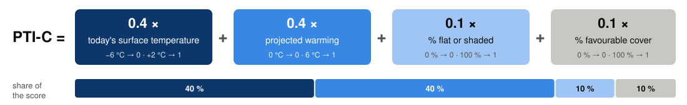
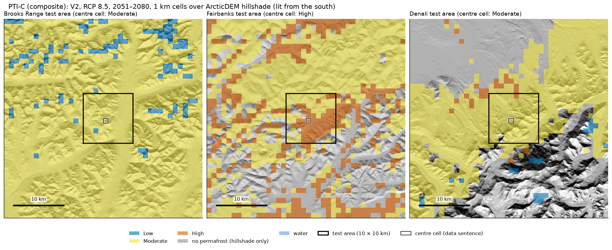

# Permafrost Thaw Index, composite version (PTI-C)
## "Does this cell contain permafrost that is susceptible to thaw?"

This is an **alternative** to the two-way PTI table in [PTI.md](PTI.md). Both use the same two temperature inputs. The
composite adds two descriptions of the ground inside each 1 km cell (how much of it is flat or shaded, and how much is
covered by vegetation associated with permafrost) and combines all four into one score from 0 to 1.

That changes the question slightly. PTI asks how susceptible the permafrost is *if it is there*; PTI-C also asks
how much of the cell is the kind of ground where permafrost sits. Given the same temperature today and the same
projected warming, a cell scores higher when more of it is flat or shaded, or covered by permafrost-favorable vegetation.

---

**BLUF:**
- **One score from four inputs:** PTI-C = 0.4 × today's ground surface temperature + 0.4 × projected warming +
  0.1 × % of the cell that is flat or shaded + 0.1 × % covered by permafrost-favorable vegetation, each first
  scaled to 0–1. The score is cut into three classes at equal thirds (1/3 and 2/3).
- **Why only these inputs:** most gridded permafrost and climate layers measure the same thing (see section 1), so
  adding them would count the same information several times. Terrain and land cover are the exceptions, which is
  why they get their own terms.
- **Temperature drives the score:** today's temperature and projected warming make up 71–83 % of the statewide
  mean score. Terrain and land cover can move a cell by at most 0.2, enough to cross one class. Most cells are
  largely flat or shaded (median 83 %), so the terrain term raises nearly every score by a similar amount.
- **Through 2050, mostly Moderate** (statewide 73–80 % of cells), with Low in the colder half of the Arctic. By
  2081–2100 under RCP 8.5, 50–67 % of cells are High (V2 lower, because GIPL's ground surface warms less than the air;
  [PTI.md](PTI.md), section 2).
- **Scores bunch in the middle:** Moderate holds 63–85 % of cells statewide in every era and scenario except
  2081–2100 under RCP 8.5, and Low appears almost only in the Arctic. Averaging four terms pulls scores toward the
  middle.
- **Permafrost fraction (PFR) is the gate, not a term:** only cells where ESA shows permafrost get a score (section
  2 explains why).
- **Decisions needed:** the weights, the scaling bounds, the class breaks, and which vegetation classes count as
  permafrost-favorable.

---

## Caveats

Our 1 km datasets cannot separate permafrost from non-permafrost ground within a cell. The terrain and land-cover
shares describe how much of a cell is the kind of ground where permafrost is likely, but they do not say where the
permafrost is or how much of the cell it covers.

The land-cover layer is a single snapshot (NLCD 2016) and is the same in every era and scenario. The land-cover term
therefore mostly informs the "is there permafrost in this cell?" part of the question; it says nothing about how
ecosystems will change over time (vegetation shifts, shrub expansion, fire), or how those changes would affect the
permafrost.

What PTI-C **cannot** answer:
- "how much of the cell has permafrost?"
- "where in the cell is the permafrost?"
- "what specific hazards could result from permafrost thaw in this cell (e.g. thermokarst)?"
- "what is the temperature of the permafrost in this cell?"
- "how will vegetation change or fire affect the permafrost in this cell?"

Section 6 has example data sentences for three test areas.

---

## Key terms

- **PTI class:** one of three classes, coloured as in PTI.md: 
   . In PTI-C the class comes from
  the 0–1 score.
- **Permafrost cells:** 1 km cells where ESA shows any permafrost (permafrost fraction, PFR, above 0; ≈ 800,000
  cells). Only these cells get a score.
- **Today's surface temperature:** mean annual ground surface temperature, 2014–2023, from ESA CCI Permafrost
  (observation-based).
- **Projected warming:** how much the ground surface warms from today to an era (2026–2050, 2051–2080, 2081–2100),
  under RCP 4.5 (moderate) or RCP 8.5 (high), using the 5-climate-model average. Exactly as in PTI.md.
- **V1 / V2:** as in PTI.md. V1 takes projected warming from air temperature; V2 from GIPL's ground surface
  (delta change method, [ESA_GIPL_SPLICING.md](ESA_GIPL_SPLICING.md); GIPL read on the climate years it carries,
  [GIPL_ISSUE_3.md](GIPL_ISSUE_3.md)), with air warming where GIPL has no usable values (flagged).
- **% flat or shaded:** share of the cell's land that is flat or on a shaded (mostly north-facing) slope, from the
  32 m terrain insolation index (TII of +0.1 or less, i.e. receiving no more sun than level ground). Only sunlit
  slopes are left out. These are the same pixels that the TII thaw transform (ArcticDEM-PISR) scores as 0.
- **% favorable cover:** share of the cell in vegetation associated with permafrost (NLCD 2016 classes: evergreen
  forest, woody wetlands, emergent herbaceous wetlands, sedge/herbaceous, dwarf scrub, moss).
- **Weight:** how much each input counts in the score. The four weights must add up to 1.
- **Percentile:** the value below which that share of cells falls. For example, the 95th percentile of today's
  surface temperature is +1.8 °C: 95 % of permafrost cells are colder.

---

## 1. Why these inputs?

We have many gridded layers that could go into a composite. Most of them carry the same information: where it is
warm, ground temperatures are warm at every depth, the active layer is thick, and there is little permafrost.
Adding several of them would count that one signal several times. The table lists the candidates, how strongly each
overlaps with others (Spearman ρ: −1 to +1, where ±1 means the two layers rank cells identically), and whether it is
used.

| Gridded layer | Strongest overlap | Used in PTI-C? |
|---|---|---|
| **ESA ground surface temperature, 2014–2023** | (reference) | **Yes: "today" term** |
| ESA temperature at 1 m | ρ 0.99 with ESA surface temperature | No: same information |
| ESA active-layer thickness | ρ 0.87 with ESA surface temperature | No: same information |
| ESA permafrost fraction (PFR) | ρ −0.86 with ESA surface temperature | **Gate only** (see below) |
| Air temperature, historical (CRU TS 4.08, 2 km) | ρ 0.82 with ESA surface temperature | No: same information |
| Air temperature, projected (SNAP 2 km), *level* | ρ 0.96 with GIPL surface temperature | No: same information |
| **Air temperature, projected, *warming*** | ρ −0.70 with air temperature level (colder places warm more) | **Yes: "warming" term, V1** |
| GIPL ground surface temperature, *level* | ρ 0.96 with air temperature | No: same information, and differs from ESA by up to about 2 °C cell by cell |
| **GIPL ground surface temperature, *warming*** | ρ 0.91 with air-temperature warming (VIF 6.5) | **Yes: "warming" term, V2 (in place of air warming)** |
| GIPL 0.5 m and 1 m temperature, permafrost top, talik | stuck cells ([GIPL_ISSUE_1.md](GIPL_ISSUE_1.md)) | No: unusable in parts of the Interior |
| **Terrain (32 m terrain insolation index): % flat or shaded** | ρ −0.11 with ESA surface temperature; 0.30 with warming | **Yes: "% flat or shaded" term** |
| **Land cover (NLCD 2016, 30 m): % favorable cover** | ρ −0.26 with ESA surface temperature; 0.54 with warming | **Yes: "% favorable cover" term** |

Statewide, permafrost cells; correlations from [CORRELATION.md](CORRELATION.md), and for the two new terms from this
analysis (warming = V1, RCP 8.5, 2051–2080). VIF: variance inflation factor, how much a layer is predicted by all
the others (1 = not at all).

**Why PFR is the gate and not a term:** the new question ("does this cell *contain* permafrost…") makes PFR relevant,
but as a weighted term it would work against the temperature term. Warm cells have little permafrost (ρ −0.86), so
"warm today" would push the score up while "sporadic permafrost" pushed it down, and the two would partly cancel. PFR
is therefore used to select the cells that get a score, and reported in the data sentence.

## 2. How the index works

Each input is first scaled to 0–1, then weighted and added:

Weights can be adjusted, but they must always add up to 1. This will need to be tested and tuned. 

Then the score is classified. This will also need to be tested and tuned. Classes do not need to be equal divisions of the PTI-C score.

| Class | PTI-C Score |
|---|---|
|  | below 1/3 (0.33) |
|  | 1/3 to 2/3 (0.33 to 0.67) |
|  | 2/3 (0.67) and above |

### Notes on inputs

The two temperature inputs are scaled to **the range of the data in the permafrost
cells**, rounded to whole degrees. The low bound becomes 0, the high bound 1, and the few cells outside the range are
capped.

| Input | Range in permafrost cells | Middle of the range | Bounds used | Cells capped |
|---|---|---|---|---|
| Today's surface temperature | −13.8 to +4.4 °C | 5th–95th percentile: −6.7 to +1.8 °C | **−6 to +2 °C** | 9 % at 0 (coldest Arctic), 3 % at 1 |
| Projected warming (all eras, scenarios, V1 and V2) | +0.3 to +7.8 °C | 98 % of values below +6.1 °C | **0 to 6 °C** | 2.3 % at 1, all in 2081–2100 |

- **Today:** the bounds trim only the extremes, so a few very cold or very warm cells do not compress everyone
  else into a narrow band. They also make physical sense: −6 °C is cold, stable permafrost, and above about +2 °C
  ESA shows almost no permafrost.
- **Warming:** the upper bound is the top of the data. The lower bound is 0 rather than the smallest value
  (+0.3 °C), so that 0 means "no warming". Capping happens only late in the century: in 2081–2100 under RCP 8.5,
  24 % of cells (V1) and 4 % (V2) warm by more than 6 °C and get the full 1.

- **Bounds set once, then fixed:** they come from all eras, scenarios and versions together and are the same for
  every map, so a score means the same thing in every era and scenario. Rescaling each era separately would stretch
  every era to 0–1 and hide the warming.
- **Added, not multiplied:** with multiplication, any input near 0 would zero the whole score (a cold place with
  very large warming would look safe).
- **Weights:** today's temperature and warming carry the index (0.4 each, equal because there is no basis to favour
  either); terrain and land cover adjust it (0.1 each), so together they can move a cell by at most 0.2.
- **Direction:** more flat or shaded ground and more permafrost-favorable cover raise the score. Shaded slopes get
  little sun and stay cold, so permafrost is likely there; flat lowlands are often ice-rich and prone to thermokarst
  when they thaw; the vegetation classes mark ground where permafrost is likely.
  Either term can be dropped (weight 0) or reversed (use 1 − share) later.

*Each input before weighting (0–1). The warming term (b) is shown for V2, RCP 8.5, 2051–2080; it changes with
version, scenario and era, the others do not.*

## 3. Two versions: V1 and V2

PTI-C uses the same two warming sources as PTI.md: **V1** air-temperature warming, **V2** GIPL ground-surface
warming with air warming where GIPL has no usable values (about 1 in 5 Interior cells, flagged). Why there are two,
and why GIPL's ground surface warms less than the air (about 20 % less), is explained in [PTI.md](PTI.md)
(sections 2 and 4). In PTI-C the warming term carries 40 % of the weight, so a warming difference of 0.5 °C moves the
score by about 0.03. V2's median scores are 0.02–0.07 lower than V1's statewide, and from 2051 on V2 puts about half
as many cells in High.

## 4. Results, area by area

Same areas as PTI.md: **statewide**, then the **Arctic, Interior, West, South** (physiographic regions of the USDA
general soil map; map in [CORRELATION.md](CORRELATION.md)). Each figure shows the classes for every era (rows) and
for V1 and V2 under both scenarios (columns). On the regional maps, permafrost cells outside the region are light
grey. Each table gives the median score and the share of the area's permafrost cells per class, as **V1 / V2**.

### 4.1 Statewide

799,499 permafrost cells; medians: today's surface temperature −0.1 °C, 83 % flat or shaded, 54 % favorable cover.

| Era, scenario | Score, median (V1 / V2) | Low | Moderate | High |
|---|---|---|---|---|
| 2026–2050, RCP 4.5 | 0.49 / 0.47 | 19 / 23 % | 80 / 76 % | 1 / 0 % |
| 2026–2050, RCP 8.5 | 0.49 / 0.46 | 20 / 27 % | 80 / 73 % | 1 / 0 % |
| 2051–2080, RCP 4.5 | 0.55 / 0.52 | 7 / 10 % | 80 / 85 % | 13 / 5 % |
| 2051–2080, RCP 8.5 | 0.62 / 0.57 | 2 / 3 % | 63 / 78 % | 35 / 19 % |
| 2081–2100, RCP 4.5 | 0.58 / 0.55 | 4 / 5 % | 72 / 82 % | 24 / 13 % |
| 2081–2100, RCP 8.5 | 0.74 / 0.67 | 0 / 0 % | 33 / 50 % | 67 / 50 % |

- **Through 2050, mostly Moderate (73–80 %) and Low (19–27 %).** Low covers the colder half of the Arctic; High
  1 % or less.
- **By 2051–2080, High grows to 5–13 % (RCP 4.5) or 19–35 % (RCP 8.5) of cells.**
- **By 2081–2100, High reaches 13–24 % (RCP 4.5) and 50–67 % (RCP 8.5).**
- **V1 vs V2:** V2's median scores are 0.02–0.07 lower, because GIPL's ground surface warms less than the air. From
  2051 on, V2 puts about half as many cells in High (for example RCP 8.5, 2051–2080: 35 vs 19 %).

### 4.2 Arctic

319,629 permafrost cells; medians: today −4.5 °C, 88 % flat or shaded, 82 % favorable cover (tundra and wetland).

| Era, scenario | Score, median (V1 / V2) | Low | Moderate | High |
|---|---|---|---|---|
| 2026–2050, RCP 4.5 | 0.35 / 0.33 | 44 / 52 % | 56 / 48 % | 0 / 0 % |
| 2026–2050, RCP 8.5 | 0.34 / 0.31 | 45 / 59 % | 55 / 41 % | 0 / 0 % |
| 2051–2080, RCP 4.5 | 0.42 / 0.39 | 15 / 22 % | 81 / 77 % | 4 / 1 % |
| 2051–2080, RCP 8.5 | 0.51 / 0.46 | 4 / 6 % | 84 / 88 % | 13 / 6 % |
| 2081–2100, RCP 4.5 | 0.45 / 0.43 | 10 / 11 % | 82 / 85 % | 8 / 4 % |
| 2081–2100, RCP 8.5 | 0.63 / 0.59 | 0 / 0 % | 63 / 78 % | 37 / 22 % |

- **Through 2050, Low and Moderate about evenly** (Low 44–59 %). The cold surface keeps the "today" term small
  (about 0.11 of the score).
- **2051–2100, mostly Moderate** (77–88 %), except under RCP 8.5 in 2081–2100.
- **Terrain and land cover matter most here:** the Arctic has the most flat or shaded ground and favorable cover,
  and the two terms add about 0.15 to its scores, more than today's temperature does.
- **2081–2100, RCP 8.5:** warming of +5.1 to +6.1 °C (median) lifts 22–37 % of the cells to High; the rest stay
  Moderate.
- **V1 vs V2:** largest difference under RCP 8.5 (V1 warms more: +4.0 vs +3.3 °C in 2051–2080, +6.1 vs +5.1 °C in
  2081–2100).

### 4.3 Interior

347,050 permafrost cells; medians: today +0.7 °C, 80 % flat or shaded, 30 % favorable cover. V2 uses GIPL in 81 % of
cells; the rest use air warming and are flagged.

| Era, scenario | Score, median (V1 / V2) | Low | Moderate | High |
|---|---|---|---|---|
| 2026–2050, RCP 4.5 | 0.53 / 0.52 | 4 / 5 % | 94 / 94 % | 2 / 1 % |
| 2026–2050, RCP 8.5 | 0.53 / 0.50 | 4 / 6 % | 95 / 94 % | 1 / 0 % |
| 2051–2080, RCP 4.5 | 0.59 / 0.56 | 2 / 3 % | 83 / 90 % | 15 / 8 % |
| 2051–2080, RCP 8.5 | 0.65 / 0.61 | 0 / 1 % | 56 / 73 % | 43 / 26 % |
| 2081–2100, RCP 4.5 | 0.62 / 0.59 | 1 / 2 % | 72 / 81 % | 27 / 18 % |
| 2081–2100, RCP 8.5 | 0.77 / 0.71 | 0 / 0 % | 16 / 34 % | 84 / 65 % |

- **Through 2050, almost all Moderate (94–95 %):** a warm surface today, but little warming yet.
- **2051–2080:** High for 8–15 % of cells under RCP 4.5 and 26–43 % under RCP 8.5 (V2 lower).
- **2081–2100:** High for 18–27 % under RCP 4.5 and 65–84 % under RCP 8.5.
- Nearly as much flat or shaded ground as the Arctic, but much less favorable cover, so the two terms add about 0.11.

### 4.4 West

106,702 permafrost cells; medians: today +0.9 °C, 83 % flat or shaded, 69 % favorable cover.

| Era, scenario | Score, median (V1 / V2) | Low | Moderate | High |
|---|---|---|---|---|
| 2026–2050, RCP 4.5 | 0.58 / 0.54 | 0 / 0 % | 99 / 100 % | 1 / 0 % |
| 2026–2050, RCP 8.5 | 0.57 / 0.53 | 0 / 0 % | 100 / 100 % | 0 / 0 % |
| 2051–2080, RCP 4.5 | 0.65 / 0.60 | 0 / 0 % | 67 / 94 % | 33 / 6 % |
| 2051–2080, RCP 8.5 | 0.71 / 0.65 | 0 / 0 % | 18 / 64 % | 82 / 36 % |
| 2081–2100, RCP 4.5 | 0.68 / 0.63 | 0 / 0 % | 36 / 75 % | 64 / 25 % |
| 2081–2100, RCP 8.5 | 0.85 / 0.75 | 0 / 0 % | 0 / 8 % | 100 / 92 % |

- **The highest scores of any region:** a warm surface today combined with plenty of flat or shaded ground and
  favorable cover.
- **Through 2050, almost all Moderate** (99–100 %).
- **From 2051 on, High grows fastest here under V1:** 33 % (RCP 4.5) and 82 % (RCP 8.5) by 2051–2080; 64 % and 100 %
  by 2081–2100. GIPL's surface warms 0.8–1.5 °C less than the air here, so fewer V2 cells cross the 2/3 break: 6 % and
  36 % by 2051–2080, 25 % and 92 % by 2081–2100.

### 4.5 South

26,118 permafrost cells (the smallest region); medians: today +0.4 °C, 60 % flat or shaded, 10 % favorable cover.

| Era, scenario | Score, median (V1 / V2) | Low | Moderate | High |
|---|---|---|---|---|
| 2026–2050, RCP 4.5 | 0.48 / 0.45 | 2 / 3 % | 97 / 96 % | 2 / 1 % |
| 2026–2050, RCP 8.5 | 0.47 / 0.43 | 2 / 5 % | 97 / 95 % | 1 / 0 % |
| 2051–2080, RCP 4.5 | 0.53 / 0.49 | 0 / 1 % | 92 / 95 % | 8 / 4 % |
| 2051–2080, RCP 8.5 | 0.58 / 0.52 | 0 / 1 % | 83 / 92 % | 17 / 8 % |
| 2081–2100, RCP 4.5 | 0.56 / 0.52 | 0 / 1 % | 87 / 92 % | 12 / 7 % |
| 2081–2100, RCP 8.5 | 0.69 / 0.60 | 0 / 0 % | 35 / 77 % | 65 / 23 % |

- **Mostly Moderate until late century:** mountainous ground with sunlit slopes (the least flat or shaded ground of
  any region) and little favorable cover; the two terms add about 0.08, the least of any region.
- **2081–2100, RCP 8.5:** High for 23–65 % of cells; V1 warms much more (+4.6 vs +3.1 °C).

## 5. What drives the score

*Each pair of bars: V1 (left), V2 (right).*

*Mean score per area, split into the contribution of each weighted input (V2, RCP 8.5). Dotted lines are the class
breaks.*

- **Today's temperature and warming make up most of the score** (statewide 71–83 %). Today's temperature sets
  the starting point; warming is what changes between eras and scenarios.
- **Terrain and land cover add about 0.13 statewide**, more in the Arctic and West (0.14–0.15) and least in the
  South (0.08).
- **The terrain term is high almost everywhere:** most cells are largely flat or shaded (median 80–88 % in every
  region except the South, 60 %), so it raises nearly all scores by 0.06–0.09 and separates cells little. Land cover
  does most of the separating between regions.
- **Why scores bunch in the middle:** a cell needs high values in most inputs to reach High (2/3), and low values in
  most of them to stay Low (below 1/3), which happens mainly in the cold Arctic. An average of four inputs pulls
  scores toward the middle, so most cells are Moderate.

## 6. Test areas and example data sentences

Generated from V2 (2051–2080, RCP 8.5) for the 1 km cell at the centre of each 10 × 10 km test area (map in
[PTI.md](PTI.md), section 5). The breakdown shows each input's weighted contribution.

*PTI-C classes (V2, RCP 8.5, 2051–2080) in a 40 × 40 km area around each test area, drawn semi-transparent over
an ArcticDEM hillshade (lit from the south, so north-facing slopes are in shadow); lakes and rivers in blue.
Black square: the 10 × 10 km test area; small outlined cell: the centre cell described by the data sentence
below.*

> **Brooks Range test area:** PTI-C:  0.44 (2051–2080, RCP 8.5):
> surface cool today (−3.9 °C), projected to warm +3.0 °C; 82 % of the cell flat or shaded; 51 %
> permafrost-favorable cover. Permafrost extent: continuous (PFR 100 %). *Score = 0.11 (today) + 0.20 (warming) +
> 0.08 (flat or shaded) + 0.05 (cover).*

> **Fairbanks test area:** PTI-C:  0.69 (2051–2080, RCP 8.5): surface above
> 0 °C today (+1.7 °C), projected to warm +3.1 °C; 30 % of the cell flat or shaded; 65 % permafrost-favorable
> cover. Permafrost extent: sparse (PFR 14 %). Note: GIPL unavailable here; air-temperature warming used instead.
> *Score = 0.38 + 0.21 + 0.03 + 0.06.*

> **Denali test area:** PTI-C:  0.52 (2051–2080, RCP 8.5): surface
> above 0 °C today (+0.2 °C), projected to warm +1.9 °C; 88 % of the cell flat or shaded; 0 % permafrost-favorable
> cover. Permafrost extent: extensive (PFR 71 %). *Score = 0.31 + 0.13 + 0.09 + 0.00 (rounded).*

## Open questions

1. **Weights:** 0.4 / 0.4 / 0.1 / 0.1 is a starting point. There is no data to calibrate them.
2. **Scaling bounds:** today −6 to +2 °C, warming 0 to 6 °C, set from the range of the data in the permafrost cells
   (section 2). Moving a bound changes every score. A higher warming bound would stop a quarter of V1 cells being
   capped in 2081–2100 under RCP 8.5, but would lower every other score.
3. **Class breaks:** equal thirds (1/3, 2/3) put most cells in Moderate until late century (statewide 63–85 %).
   Keep them, or set breaks that spread the classes more evenly?
4. **favorable vegetation:** which NLCD classes count (shrub/scrub and deciduous forest are left out), and whether
   they should raise the score at all (insulating cover protects permafrost, but its ground is often ice-rich and
   vulnerable once disturbed).
5. **Terrain:** flat ground and shaded slopes now count together (both are ground where permafrost is likely).
   Because most cells are largely flat or shaded, the term barely separates cells. Keep it, score flat and shaded
   ground separately, or drop it (weight 0)?
6. **V1 or V2:** as in PTI.md.
7. **Which question to answer:** PTI.md (susceptibility of the permafrost, if it is there) or PTI-C (whether the
   cell contains susceptible permafrost).

## Notes

- ⚠️ Weights, bounds and class breaks are judgement calls; none can be checked against observations of future thaw.
- ⚠️ Surface temperature is not permafrost temperature (as in PTI.md).
- **The cover term partly overlaps with warming:** the Arctic tundra both warms most and has the most favorable
  cover (ρ 0.54 between the two), so part of the cover term repeats the warming signal there. % flat or shaded
  overlaps less (ρ 0.30).
- Land cover is a 2016 snapshot used unchanged for every era (see Caveats).
- 170 permafrost cells (< 0.03 %) have no terrain or land-cover values and get no score.
- 5-model average only; V1, and V2 where GIPL is unavailable, use air warming as a stand-in for ground-surface
  warming.

Methods: 1 km GIPL grid; permafrost cells = ESA CCI Permafrost v5 PFR 2023 > 0 (the gate); today = ESA ground
surface temperature 2014–2023; warming V1 / V2 as in [PTI.md](PTI.md) (`<data>/results/t4/index_variants.nc`).
% flat or shaded = share of a cell's 32 m land pixels with terrain insolation index of +0.1 or less (water
excluded; `1 − sun_share`, `<data>/tii/tii_1km.npz`);
% favorable cover = share of a cell's NLCD 2016 pixels in classes 42, 90, 95, 72, 51, 74. Scaling bounds checked
against the percentiles of today and warming over the 799,669 permafrost cells (warming pooled over V1/V2, both
scenarios and the three eras). Correlations in section 1
from `<data>/results/t2/spearman_*.csv` and `vif_*.csv` ([CORRELATION.md](CORRELATION.md)); correlations of the new
terms in `<data>/results/t5/ptic_terms_corr.csv`. Script: `scripts/02_tests/t5_composite.py` (`W`, `BREAKS`,
`COVER`; slurm/16), test-area maps `scripts/03_report/test_area_maps.py`; per-cell scores and classes in `<data>/results/t5/ptic.nc`, summaries in
`ptic_area_summary.csv` and `ptic_test_areas.csv`.
