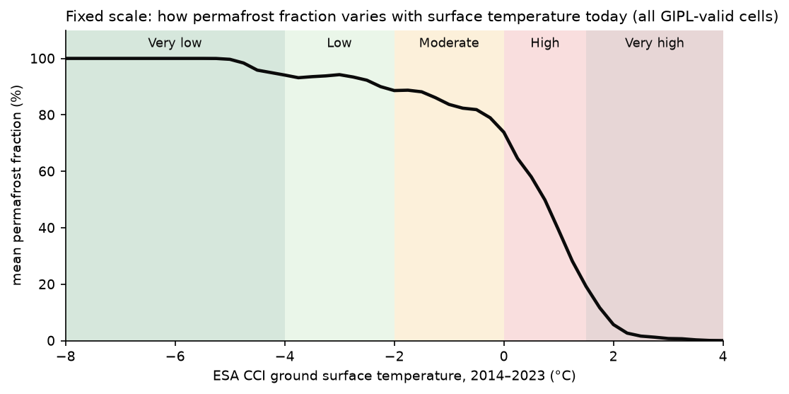
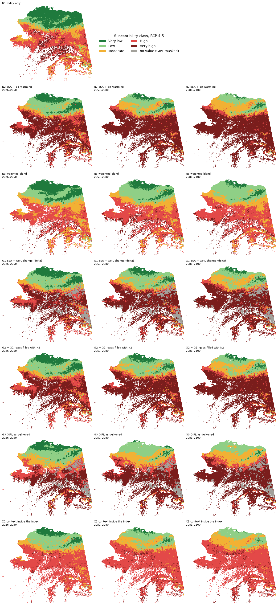
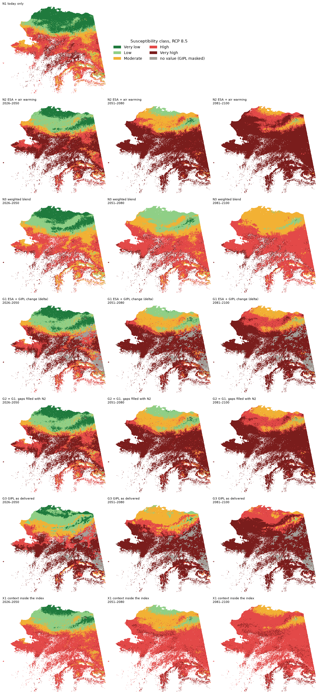
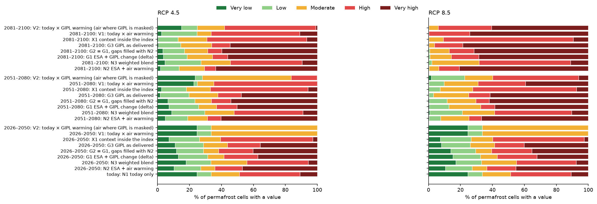

# Permafrost Thaw Index: experiments (archive)

**Status:** archived. These are the index designs tested before the two-way table was chosen. The recommended design
is in [PTI.md](PTI.md). This page records what was tried and why it was set aside.

*Updated 2026-10-26: the GIPL-based variants (G1–G3) were recomputed with GIPL read on the climate years it carries
(file year − 20, [GIPL_ISSUE_3.md](GIPL_ISSUE_3.md)); their numbers and the maps below reflect that.*

**Short answer:**
- A single fixed scale of projected ground surface temperature was tested first, in seven variants (with and without
  GIPL, with and without extra inputs).
- It ranks cells only by how warm they *will be*: cold places look safe even when they warm a lot, and warm places
  look at risk even when little changes. This led to the two-way table in PTI.md.
- Folding permafrost extent, terrain or land cover into the number moved most cells to other classes without adding
  much information, so those went into the data sentence.
- With or without GIPL, the single-scale maps mostly agreed (79–87 % same class).

---

## Key terms, in plain language

- **Fixed scale:** each class means the same physical thing in every period and scenario (here: a range of projected
  ground surface temperature).
- **Projected surface temperature:** today's ESA level + projected warming (delta change method,
  [ESA_GIPL_SPLICING.md](ESA_GIPL_SPLICING.md)).
- **Same class as N2:** share of cells a variant puts in the same class as the reference variant N2.
- **Spearman ρ:** do two maps rank places in the same order (−1 to +1; [CORRELATION.md](CORRELATION.md)).
- **V1 / V2:** the two versions of the recommended two-way table ([PTI.md](PTI.md)), shown here for comparison.

---

## 1. The fixed scale

Today, ESA shows nearly all ground as permafrost where the surface is colder than about −4 °C, a gradual thinning
towards 0 °C, a steep drop between 0 and +2 °C, and almost none above +2 °C. The classes followed that curve:

| Class | Projected surface temperature | At this temperature today, permafrost is typically |
|---|---|---|
| Very low | below −4 °C | continuous (~100 %) |
| Low | −4 to −2 °C | near-continuous (~90–95 %) |
| Moderate | −2 to 0 °C | discontinuous (~80–90 %) |
| High | 0 to +1.5 °C | patchy (~75 % falling to ~25 %) |
| Very high | above +1.5 °C | mostly absent (under 25 %) |

A class read as: *"by this era, the surface here will be as warm as places where permafrost today is …"*.

**Why it was set aside:** the scale only looks at how warm a cell *will be*. A cold place with permafrost everywhere
scores low even if it warms a lot, and a warm place with patchy permafrost scores high even if that permafrost is
stable where it survives today. Using today's permafrost fraction to place the class edges also treats places where
permafrost is scarce today as the most at risk, which does not follow.

## 2. The variants

| Variant | How projected surface temperature is built | Uses GIPL | Cells with a class: all of Alaska | Cells with a class: Interior |
|---|---|---|---|---|
| **N1** Today only | ESA 2014–2023 (no future) | no | 100 % | 100 % |
| **N2** ESA + air warming | ESA + air-temperature change (delta change method) | no | 100 % | 100 % |
| **N3** Weighted blend | 0.5 × ground temperature + 0.25 × air temperature + 0.25 × (1 − PFR), each on a fixed 0–1 scale | no | 100 % | 100 % |
| **G1** ESA + GIPL warming | ESA + GIPL surface change from 2014–2023 (delta change method) | yes | 91 % | 81 % |
| **G2** G1, gaps filled | G1 where GIPL is available, otherwise N2 with a flag | yes | 100 % | 100 % |
| **G3** GIPL as delivered | GIPL's own surface temperature | yes | 91 % | 81 % |
| **X1** Context inside the index | 0.8 × N2 + 0.1 × terrain + 0.1 × (1 − black spruce / wetland share) | no | 100 % | 100 % |

All variants use the 5-model average and cover cells where ESA shows permafrost (PFR > 0, ≈ 800,000 cells). N3 and
X1 are scores, classed with the same temperature edges converted to the 0–1 scale.

## 3. Results

Class maps for every variant (rows) and era (columns), one figure per scenario. N1 (today) is the same in both.

**Share of permafrost cells per class, 2051–2080:**

| | Very low | Low | Moderate | High | Very high |
|---|---|---|---|---|---|
| N1 today | 25 % | 9 % | 18 % | 38 % | 11 % |
| N2, RCP 4.5 | 5 % | 14 % | 13 % | 8 % | **60 %** |
| N2, RCP 8.5 | 0 % | 7 % | 18 % | 8 % | **67 %** |
| G1, RCP 8.5 | 1 % | 12 % | 20 % | 9 % | **58 %** |
| N3, RCP 8.5 | 1 % | 20 % | 20 % | 48 % | 10 % |
| X1, RCP 8.5 | 0 % | 7 % | 20 % | 65 % | 7 % |

**Agreement with N2 (ESA + air warming):**

| Variant | Same class as N2 | Spearman ρ with N2 |
|---|---|---|
| G1 ESA + GIPL warming | 79–87 % | 0.91–0.98 |
| G2 G1, gaps filled | 81–88 % | 0.91–0.98 |
| G3 GIPL as delivered | 61–83 % | 0.81–0.89 |
| N3 weighted blend | 16–35 % | 0.75–0.95 |
| X1 context inside the index | 25–49 % | 0.62–0.89 |

(Ranges over the three eras and two scenarios.)

What this showed:
- **Today (N1):** half of today's permafrost cells are already at surface temperatures where permafrost is patchy or
  mostly absent (High 38 %, Very high 11 %): the Interior, West and South.
- **The future pushes most cells into the top class.** By 2051–2080 under RCP 8.5, 67 % of permafrost cells are Very
  high in N2 (median projected surface temperature in that class: +4 °C); under RCP 4.5, 60 %. Only the Arctic keeps a
  spread of classes.
- **GIPL changes little at the class level** on this scale: G1 and N2 put 79–87 % of cells in the same class
  (GIPL's surface warms somewhat less than the air, [PTI.md](PTI.md) section 2).
- **G3 (GIPL as delivered) differs more** (61–83 % same class), mainly because GIPL's levels differ from ESA's cell by
  cell ([ESA_GIPL_SPLICING.md](ESA_GIPL_SPLICING.md)); it is not new information.
- **N3 and X1 change classes for most cells** (N3: 65–84 % of cells; X1: 51–75 %). Diluting the temperature with other
  inputs pulls cells out of the top class, and a class no longer corresponds to a temperature. Because ground
  temperature, air temperature and permafrost fraction largely carry the same information
  ([CORRELATION.md](CORRELATION.md)), N3 changes the scale more than it adds information. This is why permafrost
  extent, terrain and land cover went into the data sentence instead.

## 4. Single scale vs the two-way table

**Share of permafrost cells that are High or Very high, by region (RCP 8.5):**

| | Arctic | Interior | West | South |
|---|---|---|---|---|
| 2051–2080, single scale (N2) | 40 % | 97 % | 100 % | 99 % |
| 2051–2080, two-way table (V1) | 29 % | 94 % | 100 % | 98 % |
| 2081–2100, single scale (N2) | 84 % | 100 % | 100 % | 100 % |
| 2081–2100, two-way table (V1) | 100 % | 100 % | 100 % | 100 % |

- Through 2050 the table puts no cell above Moderate, while the single scale already has 45–50 % Very high (cells that
  are warm today).
- Later, the Interior, West and South end up High or Very high either way. The Arctic differs most: the table puts
  fewer of its cells in the top two classes in 2051–2080 (29 % vs 40 %) and more by 2081–2100 (100 % vs 84 %), when
  its "over 5 °C" column applies (see the open questions in PTI.md).
- GIPL vs air warming matters more with the table (same class for 43–100 % of the cells where GIPL is used, against
  79–87 % on the single scale), because a half-degree difference in warming can move a cell across a warming band.

## Caveats

- The fixed scale compares places to stand in for future times ("space for time"), and ESA computes permafrost
  fraction from its own modelled temperatures, so the curve in section 1 is partly built into ESA.
- 5-model average only.

Methods: as in [PTI.md](PTI.md). N3 / X1 fixed scales: surface temperature −6 to +2 °C → 0–1; air temperature
−10 to 0 °C → 0–1; terrain = cell-mean thaw score / 0.5 (capped at 1). Script: `scripts/02_tests/t4_index_variants.py`;
per-cell results in `<data>/results/t4/`.
